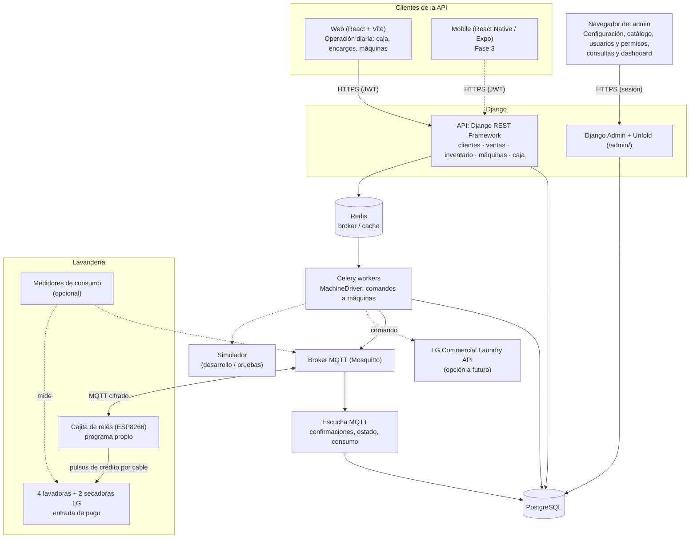
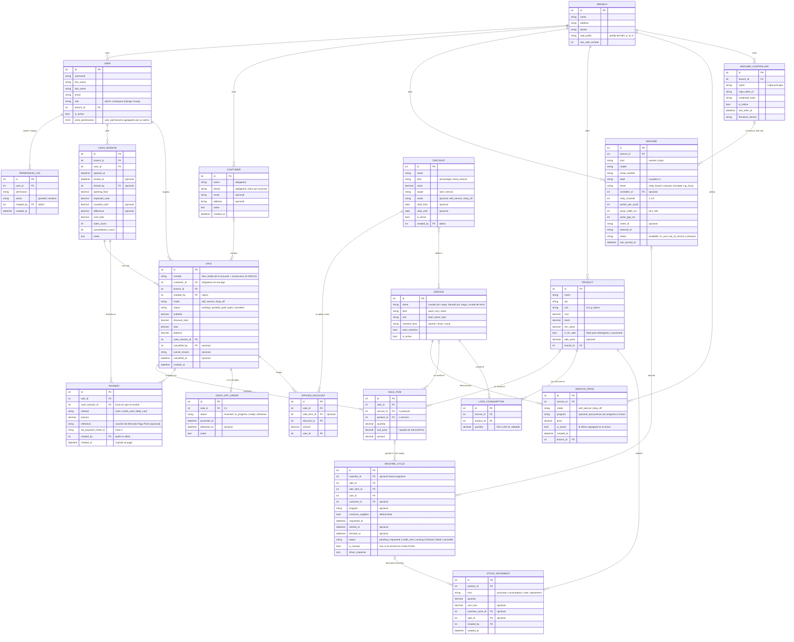
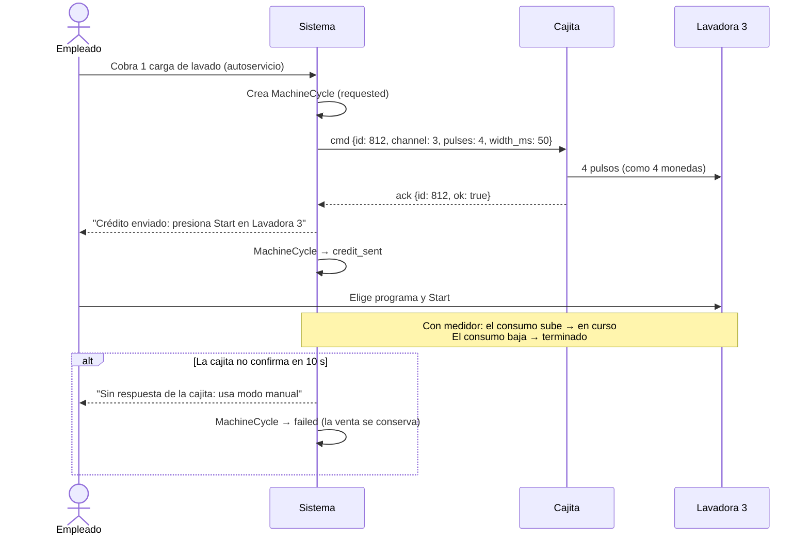
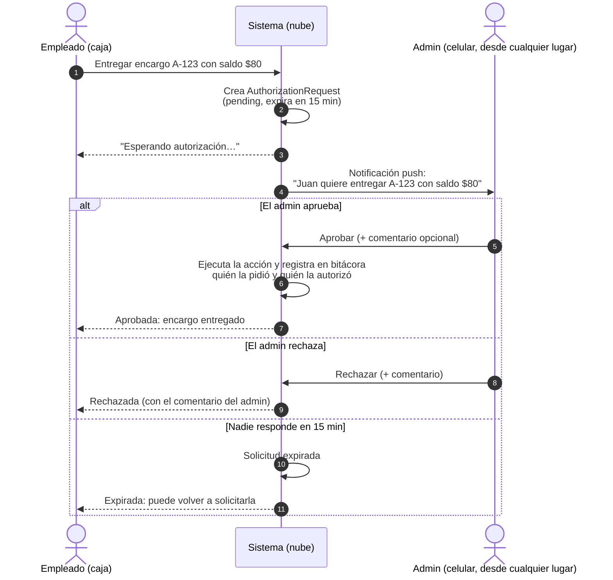

# MVP: Sistema de Gestión de Lavandería

> Definición del MVP y propuesta de implementación · Última actualización: 2026-10-18

Sistema web para una lavandería de una sola sucursal con autoservicio y servicio por encargo: ventas y caja, clientes, encargos, inventario de insumos, tickets y **activación de las lavadoras y secadoras desde el sistema**, con registro de cada uso.

---

## Índice

- [1. Requerimientos y decisiones](#1-requerimientos-y-decisiones)
- [2. Arquitectura](#2-arquitectura)
  - [Stack](#stack)
  - [Interfaces](#interfaces)
- [3. Modelo de datos](#3-modelo-de-datos)
  - [Apps de Django](#apps-de-django)
  - [Nombres en el código](#nombres-en-el-código)
  - [Entidades](#entidades)
  - [Reglas del modelo](#reglas-del-modelo)
- [4. Funcionalidades](#4-funcionalidades)
  - [Roles y permisos](#roles-y-permisos)
  - [Ticket para el cliente](#ticket-para-el-cliente)
  - [Endpoints principales (REST)](#endpoints-principales-rest)
- [5. Control de lavadoras y secadoras](#5-control-de-lavadoras-y-secadoras)
  - [Equipos](#equipos)
  - [La cajita de relés (instalación de Aitare)](#la-cajita-de-relés-instalación-de-aitare)
  - [Plan: programa propio en la cajita](#plan-programa-propio-en-la-cajita)
  - [Configuración de las máquinas](#configuración-de-las-máquinas)
  - [Opciones evaluadas](#opciones-evaluadas)
- [6. Seguridad](#6-seguridad)
- [7. Plan de trabajo](#7-plan-de-trabajo)
  - [Fase 0 – Preparación](#fase-0--preparación)
  - [Fase 1 – MVP operativo](#fase-1--mvp-operativo)
  - [Fase 2 – Control de máquinas e integraciones](#fase-2--control-de-máquinas-e-integraciones)
  - [Fase 3 – Crecimiento](#fase-3--crecimiento)
- [8. Estructura del repositorio](#8-estructura-del-repositorio)
- [9. Pendientes](#9-pendientes)
- [Anexo: diseños para fases futuras](#anexo-diseños-para-fases-futuras)
  - [Autorización remota del administrador](#autorización-remota-del-administrador)
- [Referencias](#referencias)

---

## 1. Requerimientos y decisiones

| Área                        | Decisión                                                                                                                                                                                    |
|-----------------------------|---------------------------------------------------------------------------------------------------------------------------------------------------------------------------------------------|
| **Cobro**                   | Por carga (lavadora / secadora). Precio **fijo** hoy, configurable por programa a futuro.                                                                                                   |
| **Modalidades**             | Autoservicio y encargo, con precios distintos. Catálogo ampliable (p. ej. lavado de tenis).                                                                                                 |
| **Encargos**                | Se cobran al recibir, al entregar o con anticipo + resto. Estados: recibido → en proceso → listo → entregado.                                                                               |
| **Activación de máquinas**  | La hace el **empleado** desde la caja, después de cobrar. El cliente no activa máquinas en el MVP.                                                                                          |
| **Detergente y suavizante** | Incluidos siempre (promoción permanente). Si el cliente trae los suyos, se usan y el precio no cambia. Unos **150–200 ml de cada uno** por carga de lavado (por confirmar).                 |
| **Clientes**                | Nombre y teléfono obligatorios; dirección y demás datos opcionales.                                                                                                                         |
| **Inventario**              | Insumos (detergente, suavizante, bolsas): entradas, consumo automático por carga, stock mínimo.                                                                                             |
| **Pagos**                   | Efectivo y tarjeta (crédito / débito) en terminal **Mercado Pago Point**. Sin CFDI por ahora.                                                                                               |
| **Caja**                    | Apertura y corte **por turno**; una caja abierta por sucursal.                                                                                                                              |
| **Tickets**                 | Comprobante no fiscal con desglose del consumo, en impresora térmica **POS-8360 de 80 mm por USB**.                                                                                         |
| **Roles**                   | **Administrador (admin)** y **empleado**. Más de 5 usuarios, cada uno con su propia cuenta.                                                                                                 |
| **Permisos**                | Cada acción es un permiso. El admin puede agregar permisos de admin a un empleado concreto (excepto gestionar usuarios y permisos).                                                         |
| **Descuentos**              | El empleado solo aplica los del catálogo que crea el admin: porcentaje o monto fijo, con vigencia, por servicio o modalidad.                                                                |
| **Cancelaciones**           | El empleado puede cancelar sin autorización, con motivo obligatorio y registro en bitácora.                                                                                                 |
| **Acciones reservadas**     | Solo las hace un admin o un empleado con ese permiso. La autorización remota desde el celular queda para una fase futura.                                                                   |
| **Back-office**             | Admin de Django personalizado con **Unfold**. React solo para la operación diaria.                                                                                                          |
| **Equipos**                 | 4 lavadoras `GCWM1069CD7` y 2 secadoras `CDG27RUCNS` (LG, comerciales).                                                                                                                     |
| **Control de máquinas**     | **Cajita de relés existente** con programa propio, conectada por MQTT: manda pulsos de crédito a la entrada de pago de cada máquina. Respaldo: modo libre (PUSH) + registro manual. Ver §5. |
| **Sucursales**              | Una sola. Se guarda un modelo `Branch` mínimo por si se abre otra.                                                                                                                          |
| **Infraestructura**         | Nube (AWS de inicio, sin atarse a ella) con Docker. API para web y, a futuro, móvil.                                                                                                        |

---

## 2. Arquitectura



### Stack

| Capa                   | Tecnología                                                                  | Nota                                                                       |
|------------------------|-----------------------------------------------------------------------------|----------------------------------------------------------------------------|
| Backend                | Django 5.2 LTS + DRF                                                        |                                                                            |
| Auth                   | `djangorestframework-simplejwt`                                             | JWT para web y móvil; permisos con Groups/Permissions de Django.           |
| Tareas asíncronas      | Celery + Redis                                                              | Comandos a máquinas y reintentos sin bloquear la API.                      |
| Control de máquinas    | MQTT (Mosquitto) + programa propio en la cajita (ESPHome o firmware propio) | La cajita se conecta sola al broker; no hay que abrir puertos en el local. |
| Admin / back-office    | Django Admin + `django-unfold`                                              | Ver *Interfaces*.                                                          |
| Frontend               | React + TypeScript + Vite                                                   | Solo operación diaria. UI: MUI o shadcn/ui. Datos: TanStack Query.         |
| Tiempo real (opcional) | Django Channels o SSE                                                       | Se puede empezar con *polling* cada 10 s.                                  |
| Mobile                 | React Native (Expo)                                                         | Fase 3; misma API.                                                         |
| BD                     | PostgreSQL 16                                                               |                                                                            |
| Documentación API      | `drf-spectacular` (OpenAPI)                                                 | Genera el cliente TS.                                                      |
| Contenedores           | Docker + docker compose                                                     | `api`, `worker`, `beat`, `db`, `redis`, `web`, `mqtt`, `mqtt-listener`.    |
| CI/CD                  | GitHub Actions                                                              | Pruebas, lint (ruff, oxlint), build de imágenes.                           |

**Despliegue:** al inicio, una VM (AWS EC2/Lightsail o GCP Compute Engine) con docker compose, Caddy/Nginx con HTTPS y respaldos diarios de PostgreSQL a S3/GCS. Al crecer: BD administrada (RDS / Cloud SQL), ECS Fargate / Cloud Run y Redis administrado. Configuración por variables de entorno y almacenamiento compatible con S3 (`django-storages`): nada específico de un proveedor en el código.

### Interfaces

| Interfaz                                                                              | Quién la usa                             | Para qué                                                                                                                                 |
|---------------------------------------------------------------------------------------|------------------------------------------|------------------------------------------------------------------------------------------------------------------------------------------|
| **Web React** (caja)                                                                  | Empleados y admin                        | Punto de venta, encargos, activar máquinas, abrir/cerrar caja, imprimir tickets.                                                         |
| **Django Admin + [Unfold](https://github.com/unfoldadmin/django-unfold)** (`/admin/`) | Admin y empleados con permisos agregados | Usuarios y permisos, catálogo y precios, descuentos, consumo por carga, inventario, máquinas y cajita, consultas, dashboard de reportes. |

**Personalización con Unfold:** marca de la lavandería (logo, colores, modo claro/oscuro, español); menú lateral por áreas (*Operación*, *Catálogo*, *Inventario*, *Máquinas*, *Usuarios y permisos*, *Bitácoras*), visible según permisos; **dashboard** con ventas del día (efectivo / tarjeta), cargas por máquina, encargos pendientes y listos, stock bajo, diferencias de caja, cancelaciones y descuentos por empleado; filtros (fechas, empleado, modalidad, método de pago, máquina) y búsqueda global; fichas con pestañas (una venta con sus detalles, pagos, descuentos y ciclos); acciones (máquina fuera de servicio, desactivar descuento, reimprimir ticket, pulso de prueba).

**Reglas del admin:** ventas, pagos, cortes y bitácoras son **de solo lectura**; se crean y cancelan solo desde la caja. Entran el rol admin y los empleados con algún permiso agregado (`is_staff`), y cada sección respeta la tabla de permisos. Usa sesión de Django (no JWT); estáticos con WhiteNoise o Nginx.

---

## 3. Modelo de datos

### Apps de Django
```
backend/
├── core/          # Branch, User, roles, configuración
├── customers/     # Customer
├── inventory/     # Product, LoadConsumption, StockMovement
├── sales/         # Service, ServicePrice, Sale, SaleItem, Payment, DropOffOrder, Discount, AppliedDiscount, CashSession
└── machines/      # MachineController, Machine, MachineCycle, drivers/ (relay_board, manual, simulator, lg_cloud)
```

### Nombres en el código

El código está en inglés; la interfaz, en español. Equivalencias principales:

| Concepto                 | Código                      | Concepto                  | Código                         |
|--------------------------|-----------------------------|---------------------------|--------------------------------|
| Sucursal                 | `Branch`                    | Venta / línea de venta    | `Sale` / `SaleItem`            |
| Usuario                  | `User`                      | Pago                      | `Payment`                      |
| Cliente                  | `Customer`                  | Encargo                   | `DropOffOrder`                 |
| Servicio / precio        | `Service` / `ServicePrice`  | Descuento / aplicado      | `Discount` / `AppliedDiscount` |
| Producto (insumo)        | `Product`                   | Corte de caja (turno)     | `CashSession`                  |
| Consumo por carga        | `LoadConsumption`           | Cajita de relés           | `MachineController`            |
| Movimiento de inventario | `StockMovement`             | Máquina                   | `Machine`                      |
| Bitácora de permisos     | `PermissionLog`             | Ciclo de uso              | `MachineCycle`                 |
| Autoservicio / encargo   | `self_service` / `drop_off` | Solicitud de autorización | `AuthorizationRequest`         |

**Campos comunes:** todos los modelos heredan de `core.models.BaseModel`, que guarda cuándo y quién creó y modificó cada registro (`created_at`, `updated_at`, `created_by`, `updated_by`). El usuario se toma solo de la petición. En el diagrama solo aparecen cuando tienen un significado de negocio (p. ej. quién registró un movimiento).

### Entidades



### Reglas del modelo

**Ventas y ciclos**
- **Cada carga vendida** de un servicio con `uses_machine = true` genera un `MachineCycle` (3 cargas → 3 ciclos). Así se **cuadran las ventas contra los usos reales** y se detectan ciclos no cobrados.
- **Autoservicio:** se cobra completo, el empleado activa la máquina y el ciclo se inicia de inmediato.
- **Encargo:** los ciclos quedan *pendientes de asignar* y el empleado los activa al procesar la ropa; el `DropOffOrder` avanza de estado con ellos. Se puede pagar en varios `Payment`. Un encargo con saldo solo lo entrega quien tenga `sales.deliver_with_balance`.
- **Estados del ciclo:** `requested` → `credit_sent` (la cajita confirmó el crédito; falta presionar Start) → `running` (por el medidor de consumo, el empleado o por tiempo) → `finished`. Si la cajita no confirma pasa a `failed`. `is_manual = true` cuando se arrancó en modo PUSH.
- **SaleItem:** un servicio **o** un producto. `unit_price` se copia de `ServicePrice` según la modalidad (o de `Product.sale_price`) y se conserva aunque el precio cambie. Vender un producto lo descuenta del stock en el mismo cobro (`StockMovement` de venta).
- **Folio:** cada sucursal define su prefijo (`Branch.sale_prefix`) y el consecutivo no tiene huecos (`A-000123`).

**Precios y descuentos**
- **ServicePrice:** hoy un precio fijo por servicio y modalidad (`program` vacío). Para cobrar distinto ciertos programas se agregan filas con `program`; si no hay, se usa el general. Un servicio nuevo es solo dar de alta registros. **Los precios no se editan:** para cambiar uno se agrega otro, que pasa a ser el activo, y el anterior queda inactivo como historial (con su fecha de captura). Solo hay un precio activo por servicio, modalidad, programa y sucursal.
- **Discount:** los crea quien tenga `sales.manage_discounts`. El empleado elige de la lista los vigentes para esa modalidad y servicio (p. ej. "10% martes en autoservicio"). `AppliedDiscount` guarda el monto y quién lo aplicó.

**Inventario**
- **LoadConsumption:** solo para lavado (el secado no consume). Valor inicial 150–200 ml de detergente y 150–200 ml de suavizante, editable desde el admin.
- Al iniciar un ciclo con `customer_supplies = false` se genera un `StockMovement(kind=consumption)`. Así se ve el costo de la promoción y salen alertas de stock mínimo. Comparar cada mes el consumo teórico contra las compras ayuda a afinar la medida y detectar mermas.
- **StockMovement:** `quantity` lleva signo (positivo suma, negativo resta): las compras suman, el consumo y las ventas restan, y los ajustes pueden ir en cualquier sentido. El stock de un producto solo cambia con movimientos; los movimientos no se editan ni se borran.

**Caja y pagos**
- **CashSession:** uno por turno, y solo una caja abierta por sucursal (el siguiente turno abre cuando el anterior cierra); no se puede cobrar sin caja abierta. Si al cerrar hay diferencia entre lo contado y lo esperado, la nota es obligatoria. Se guarda quién la cerró (`closed_by`); una caja olvidada la puede cerrar desde el admin quien tenga `sales.view_all_cash_sessions`. `expected_cash = opening_float + cash payments of the session` (menos cancelados). Cada pago cuenta en el turno en que se recibió (`Payment.cash_session`), aunque la venta sea de otro turno (p. ej. el saldo de un encargo). Un pago no puede ser mayor que el saldo: el cambio en efectivo no se guarda. `card_total` se cuadra contra el reporte de Mercado Pago Point.
- **Pago con tarjeta:** en el MVP se captura a mano la referencia del voucher; en la Fase 2 la integración con la API de Point la llena sola (`mp_payment_intent_id`).

**Usuarios y máquinas**
- **User:** una cuenta por persona; al irse se desactiva (no se borra). `role` = `Group` de Django; `extra_permissions` = `user_permissions`.
- **MachineController / Machine:** una cajita controla las 6 máquinas, un relé por máquina (`relay_channel`). Los pulsos de cada máquina deben coincidir con su configuración de pago (ver §5).

---

## 4. Funcionalidades

### Roles y permisos

Cada acción es un **permiso**. Un **rol** es un paquete de permisos por defecto, y el admin puede **agregar permisos individuales** a un empleado (p. ej. al encargado de la tarde: *entregar encargos con saldo* y *ver cortes de caja*) sin convertirlo en admin.

```
permisos efectivos = permisos del rol + permisos agregados al usuario
```

| Permiso                                      | Código                         | Admin | Empleado | ¿Se puede agregar a un empleado? |
|----------------------------------------------|--------------------------------|:-----:|:--------:|:--------------------------------:|
| Cobrar ventas e imprimir tickets             | `sales.charge`                 |  ✅   |    ✅    |                —                 |
| Activar máquinas / registrar ciclos          | `machines.start_machine`       |  ✅   |    ✅    |                —                 |
| Registrar clientes y gestionar encargos      | `customers.manage_customers`   |  ✅   |    ✅    |                —                 |
| Aplicar descuentos del catálogo              | `sales.apply_discount`         |  ✅   |    ✅    |                —                 |
| Cancelar ventas (con motivo)                 | `sales.cancel_sale`            |  ✅   |    ✅    |                —                 |
| Registrar entradas de inventario             | `inventory.receive_stock`      |  ✅   |    ✅    |                —                 |
| Abrir y cerrar **su** caja                   | `sales.operate_cash_session`   |  ✅   |    ✅    |                —                 |
| Crear, editar o desactivar descuentos        | `sales.manage_discounts`       |  ✅   |    ❌    |                ✅                |
| Ajustes de inventario (mermas, correcciones) | `inventory.adjust_stock`       |  ✅   |    ❌    |                ✅                |
| Entregar un encargo con saldo pendiente      | `sales.deliver_with_balance`   |  ✅   |    ❌    |                ✅                |
| Ver cortes de otros turnos                   | `sales.view_all_cash_sessions` |  ✅   |    ❌    |                ✅                |
| Servicios, precios, productos, consumo/carga | `sales.manage_catalog`         |  ✅   |    ❌    |                ✅                |
| Alta y configuración de máquinas y cajita    | `machines.manage_machines`     |  ✅   |    ❌    |                ✅                |
| Reportes                                     | `core.view_reports`            |  ✅   |    ❌    |                ✅                |
| Gestionar usuarios, roles y permisos         | `core.manage_users`            |  ✅   |    ❌    |                ✅                |

- Solo quien tiene *Gestionar usuarios, roles y permisos* agrega o quita permisos, y por eso un empleado no puede darse permisos a sí mismo. Ese permiso también se puede dar como extra: quien lo tiene decide a quién confiárselo.
- Al quitar un permiso, deja de valer en la siguiente acción, sin cerrar sesión. Se registra quién lo otorgó o quitó y cuándo.
- Si un empleado no tiene el permiso, la acción queda **bloqueada**: la hace un admin o un empleado con ese permiso.
- **Implementación:** `Group` por rol, `Permission` personalizados con los códigos de la tabla y `user_permissions` para los individuales. Cada endpoint de DRF declara el permiso que exige; el frontend solo oculta botones. **La validación siempre ocurre en el backend.** En el admin, la ficha del usuario muestra los permisos del rol y casillas para los extra.
- **Los roles se pueden editar:** se crean con los permisos de la tabla y después el admin puede cambiarlos; las actualizaciones del sistema nunca deshacen sus cambios. Cuando una etapa agrega permisos nuevos, se le dan a los roles una sola vez (Admin: todos; Empleado: los de la tabla).

### Ticket para el cliente

Comprobante **no fiscal**, que se imprime al cobrar y se puede reimprimir.

```
        LAVANDERÍA <nombre>
     <dirección> · <teléfono>
--------------------------------
Folio: A-000123   17/10/2026 14:32
Atendió: <cajero>
Cliente: <nombre> · <teléfono>      (si aplica)
Modalidad: ENCARGO
--------------------------------
Cant  Concepto            Importe
 3    Lavado por carga     $XXX.XX
        @ $XX.XX
 2    Secado por carga     $XXX.XX
        @ $XX.XX
      Detergente y suavizante
        (promoción)          $0.00
--------------------------------
Subtotal                   $XXX.XX
Descuento                   -$X.XX
TOTAL                      $XXX.XX
--------------------------------
Pagos:
  Anticipo  Efectivo       $XXX.XX
  Saldo pendiente          $XXX.XX
Entrega estimada: 18/10/2026 18:00
--------------------------------
  Comprobante no fiscal · Gracias
```

- **Autoservicio:** puede indicar la máquina asignada a cada carga ("Lavadora 3").
- **Encargo:** el ticket de recepción sirve para recoger la ropa; al entregar se imprime otro con saldo en $0.
- La línea "Detergente y suavizante (promoción) $0.00" sale **siempre** que haya cargas de lavado. Si el cliente trajo sus productos, el ticket no cambia (`customer_supplies` es solo interno).
- Con tarjeta: tipo y referencia del voucher. En efectivo: monto recibido y cambio.
- **Impresión (MVP):** vista React con `@media print` a **80 mm** (~48 caracteres por línea) en la POS-8360 USB, desde el diálogo del navegador (sin márgenes ni encabezados). **Mejora opcional:** impresión directa y apertura de cajón con ESC/POS vía QZ Tray. El backend entrega los datos ya calculados (`/api/sales/{id}/receipt/`), reutilizables para WhatsApp o PDF.

### Endpoints principales (REST)
```
/api/auth/token/  /api/auth/refresh/
/api/auth/me/                       usuario actual + permisos efectivos
/api/users/                         CRUD (solo admin)
/api/users/{id}/permissions/        agregar / quitar permisos individuales (solo admin)
/api/customers/                     CRUD + búsqueda por teléfono/nombre
/api/services/                      catálogo + precios por modalidad
/api/products/                      solo lectura + /low-stock/ (se crean y editan en el admin)
/api/inventory/movements/           registrar entradas (receive_stock) + historial
/api/sales/                         crear (con modalidad), pagar, cancelar
/api/sales/{id}/receipt/            datos del ticket
/api/drop-off-orders/               listado por estado, cambiar estado, entregar
/api/discounts/                     catálogo (gestionar / vigentes)
/api/cash-sessions/                 abrir / cerrar turno, corte actual, historial
/api/machines/                      listado con estado
/api/machines/{id}/start/           crea MachineCycle y encola el comando
/api/machines/{id}/test-pulse/      solo con machines.manage_machines
/api/machine-controllers/           estado de la cajita (en línea, última conexión)
/api/machine-cycles/                historial de usos
/api/reports/daily-sales/  /machine-usage/  /inventory/
```

---

## 5. Control de lavadoras y secadoras

### Equipos

|    Lavadora `GCWM1069CD7` (×4)     |     Secadora `CDG27RUCNS` (×2)     |
|:----------------------------------:|:----------------------------------:|
|  |  |

Del manual de la lavadora (`docs/Wahser_GCWM1069CD7_manual.pdf`):
- Modelo tipo **tarjeta / OPL**. Desde el menú de servicio se elige **PAY** (monedas o tarjeta) o **FREE / OPL** (*On-Premise Laundry*: sin pago, muestra *PUSH* y arranca con Start). Hoy las máquinas están en **OPL**.
- En modo PAY acepta **monedero por pulsos de crédito** (50 o 100 ms) con valor configurable por pulso, o lector de tarjeta Greenwald / ESD.
- 120 V, 60 Hz, enchufe de 3 patas en contacto propio.
- Tiene WiFi para la plataforma comercial **LG Laundry Lounge** (no LG ThinQ). Una lavadora ya está en la red, sin registrar. **El control no depende de ese WiFi.**
- Contraseña de fábrica del menú de servicio: `3000` (ver §6).
- Falta revisar el manual de la secadora.

### La cajita de relés (instalación de Aitare)

|                             |                                                                                                                                                                                                                                                                                                                                                   |
|-----------------------------|---------------------------------------------------------------------------------------------------------------------------------------------------------------------------------------------------------------------------------------------------------------------------------------------------------------------------------------------------|
| **Hardware**                | Placa genérica de **8 relés** (Songle SRD-05VDC) con **ESP-12F (ESP8266)**, alimentación de 7 a 28 V. Usa **6 relés**, uno por máquina, cableados a la **entrada de pago**. Tiene expuesto el puerto de programación (5V, TXD, RXD, IO0, GND).                                                                                                    |
| **Cómo funcionaba**         | El programa "ControlEquipos" (Visual Basic 6, en la PC del negocio) le mandaba órdenes por **HTTP en una red local aislada**: router propio de Aitare, sin internet, red `192.168.10.x` (`/?E=1&T=…`, `/?E=3&PM=…&PR=…`). La cajita cerraba el relé varias veces, como monedas; la máquina **pitaba y mostraba el tiempo** y se presionaba Start. |
| **Por qué se dejó de usar** | Fallaba seguido. Causa probable: la PC tenía que estar en la red sin internet y Windows se cambiaba sola a la red con internet. Otras posibles: antena del ESP8266 dentro de la caja de plástico o la fuente. La distancia no es problema (local de 4 × 7 m). El router de Aitare está apagado.                                                   |

Fotos de la placa: `docs/board_1.jpeg` y `docs/board_2.jpeg`. Copia del programa de Aitare: carpeta `Aitaire/` (fuera de git).

### Plan: programa propio en la cajita

Se conservan la placa, los relés y los 6 cables; solo se cambia el programa (ESPHome o firmware propio):

1. Se **respalda el programa de Aitare** (adaptador USB-serie) para poder volver atrás.
2. Se retira el router de Aitare; la placa se conecta al **WiFi principal del local (2.4 GHz)**.
3. La placa abre una conexión **saliente y cifrada** al broker MQTT en la nube: sin puertos abiertos ni PC encendida en el local.
4. Si la señal del ESP8266 no alcanza, se cambia solo la placa por una **ESP32 de 8 relés con antena externa**.

**Cómo se comunica:**
- `RelayBoardDriver` (implementa `MachineDriver`) publica en `laundry/<controller>/cmd`: `{"id": 812, "channel": 3, "pulses": 4, "width_ms": 50, "gap_ms": 150}`.
- La cajita envía los pulsos por el relé y responde en `laundry/<controller>/ack`: `{"id": 812, "ok": true}`. Publica *en línea / fuera de línea* con el mensaje de "última voluntad" de MQTT.
- **Sin pulsos duplicados:** él `id` es el del `MachineCycle`; la cajita recuerda los últimos y no repite si llega un reintento.
- La **escucha MQTT** (proceso aparte) recibe confirmaciones, estado y consumo, y actualiza `MachineCycle`, `Machine` y `MachineController`. Se guarda la respuesta cruda en `driver_response`.
- Cada cajita tiene su propio usuario MQTT y solo accede a sus temas.

**Flujo de una venta:**



- **Caja:** "Activar Lavadora 3" → "Crédito enviado: presiona Start", con indicador de cajita en línea.
- **Admin:** alta de la cajita, relé y pulsos por máquina, **pulso de prueba** y bitácora de órdenes.
- **Sin ciclos colgados:** una tarea de Celery Beat cierra por tiempo los ciclos sin medidor.
- **Sin internet o con la cajita fallando:** la máquina se pasa a **OPL (PUSH)** y la venta se registra a mano (`MachineCycle.is_manual`), sin perderla.

### Configuración de las máquinas

| Ajuste                                               | Valor                                                                                                                       | Página del manual (PDF) |
|------------------------------------------------------|-----------------------------------------------------------------------------------------------------------------------------|:-----------------------:|
| Entrar al menú de servicio                           | Tarjeta de servicio o interruptor + contraseña                                                                              |        23–24, 26        |
| Pago o libre (`Product Type`)                        | **`PAY`** (respaldo: `FrEE` / OPL)                                                                                          |           68            |
| Monedas o tarjeta (`Vend Type`)                      | **Coin**                                                                                                                    |           70            |
| Duración del pulso (`Coin Drop Type`)                | 50 ms o 100 ms, igual que `Machine.pulse_width_ms`                                                                          |           72            |
| Precio por programa (`Regular Price Setup`)          | Según los pulsos (0.00–9.95)                                                                                                |          26–29          |
| Valor de cada pulso (`Coin 1 Value`)                 | **Pulsos por ciclo = precio ÷ valor por pulso** (fábrica: 1.00 ÷ 0.25 = 4). Se puede simplificar a 1 pulso igualando ambos. |           63            |
| Tiempo que guarda el crédito (`Standby Return Time`) | 0 = siempre; 1–180 = ese tiempo                                                                                             |           66            |
| Indicador de crédito completo                        | El LED de Start parpadea (*"full vend price has been satisfied"*)                                                           |           12            |
| Operación normal                                     | Programa → precio → crédito → Start                                                                                         |           22            |

Aitare ya tenía esta configuración: hay que copiar sus valores de ControlEquipos. El manual de usuario no muestra el conector físico de la entrada de pago (está en el manual de servicio o se ve en la instalación).

### Opciones evaluadas

| Opción                                                                | Rol           | Resumen                                                                                                                                                       |
|-----------------------------------------------------------------------|---------------|---------------------------------------------------------------------------------------------------------------------------------------------------------------|
| **A. Cajita de relés con programa propio**                            | **Principal** | Hardware y cableado ya instalados, independiente de LG, la máquina no arranca sin pago. Requiere cambiar el programa (reversible) y alguien presiona Start.   |
| **B. LG Smart Laundry Lounge / Commercial Laundry API**               | A futuro      | Oficial y con más datos. Solo para socios B2B de LG; documentación no pública; no se sabe si permite iniciar ciclos. Información pedida con `contacto_lg.md`. |
| **C. Medición de consumo** (p. ej. Shelly Plus Plug US, 120 V / 15 A) | Complemento   | Confirma arranque y fin y cuenta ciclos reales, por MQTT. No arranca máquinas; hay que calibrar el umbral.                                                    |
| **D. Registro manual** (OPL / PUSH)                                   | Respaldo      | Sin riesgo técnico; solo bitácora.                                                                                                                            |
| LG ThinQ / `pythinqconnect` / Home Assistant                          | Descartada    | Son para aparatos de casa; estos equipos usan Laundry Lounge.                                                                                                 |

**Recomendación:** construir el MVP con **D + simulador**, conectar **A** en cuanto se pruebe con una lavadora y sumar **C** para confirmar arranque y fin. **B** queda según lo que responda LG.

Sobre LG: la [página de LG México](https://www.lg.com/mx/business/lavanderia-comercial/smart-laundry-lounge/) ofrece Smart Laundry Lounge con la app **LG Laundry Crew** y una API (más de 40 endpoints: Dispositivo, Estadísticas, Tienda, Registro, Callback). El acceso pasa por acuerdos (confidencialidad, licencia), una clave de pruebas con app instaladora y una clave de producción, desde `smartsolution.developer.lge.com`. Ese portal público solo documenta la ThinQ Business API, para aparatos de casa.

---

## 6. Seguridad

- HTTPS obligatorio; JWT con expiración corta + refresh token.
- Permisos validados en el backend (§4); solo un admin gestiona usuarios y permisos.
- Datos de clientes: el mínimo necesario, aviso de privacidad y respaldos cifrados.
- Credenciales (MQTT, LG, Mercado Pago) en variables de entorno o *secrets manager*, nunca en el repositorio.
- MQTT cifrado; cada cajita con su propio usuario revocable y acceso solo a sus temas; solo el backend publica órdenes.
- **Cambiar la contraseña de fábrica `3000`** del menú de servicio de las máquinas, si el menú lo permite: con ella se puede pasar una máquina a modo libre.
- Bitácora de acciones sensibles: cancelaciones, descuentos, ajustes de inventario, entregas con saldo, arranques manuales, diferencias de caja, cambios de permisos.

---

## 7. Plan de trabajo

### Fase 0 – Preparación
- **Cajita:** capturas de la configuración de pulsos de cada equipo en ControlEquipos; foto de la conexión de un relé; adaptador USB-serie (CH340 o CP2102); respaldo del programa de Aitare; prueba con **una lavadora** en modo PAY; confirmar WiFi de 2.4 GHz.
- **Máquinas:** manual de la secadora; cambiar la contraseña `3000`; probar un medidor de consumo en una lavadora (opcional).
- **LG:** enviar la consulta de información (`contacto_lg.md`) y revisar el portal de desarrolladores con sesión iniciada.
- **Caja:** driver de la POS-8360 y ticket de prueba de 80 mm; cuenta de desarrollador de Mercado Pago (API de Point).
- **Proyecto:** repositorio, estructura `backend/`, docker compose y pruebas.

### Fase 1 – MVP operativo
- Autenticación, usuarios, roles y permisos individuales.
- Admin con Unfold: marca, menú, configuración (catálogo, precios, descuentos, consumo por carga, máquinas, usuarios y permisos) y consultas de solo lectura.
- Clientes (alta rápida por teléfono).
- Catálogo de servicios con precio de autoservicio y de encargo.
- Punto de venta: modalidad, cobro en efectivo o tarjeta (referencia del voucher), ticket y reimpresión.
- Encargos: recepción con fecha promesa, pagos parciales, tablero pendiente / listo / entregado.
- Inventario: entradas, consumo automático por carga, alertas de stock.
- Descuentos autorizados.
- Apertura y corte de caja por turno.
- Máquinas y ciclos con **driver manual y simulador** (el simulador imita a la cajita: confirma o falla).
- Reportes en el dashboard de Unfold.
- Despliegue en una VM con respaldos.

### Fase 2 – Control de máquinas e integraciones
- Broker MQTT, escucha MQTT, `RelayBoardDriver` y programa de la cajita; alta de relés y pulsos de las 6 máquinas; pulso de prueba.
- Medición de consumo en las 6 máquinas (opcional).
- Estado de las máquinas en tiempo real; conciliación ventas ↔ ciclos y alertas de ciclos sin cobro.
- Integración con la API de Mercado Pago Point.
- `LGCloudDriver`, solo si LG da acceso a su API.

### Fase 3 – Crecimiento
- App móvil (Expo) y, si el negocio lo decide, activación por el propio cliente con pago en línea.
- Notificaciones por WhatsApp/SMS ("tu ropa está lista").
- Precios por programa o por tiempo de secado (el modelo ya lo soporta).
- Autorización remota de acciones reservadas y verificación en dos pasos para admins (ver Anexo).
- Permisos temporales y roles personalizados (p. ej. "Encargado de turno").
- Facturación CFDI, multisucursal y programa de lealtad, si se necesitan.

---

## 8. Estructura del repositorio

```
Laundry/
├── backend/
│   ├── config/            # settings (base, dev, test, prod), urls, celery.py
│   ├── templates/admin/   # plantillas del dashboard de Unfold
│   ├── core/  customers/  inventory/  sales/  machines/
│   ├── requirements/      # o pyproject.toml
│   └── Dockerfile
├── frontend/
│   ├── src/ (api/, features/, components/, routes/)
│   └── Dockerfile
├── firmware/              # programa de la cajita (ESPHome YAML o código) y respaldo del de Aitare
├── mosquitto/             # configuración del broker MQTT (usuarios, permisos por tema)
├── docker-compose.yml
├── docker-compose.prod.yml
├── .env.example
├── docs/                  # imágenes, manuales, datos de configuración
├── mvp.md
└── plan.md
```

---

## 9. Pendientes

1. **Cajita:** capturas de la configuración de pulsos en ControlEquipos, foto de la conexión de un relé y adaptador USB-serie.
2. **Secadora:** manual de la `CDG27RUCNS`, para confirmar que su entrada de pago y pulsos funcionan igual.
3. **LG:** respuesta a la consulta (`contacto_lg.md`): compatibilidad, registro, API, inicio remoto y costos.
4. **Insumos:** medida exacta de detergente y suavizante por carga (editable; no bloquea).
5. **Impresora POS-8360:** confirmar con una impresión de prueba si acepta ESC/POS, y si se usa cajón de dinero.

---

## Anexo: diseños para fases futuras

### Autorización remota del administrador

Cuando un empleado intenta una acción reservada, el sistema le ofrece **"Solicitar autorización"** y el admin la aprueba desde su celular, desde cualquier lugar:



- **Notificación:** Web Push (respaldo: correo; después: WhatsApp) y bandeja de "Solicitudes pendientes" en el panel del admin.
- **Seguridad:** autoriza exactamente lo pedido (acción + objeto + monto); un solo uso; expira en 15 min (configurable); solo un admin aprueba. Conviene implementarla junto con verificación en dos pasos para admins.
- **Acciones solicitables:** entregar encargo con saldo y ajustes de inventario, ampliable a otras.
- **Modelo:** `AuthorizationRequest(kind, requested_by, object_type, object_id, data JSON, status [pending | approved | rejected | expired | used], resolved_by, comment, created_at, expires_at, resolved_at)`. La acción solo se ejecuta con una solicitud aprobada, vigente, sin usar y con los mismos datos.

---

## Referencias

- Manual de la lavadora `GCWM1069CD7`: `docs/Wahser_GCWM1069CD7_manual.pdf`
- Instalación de Aitare: fotos en `docs/board_1.jpeg` y `docs/board_2.jpeg`; programa en `Aitaire/` (fuera de git)
- Consulta a LG: `contacto_lg.md`
- LG México – Smart Laundry Lounge: https://www.lg.com/mx/business/lavanderia-comercial/smart-laundry-lounge/
- LG – Commercial Laundry API: https://thinq.developer.lge.com/en/cloud/about/service/commercial-laundry/
- LG Smart Solution API Developer: https://smartsolution.developer.lge.com/en/apiManage/landing
- django-unfold: https://github.com/unfoldadmin/django-unfold
