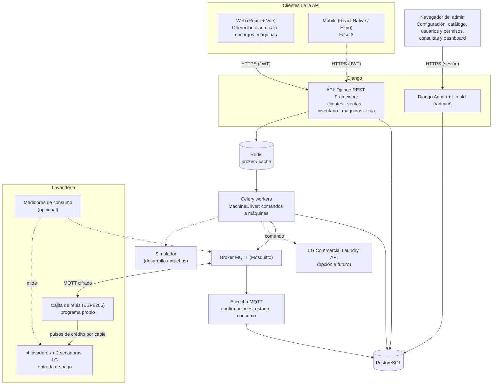
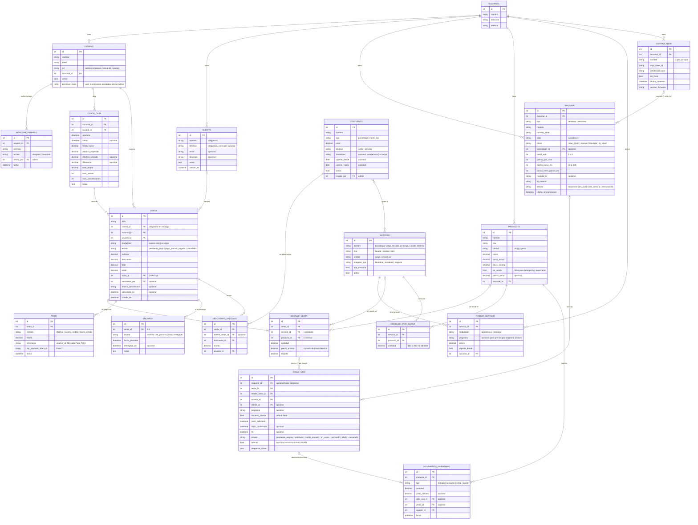
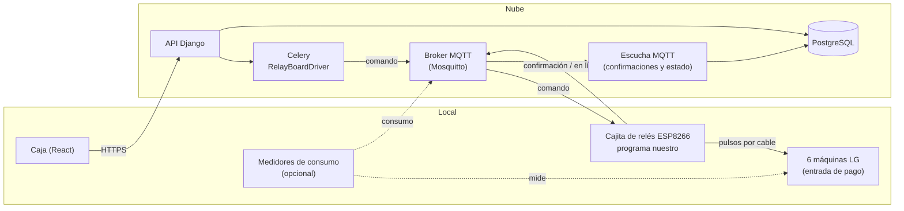
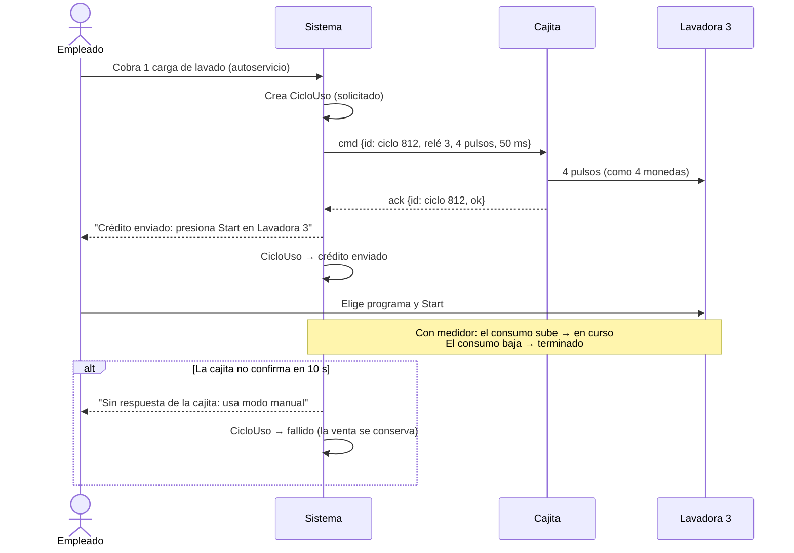

# MVP: Sistema de Gestión de Lavandería

> Definición del MVP y propuesta de implementación · Última actualización: 2026-10-17

---

## 1. Revisión de la propuesta inicial

### Lo que está bien planteado
- El alcance es razonable para un MVP: ventas, clientes, inventario y control de equipos.
- Exponer todo mediante una API (DRF) es lo correcto: el mismo backend sirve a la web y, más adelante, a la app móvil.
- Docker desde el inicio permite no depender de un solo proveedor de nube (AWS / GCloud).

### Observaciones y huecos detectados

| #  | Observación                                                                                                                                                                                                                                                                                                                                                                                            | Impacto                                                                                   | Recomendación                                                                                                                                                                      |
|----|--------------------------------------------------------------------------------------------------------------------------------------------------------------------------------------------------------------------------------------------------------------------------------------------------------------------------------------------------------------------------------------------------------|-------------------------------------------------------------------------------------------|------------------------------------------------------------------------------------------------------------------------------------------------------------------------------------|
| 1  | ✅ *Corregido:* el modelo de la secadora en la propuesta inicial decía `CDG27RUNCNS`; el correcto (según la etiqueta) es **`CDG27RUCNS`**.                                                                                                                                                                                                                                                             | —                                                                                         | —                                                                                                                                                                                  |
| 2  | **Se supone control "por red local".** Los equipos comerciales LG no exponen una API local documentada. LG ofrece una **Commercial Laundry API** *cloud‑to‑cloud* (REST), y **solo para socios B2B de LG**. Además, los equipos se dan de alta con una app instaladora que entrega el representante de LG. El manual confirma que estos equipos usan **LG Laundry Lounge** (ver §4).                   | **Alto.** Es el requerimiento más riesgoso y del que depende el punto 4 de los generales. | Validar con LG **antes de desarrollar** (ver §4). Diseñar el sistema con una capa de abstracción y tener un plan B.                                                                |
| 3  | ✅ *Confirmado:* los equipos **tienen WiFi** y pueden conectarse a la red del local (internet estable); una lavadora ya está conectada a la red, pero sin registrar. **Ojo:** tener WiFi no basta para controlarlos desde nuestro sistema. Hace falta que un instalador de LG los registre y acceso a la API (punto 2). **El arranque se hará con la cajita de relés que ya está instalada** (ver §4). | Medio                                                                                     | Contactar a LG Business (`contacto_lg.md`).                                                                                                                                        |
| 4  | ✅ *Definido:* roles **administrador (admin)** y **empleado**, más de 5 usuarios.                                                                                                                                                                                                                                                                                                                      | Medio                                                                                     | Autenticación y permisos desde el MVP. Ver §3, *Roles y permisos*.                                                                                                                 |
| 5  | ✅ *Resuelto:* cobro **por carga** (lavadora / secadora), con **precios distintos para autoservicio y encargo**, y catálogo ampliable (p. ej. lavado de tenis).                                                                                                                                                                                                                                        | —                                                                                         | Catálogo `Servicio` + `PrecioServicio` por modalidad (ver §3). El **encargo** necesita además un flujo de estados (recibido → listo → entregado).                                  |
| 6  | ✅ *Resuelto:* pagos en **efectivo y tarjeta (crédito/débito)**; no se requiere CFDI. Corte de caja **por turno**.                                                                                                                                                                                                                                                                                     | Bajo                                                                                      | El cobro con tarjeta se hace en una terminal externa (banco, Clip, Mercado Pago Point) y el sistema solo registra tipo y referencia. Apertura y corte de caja por turno en el MVP. |
| 7  | "Inventario" no especifica qué se controla.                                                                                                                                                                                                                                                                                                                                                            | Bajo                                                                                      | Se propone: insumos (detergente, suavizante, bolsas) con entradas/salidas y stock mínimo.                                                                                          |
| 8  | Por ahora hay **una sola sucursal**, sin planes cercanos de abrir más.                                                                                                                                                                                                                                                                                                                                 | Bajo                                                                                      | Mantener un modelo `Sucursal` mínimo (una fila), sin pantallas de multisucursal. Agregarlo desde el inicio cuesta casi nada y evita migraciones si después se abre otra.           |
| 10 | El detergente y el suavizante van **incluidos siempre** (promoción permanente). Si el cliente trae los suyos, se usan los del cliente y **el precio no cambia**.                                                                                                                                                                                                                                       | Medio (inventario)                                                                        | El inventario no se mueve por ventas, sino por **consumo por carga**: se descuenta automáticamente cuando se usan los insumos de la casa. Ver §3.                                  |
| 11 | Se necesita **imprimir tickets** para el cliente con el desglose del consumo.                                                                                                                                                                                                                                                                                                                          | Medio                                                                                     | Ticket en la impresora térmica del local (**POS-8360, 80 mm, USB**). Ver §3, *Ticket para el cliente*.                                                                             |
| 9  | No se mencionan **notificaciones** al cliente (ropa lista).                                                                                                                                                                                                                                                                                                                                            | Bajo                                                                                      | Fase 2: WhatsApp/SMS usando el teléfono ya registrado.                                                                                                                             |

---

## 2. Arquitectura propuesta



### Stack

| Capa                   | Tecnología                                                                               | Nota                                                                                                                                                             |
|------------------------|------------------------------------------------------------------------------------------|------------------------------------------------------------------------------------------------------------------------------------------------------------------|
| Backend                | Django 5 + DRF                                                                           | Se mantiene lo propuesto.                                                                                                                                        |
| Auth                   | `djangorestframework-simplejwt`                                                          | JWT para la web y el móvil. Roles con Groups/Permissions de Django.                                                                                              |
| Tareas asíncronas      | **Celery + Redis**                                                                       | *Agregado.* Mandar comandos a las máquinas, consultar su estado y reintentar sin bloquear la API.                                                                |
| Tiempo real (opcional) | Django Channels o SSE                                                                    | Mostrar el estado de las máquinas en vivo. Se puede empezar con *polling* cada 10 s.                                                                             |
| Control de máquinas    | **MQTT** (Mosquitto) + programa propio en la cajita de relés (ESPHome o firmware propio) | *Agregado.* La cajita se conecta sola al broker; no hay que abrir puertos en el local. Ver §4.                                                                   |
| Admin / back-office    | Django Admin + **django-unfold**                                                         | *Agregado.* Tema moderno (Tailwind) para el admin de Django: configuración, catálogo, usuarios y permisos, consultas y dashboard. Ver *Django Admin con Unfold*. |
| Frontend               | React + TypeScript + Vite                                                                | Solo la operación diaria (caja, encargos, máquinas). UI: MUI o shadcn/ui. Datos: TanStack Query.                                                                 |
| Mobile                 | React Native (Expo)                                                                      | Fase 3; consume la misma API.                                                                                                                                    |
| BD                     | PostgreSQL 16                                                                            |                                                                                                                                                                  |
| Documentación API      | `drf-spectacular` (OpenAPI)                                                              | Permite generar el cliente TS automáticamente.                                                                                                                   |
| Contenedores           | Docker + docker compose                                                                  | Servicios: `api`, `worker`, `beat`, `db`, `redis`, `web`, `mqtt`, `mqtt-listener`.                                                                               |
| CI/CD                  | GitHub Actions                                                                           | Pruebas, lint (ruff, eslint) y build de imágenes.                                                                                                                |

### Despliegue (sin atarse a una nube)
- **Etapa inicial (bajo costo):** una sola VM (AWS EC2/Lightsail o GCP Compute Engine) con docker compose, Caddy/Nginx con HTTPS automático y respaldos diarios de PostgreSQL hacia S3/GCS.
- **Etapa de crecimiento:** BD administrada (RDS / Cloud SQL), contenedores en ECS Fargate / Cloud Run y Redis administrado.
- **Portabilidad:** configuración por variables de entorno (12‑factor) y almacenamiento con API compatible con S3 (`django-storages`). Nada específico de un proveedor dentro del código.

### Django Admin con Unfold

El back-office se hace con el **admin de Django personalizado con [django-unfold](https://github.com/unfoldadmin/django-unfold)** en lugar de pantallas en React. Así el frontend de React se enfoca solo en la operación diaria y el MVP se reduce bastante.

**Reparto de responsabilidades:**

| Interfaz                              | Quién la usa                              | Para qué                                                                                                                                                                                                       |
|---------------------------------------|-------------------------------------------|----------------------------------------------------------------------------------------------------------------------------------------------------------------------------------------------------------------|
| **Web React** (caja)                  | Empleados y admin                         | Punto de venta, encargos, activar máquinas, abrir/cerrar caja, imprimir tickets.                                                                                                                               |
| **Django Admin + Unfold** (`/admin/`) | Admin, y empleados con permisos agregados | Usuarios y permisos, servicios y precios, descuentos, consumo por carga, productos e inventario (entradas y ajustes), alta de máquinas, consulta de ventas, cortes, ciclos y bitácoras, dashboard de reportes. |

**Personalización con Unfold:**
- **Marca:** nombre, logo y colores de la lavandería; modo claro/oscuro; interfaz en español.
- **Menú lateral** agrupado por área, con iconos: *Operación* (ventas, encargos, ciclos, cortes de caja), *Catálogo* (servicios, precios, descuentos), *Inventario* (productos, movimientos, consumo por carga), *Máquinas*, *Usuarios y permisos*, *Bitácoras*. Cada usuario solo ve las secciones para las que tiene permiso.
- **Dashboard de inicio** con indicadores: ventas del día (efectivo / tarjeta), cargas por máquina, encargos pendientes y listos, productos con stock bajo, diferencias en los últimos cortes de caja, cancelaciones y descuentos por empleado. Cubre los reportes básicos del MVP sin construirlos en React.
- **Filtros avanzados** (rango de fechas, empleado, modalidad, método de pago, máquina) y búsqueda global.
- **Pestañas e inlines:** p. ej. una venta muestra sus detalles, pagos, descuentos y ciclos en una sola ficha; un usuario muestra su rol y la lista de casillas de permisos extra.
- **Acciones:** p. ej. marcar una máquina como fuera de servicio, desactivar un descuento, reimprimir un ticket.

**Reglas:**
- **Ventas, pagos, cortes y bitácoras son de solo lectura en el admin.** Se crean y se cancelan únicamente desde la caja (React/API), para no alterar el historial ni saltarse las validaciones.
- El acceso a `/admin/` lo tiene el rol admin y los empleados con al menos un permiso agregado (`is_staff`). Dentro, cada sección respeta los mismos permisos de la tabla de *Roles y permisos*.
- El admin usa sesión de Django (no JWT) y sirve sus archivos estáticos desde el mismo contenedor de la API (WhiteNoise o Nginx).

---

## 3. Módulos y modelo de datos

### Apps de Django
```
backend/
├── core/          # Sucursal, Usuario, roles, configuración
├── clientes/      # Cliente
├── inventario/    # Producto/Insumo, MovimientoInventario
├── ventas/        # Venta, DetalleVenta, Pago, CorteCaja, Servicio (catálogo/precios)
└── maquinas/      # Controlador, Maquina, CicloUso, drivers/ (relay_board, manual, simulator, lg_cloud)
```

### Entidades principales



**Notas del modelo:**
- **Usuario:** una cuenta por persona. Cuando un empleado se va, su cuenta se desactiva (no se borra) para conservar su historial. `rol` es un `Group` de Django con los permisos por defecto; `permisos_extra` son los `user_permissions` que agrega un admin.
- **PrecioServicio:** hoy hay un precio fijo por servicio y modalidad (`programa` vacío). Si a futuro se cobran distinto ciertos programas (agua caliente, ciclo pesado, más tiempo de secado), se dan de alta filas con `programa` y el POS lo pide; si no hay precio para ese programa se usa el general. Agregar un servicio nuevo (p. ej. lavado de tenis) es solo dar de alta registros, sin cambiar código.
- **ConsumoPorCarga:** solo aplica a "Lavado por carga" (el secado no consume insumos). Valor inicial: entre 150 y 200 ml de detergente y entre 150 y 200 ml de suavizante por carga, pendiente de confirmar. Es un dato editable desde el admin. Comparar cada mes el consumo teórico contra las compras reales sirve para afinar la medida y detectar mermas.
- **MovimientoInventario:** los de `tipo = consumo` se generan solos al iniciar un ciclo que usa insumos de la casa.
- **Venta:** en autoservicio se cobra completo antes de activar la máquina. En encargo se puede pagar al recibir, al entregar o con anticipo + resto (varios `Pago` por venta). Un encargo con saldo pendiente solo lo entrega quien tenga el permiso `encargos.entregar_con_saldo`.
- **Encargo:** solo existe si la venta es de encargo; permite saber qué ropa está pendiente o lista.
- **DetalleVenta:** cada línea es un servicio **o** un producto. `precio_unitario` se copia de `PrecioServicio` según la modalidad y se conserva aunque el precio cambie después.
- **Pago:** la tarjeta se cobra en Mercado Pago Point. En el MVP la referencia del voucher se captura a mano; en la Fase 2 la integración con la API de Point la llena sola (`mp_payment_intent_id`).
- **Descuento:** solo los crea quien tenga `descuentos.gestionar`. El empleado elige de la lista los que aplican a esa venta (vigentes, de esa modalidad y servicio). Ejemplos: "10% martes en autoservicio", "$20 menos en encargo". `DescuentoAplicado` guarda el monto calculado en el momento y quién lo aplicó.
- **CorteCaja:** uno por turno y empleado. `efectivo_esperado = fondo_inicial + pagos en efectivo del turno` (menos los cancelados). `total_tarjeta` se cuadra contra el reporte de Mercado Pago Point.
- **CicloUso:** `insumos_cliente = true` significa que el cliente trajo su detergente: no se descuenta inventario y el precio no cambia. Estado `credito_enviado`: la cajita confirmó que dio el crédito, pero la máquina arranca hasta que alguien presiona Start. Pasa a `en_curso` con el medidor de consumo, porque lo marca el empleado o por tiempo. `manual = true` cuando la máquina se arrancó en modo PUSH (sin cajita).
- **Controlador:** la cajita de relés. Una sola controla las 6 máquinas, un relé por máquina (`Maquina.canal_rele`). `en_linea` y `ultima_conexion` se actualizan con los mensajes de la cajita (ver §4).
- **Maquina:** `pulsos_por_ciclo`, `ancho_pulso_ms` y `pausa_entre_pulsos_ms` deben coincidir con la configuración de pago de la máquina (precio del programa ÷ valor por pulso). Ver §4, *Configuración de las máquinas*.
- **SolicitudAutorizacion** *(fase futura, no está en el diagrama)*: `tipo [entrega_con_saldo | ajuste_inventario | …]`, solicitante, objeto, `datos` (monto, motivo), `estado [pendiente | aprobada | rechazada | expirada | usada]`, quién la resolvió, comentario, `expira_en`. La acción se ejecuta solo si hay una solicitud aprobada, vigente, sin usar y con los mismos datos.

**Regla clave:** cada carga vendida de un servicio con `usa_maquina = true` genera un `CicloUso` ligado a la `DetalleVenta` (una venta de 3 cargas de lavado → 3 ciclos). Así se pueden **cuadrar las ventas contra los usos reales de las máquinas** y detectar ciclos no cobrados.

- **Autoservicio:** el cliente paga en el mostrador y el **empleado** activa la máquina desde la web; el ciclo se inicia de inmediato. El cliente no activa máquinas por su cuenta (no está en el alcance del MVP).
- **Insumos:** al iniciar un ciclo, si `insumos_cliente = false`, se genera un `MovimientoInventario(tipo=consumo)` según `ConsumoPorCarga`. Así el administrador ve cuánto cuesta la promoción del detergente gratis y recibe alertas de stock mínimo.
- **Encargo:** los ciclos quedan *pendientes de asignar* y el empleado los activa cuando procesa la ropa. El `Encargo` avanza de estado conforme se completan sus ciclos.

### Roles y permisos

Más de 5 usuarios, **cada empleado con su propia cuenta** (nunca compartida), para que ventas, cancelaciones y cortes queden a nombre de quien los hizo.

**Modelo:** cada acción del sistema es un **permiso**. Un **rol** es solo un paquete de permisos por defecto. Además, el admin puede **agregar permisos individuales** a un empleado concreto, para que haga acciones de admin sin convertirlo en admin. Por ejemplo, darle a Juan, el encargado de la tarde, permiso de *entregar encargos con saldo* y *ver cortes de caja*.

```
permisos efectivos de un usuario = permisos de su rol + permisos agregados a él
```

| Permiso                                                       | Código                        | Admin | Empleado (por defecto) | ¿Se puede agregar a un empleado? |
|---------------------------------------------------------------|-------------------------------|:-----:|:----------------------:|:--------------------------------:|
| Cobrar ventas (autoservicio / encargo) e imprimir tickets     | `ventas.cobrar`               |  ✅   |           ✅           |                —                 |
| Activar máquinas / registrar ciclos                           | `maquinas.activar`            |  ✅   |           ✅           |                —                 |
| Registrar clientes y gestionar encargos                       | `clientes.gestionar`          |  ✅   |           ✅           |                —                 |
| Aplicar descuentos **del catálogo autorizado**                | `descuentos.aplicar`          |  ✅   |           ✅           |                —                 |
| Cancelar ventas (motivo obligatorio, queda en bitácora)       | `ventas.cancelar`             |  ✅   |           ✅           |                —                 |
| Registrar entradas de inventario                              | `inventario.entrada`          |  ✅   |           ✅           |                —                 |
| Abrir y cerrar **su** caja (corte por turno)                  | `caja.operar`                 |  ✅   |           ✅           |                —                 |
| Crear, editar o desactivar descuentos                         | `descuentos.gestionar`        |  ✅   |           ❌           |                ✅                |
| Ajustes de inventario (mermas, correcciones)                  | `inventario.ajustar`          |  ✅   |           ❌           |                ✅                |
| Entregar un encargo con saldo pendiente                       | `encargos.entregar_con_saldo` |  ✅   |           ❌           |                ✅                |
| Ver cortes de otros turnos y diferencias de caja              | `caja.ver_todos`              |  ✅   |           ❌           |                ✅                |
| Precios, servicios, consumo por carga                         | `catalogo.gestionar`          |  ✅   |           ❌           |                ✅                |
| Alta y configuración de máquinas                              | `maquinas.gestionar`          |  ✅   |           ❌           |                ✅                |
| Reportes (ventas, uso de máquinas, inventario, cancelaciones) | `reportes.ver`                |  ✅   |           ❌           |                ✅                |
| Gestionar usuarios, roles y permisos                          | `usuarios.gestionar`          |  ✅   |           ❌           |        ❌ **solo admin**         |

- **Quién asigna:** solo un admin agrega o quita permisos. Gestionar usuarios y permisos **no se puede delegar**, para evitar que un empleado se dé permisos a sí mismo o a otros.
- **Efecto inmediato:** al quitar un permiso, el empleado pierde el acceso en su siguiente acción, sin cerrar sesión.
- **Bitácora:** se registra quién otorgó o quitó cada permiso y cuándo. Las acciones hechas con un permiso agregado quedan a nombre del empleado, igual que el resto.
- **Interfaz:** en el admin de Django (Unfold), la ficha de cada usuario muestra los permisos del rol (fijos) y una lista de casillas con los permisos que se pueden agregar.
- **Implementación:** usa el sistema de permisos que ya trae Django: un `Group` por rol (`Admin`, `Empleado`), `Permission` personalizados con los códigos de la tabla y `user_permissions` para los permisos individuales. En DRF, cada endpoint declara el permiso que exige (p. ej. una clase `TienePermiso("encargos.entregar_con_saldo")`) y el frontend usa la lista de permisos efectivos solo para ocultar botones. **La validación real siempre ocurre en el backend.**
- Un empleado **no puede cobrar sin tener una caja abierta**: cada venta y cada pago quedan ligados a su turno.
- Las cancelaciones las puede hacer el empleado sin autorización, pero se registran (quién, cuándo, motivo, monto). El administrador las ve en un reporte de cancelaciones por empleado.
- **MVP:** si un empleado no tiene el permiso de una acción, esta queda **bloqueada** para él. La hace un admin o un empleado al que se le haya agregado ese permiso.
- **Fase futura:** permisos temporales (con fecha de vencimiento, p. ej. mientras el admin está de vacaciones) y roles personalizados (p. ej. "Encargado de turno") como paquetes de permisos con nombre, si se vuelve tedioso asignarlos uno por uno.
- **Fase futura:** autorización remota (ver abajo).

#### Autorización remota del administrador *(fase futura, fuera del MVP)*

> Diseño de referencia para cuando se implemente; en el MVP no se construye. El modelo de permisos del MVP ya deja preparado el punto donde se agregará.

Cuando el empleado intenta una acción reservada, en lugar de solo bloquearla el sistema le ofrece **"Solicitar autorización"**:


- **Desde cualquier lugar:** el sistema está en la nube, así que el administrador entra desde su celular con el mismo sistema web (responsivo, instalable como app/PWA), sin estar en el local.
- **Notificación:** Web Push al celular del administrador (gratis, sin depender de terceros). Respaldo: correo. Más adelante: WhatsApp. Además, en el panel del administrador hay una bandeja de "Solicitudes pendientes".
- **Seguridad de la solicitud:**
  - Autoriza **exactamente** lo que se pidió (acción + venta + monto). Si algo cambia, se necesita otra solicitud.
  - Es de un solo uso y **expira** (15 min, configurable). Si expira, el empleado puede volver a pedirla.
  - Solo un administrador puede aprobarla.
- **Acciones que se pueden solicitar** (configurable por el administrador): entregar un encargo con saldo pendiente y ajustes de inventario. El mecanismo es genérico: si en el futuro se agrega otra acción reservada (p. ej. un descuento fuera del catálogo), se suma a la lista sin rediseñar nada.
- **Tiempo real:** la pantalla del empleado se actualiza sola al aprobarse (WebSocket/SSE o *polling* cada pocos segundos).

### Ticket para el cliente

Comprobante **no fiscal** (no se requiere CFDI), que se imprime al cobrar y se puede reimprimir desde el historial de ventas.

**Contenido (desglose del consumo):**
```
        LAVANDERÍA <nombre>
     <dirección> · <teléfono>
--------------------------------
Folio: A-000123   17/10/2026 14:32
Atendió: <cajero>
Cliente: <nombre> · <teléfono>      (si aplica)
Modalidad: ENCARGO
--------------------------------
Cant  Concepto            Importe
 3    Lavado por carga     $XXX.XX
        @ $XX.XX
 2    Secado por carga     $XXX.XX
        @ $XX.XX
      Detergente y suavizante
        (promoción)          $0.00
--------------------------------
Subtotal                   $XXX.XX
Descuento                   -$X.XX
TOTAL                      $XXX.XX
--------------------------------
Pagos:
  Anticipo  Efectivo       $XXX.XX
  Saldo pendiente          $XXX.XX
Entrega estimada: 18/10/2026 18:00
--------------------------------
  Comprobante no fiscal · Gracias
```
- En **autoservicio** se puede agregar la máquina asignada a cada carga ("Lavadora 3"), para que el cliente sepa cuál usar.
- En **encargo**, el ticket de recepción sirve de comprobante para recoger la ropa. Al entregar se imprime otro con los pagos y el saldo en $0.
- La línea "Detergente y suavizante (promoción) $0.00" aparece **siempre** que haya cargas de lavado, como recordatorio de la promoción.
- El ticket es igual aunque el cliente traiga su propio detergente: ese dato (`insumos_cliente`) es solo de uso interno, para el inventario, y no aparece en el ticket.
- Si se paga con tarjeta, se imprimen el tipo (crédito/débito) y la referencia del voucher; si se paga en efectivo, el monto recibido y el cambio.

**Implementación:**
- **MVP:** vista de ticket en React con CSS `@media print` a ancho de **80 mm** (~72 mm imprimibles, ~48 caracteres por línea), que se imprime con el diálogo del navegador en la impresora térmica **POS-8360 (USB)** instalada en la PC de caja (con su driver). No requiere software extra. Configurar en el navegador: sin márgenes, sin encabezados/pies y tamaño de papel de 80 mm.
- **Mejora (opcional):** impresión directa sin diálogo y apertura del cajón de dinero con comandos ESC/POS, por medio de un agente local (p. ej. QZ Tray) que habla con la impresora por USB. Conviene si el diálogo del navegador estorba en la operación diaria.
- El backend entrega los datos del ticket ya calculados (`/api/ventas/{id}/ticket/`), así el mismo formato sirve después para enviarlo por WhatsApp o como PDF.

### Endpoints principales (REST)
```
/api/auth/token/  /api/auth/refresh/
/api/auth/me/                  usuario actual + permisos efectivos (para el frontend)
/api/usuarios/                 CRUD de usuarios (solo admin)
/api/usuarios/{id}/permisos/   ver / agregar / quitar permisos individuales (solo admin)
/api/clientes/                 CRUD + búsqueda por teléfono/nombre
/api/servicios/                catálogo + precios por modalidad
/api/productos/                CRUD + /alertas-stock/
/api/inventario/movimientos/
/api/ventas/                   crear (con modalidad), pagar, cancelar
/api/ventas/{id}/ticket/       datos del ticket para imprimir / reimprimir
/api/encargos/                 listado por estado, cambiar estado, entregar
/api/descuentos/               catálogo (crear/editar: solo administrador; vigentes: empleado)
/api/caja/cortes/              abrir / cerrar turno, corte actual, historial (administrador)
/api/maquinas/                 listado con estado
/api/maquinas/{id}/iniciar/    POST → crea CicloUso y encola el comando
/api/maquinas/{id}/detener/
/api/maquinas/{id}/pulso-prueba/  POST, solo con permiso maquinas.gestionar
/api/controladores/            estado de la cajita (en línea, última conexión)
/api/ciclos/                   historial de usos (filtros por máquina y fecha)
/api/reportes/ventas-diarias/  /uso-maquinas/  /inventario/
```

---

## 4. Control de lavadoras y secadoras

### Situación
- **Lavadoras:** 4 × `GCWM1069CD7`
- **Secadoras:** 2 × `CDG27RUCNS`

|    Lavadora `GCWM1069CD7`     |     Secadora `CDG27RUCNS`     |
|:-----------------------------:|:-----------------------------:|
|  |  |

- Los equipos **tienen WiFi** y el local tiene internet estable. **Una lavadora ya está conectada a la red**, pero no está registrada en ninguna plataforma de LG.
- El proveedor de los equipos instaló una **cajita de relés** (sistema Aitare) que arranca las máquinas por cable. Hoy no se usa: las máquinas están en **modo libre (PUSH)** y se arrancan con Start.

### Control actual: cajita de relés (Aitare)

|                     |                                                                                                                                                                                                                                                                                                                                                                                            |
|---------------------|--------------------------------------------------------------------------------------------------------------------------------------------------------------------------------------------------------------------------------------------------------------------------------------------------------------------------------------------------------------------------------------------|
| **Hardware**        | Placa genérica de **8 relés** (Songle SRD-05VDC, 5 V) con módulo WiFi **ESP-12F (ESP8266)**, alimentación de 7 a 28 V, en una caja de plástico. Usa **6 relés**, uno por máquina, con un cable a la **entrada de pago** de cada una. La placa trae expuesto su puerto de programación (5V, TXD, RXD, IO0, GND), así que se le puede cargar otro programa.                                  |
| **Red**             | La cajita estaba conectada a un **router propio de Aitare, sin internet** (red `192.168.10.x`). El router hoy está apagado. Las lavadoras no participaban en esa red.                                                                                                                                                                                                                      |
| **Software**        | "ControlEquipos" (Visual Basic 6), en la PC del negocio junto con el punto de venta Aitare. Le habla a la placa por **HTTP en la red local** (`/?E=1&T=…`, `/?E=3&PM=…&PR=…`, `/?R=1`) y configura por máquina el *pulso de arranque*, la *duración del pulso* (ms) y el *número de pulsos*. Revisa la conexión con `ping`.                                                                |
| **Funcionamiento**  | Al activar una máquina, la cajita cierra su relé varias veces, como si cayeran monedas. La máquina recibe el crédito, **pita y muestra el tiempo del ciclo**, y se presiona Start.                                                                                                                                                                                                         |
| **Por qué fallaba** | No confirmado. Lo más probable: la PC debía estar conectada al router de Aitare (sin internet) y Windows se cambiaba sola a la red con internet, así que el programa perdía la cajita. Otras causas posibles: la antena impresa del ESP8266 dentro de una caja de plástico, o la fuente de alimentación. La distancia no es problema (local de 4 × 7 m, cajita a menos de 4 m del router). |

Fotos y copia del programa: carpeta `Aitaire/`.

### Plan principal: programa propio en la cajita

Se conservan la placa, los relés y los 6 cables. Solo se reemplaza el programa de la placa por uno nuestro (ESPHome o firmware propio):

1. **Se retira el router de Aitare.** La placa se conecta directo al WiFi principal del local (red de **2.4 GHz**; el ESP8266 no usa 5 GHz).
2. La placa abre una conexión **saliente y cifrada** al broker MQTT en la nube. No hay que abrir puertos ni tener una PC encendida en el local.
3. El sistema le manda las órdenes y la placa responde con una confirmación.
4. Antes de cambiar el programa, se **respalda el de Aitare** para poder volver atrás.
5. Si la señal del ESP8266 resulta insuficiente, se cambia solo la placa por una **ESP32 de 8 relés con antena externa** y se pasan los 6 cables.

**Componentes:**



- **Broker MQTT (Mosquitto):** un contenedor más en Docker. Cada cajita tiene su propio usuario y contraseña y solo puede leer y escribir en sus temas.
- **`RelayBoardDriver`:** implementa `MachineDriver`. Publica la orden en `lavanderia/<controlador>/cmd`, por ejemplo `{"id": 812, "canal": 3, "pulsos": 4, "ancho_ms": 50, "pausa_ms": 150}`.
- **Programa de la cajita:** recibe la orden, envía los pulsos por el relé indicado y responde en `lavanderia/<controlador>/ack` con `{"id": 812, "ok": true}`. Publica `en línea / fuera de línea` (mensaje de "última voluntad" de MQTT). Recuerda los últimos `id` para **no repetir pulsos** si llega un reintento.
- **Escucha MQTT:** un proceso aparte, siempre encendido. Recibe confirmaciones, estado de la cajita y consumo de los medidores, y actualiza `CicloUso`, `Maquina` y `Controlador`.
- **Medidores de consumo (opcional):** confirman que la máquina realmente arrancó y avisan cuando termina. Ver la opción C más abajo.

**Flujo de una venta:**



**En las pantallas:**
- **Caja (React):** después de cobrar aparece "Activar Lavadora 3", luego el aviso "Crédito enviado: presiona Start", y un indicador de si la cajita está en línea.
- **Admin (Unfold):** alta de la cajita, relé y pulsos de cada máquina; acción **"Enviar pulso de prueba"** (permiso `maquinas.gestionar`); bitácora de órdenes y confirmaciones.

**Sin internet o con la cajita fallando:** se pasa la máquina a **modo libre (PUSH)** desde su menú y la venta se registra a mano. El sistema marca esos ciclos como manuales (`CicloUso.manual`) para el corte y los reportes.

### Configuración de las máquinas

- Pasarlas de vuelta a **modo de pago** con monedas: `Product Type = PAY` y `Vend Type = Coin`.
- **Pulsos por ciclo = precio del programa ÷ valor de cada pulso.** Con los valores de fábrica (precio 1.00 y moneda 0.25) son 4 pulsos. Aitare ya tenía esto configurado: hay que copiar sus valores de ControlEquipos.
  - Se puede **simplificar a 1 pulso por ciclo** igualando el valor por pulso al precio. Menos pulsos, menos riesgo de que se pierda uno.
- **Duración del pulso:** 50 ms o 100 ms, igual en la máquina (`Coin Drop Type`) y en el sistema (`Maquina.ancho_pulso_ms`).
- **Tiempo que la máquina guarda el crédito** (`Standby Return Time`): indefinido (0) o de 1 a 180 si nadie presiona Start.

### Páginas del manual sobre pagos y pulsos

Manual de usuario `Wahser_GCWM1069CD7_manual.pdf`. Páginas del PDF:

| Tema                          |    Página     | Qué dice                                                                                                                                                    |
|-------------------------------|:-------------:|-------------------------------------------------------------------------------------------------------------------------------------------------------------|
| Indicador de crédito completo |    **12**     | *"The Start/Pause LED flashes when the full vend price has been satisfied and the cycle has been chosen"*: el pitido y el parpadeo que se veían con Aitare. |
| Operación normal              |    **22**     | Elegir programa → la pantalla muestra el precio → meter crédito → Start. En modo OPL muestra *PUSH* y no pide pago.                                         |
| Entrar al menú de servicio    | **23–24, 26** | Con la tarjeta de servicio o el interruptor, y la contraseña de fábrica `3000`.                                                                             |
| Precio por programa           |   **26–29**   | "Regular Price Setup": precio de cada programa (0.00–9.95).                                                                                                 |
| **Valor de cada pulso**       |    **63**     | "Coin 1 Value Setup": *"set the value of each coin signal received"* (0.05–9.95).                                                                           |
| Tiempo que guarda el crédito  |    **66**     | "Standby Return Time": 0 = siempre; 1–180 = ese tiempo. Solo en modo monedas.                                                                               |
| Tipos de configuración        |    **67**     | Menú "Type": producto, moneda, tipo de venta, lector de tarjeta, monedero.                                                                                  |
| **Pago o libre**              |    **68**     | "Product Type": `PAY` (monedas o tarjeta) o `FrEE` (OPL, sin pago).                                                                                         |
| **Monedas o tarjeta**         |    **70**     | "Vend Type Setup".                                                                                                                                          |
| Lector de tarjeta             |    **71**     | Greenwald o ESD.                                                                                                                                            |
| **Duración del pulso**        |    **72**     | "Coin Drop Type": **50 ms** (ESD, Greenwald, Munzprufer) o **100 ms** (Corea).                                                                              |

El manual de usuario **no** muestra el conector físico de la entrada de pago. Viene en el manual de servicio o se ve en la instalación de Aitare.


### Lo que dice el manual de la lavadora

Fuente: `Wahser_GCWM1069CD7_manual.pdf`.

- **Plataforma:** el WiFi se conecta a **LG Laundry Lounge**, la plataforma comercial de LG, no a LG ThinQ (p. 3):
  - *LG Laundry Lounge Installer:* app para instaladores que "registra el producto en el servidor. Solo disponible para usuarios autorizados".
  - *LG Laundry Lounge:* app del dueño para "monitoreo en tiempo real de tiendas y productos registrados".
- **LED de WiFi:** fijo = conectado; parpadeando = conectando (p. 12).
- **Sistema de pago:** el modelo `CD7` es de tipo **tarjeta** y se configura desde el menú de servicio (pp. 68–72):
  - **PAY:** acepta lector de tarjeta (Greenwald o ESD) o monedero por **pulsos de crédito** (50 o 100 ms), con valor configurable por pulso.
  - **FREE (OPL):** no pide pago; la pantalla muestra *PUSH* y basta con presionar Start.
- **Electricidad:** 120 V, 60 Hz, enchufe de 3 patas en contacto propio.
- **Seguridad:** la contraseña de fábrica del menú de servicio es `3000` y está publicada en el manual. Hay que cambiarla si el menú lo permite, porque con ella se pueden cambiar precios o pasar la máquina a modo libre.
- Falta revisar el manual de la secadora `CDG27RUCNS`.

### Opción a futuro: la plataforma de LG en México

La [página de LG México](https://www.lg.com/mx/business/lavanderia-comercial/smart-laundry-lounge/) confirma que **Smart Laundry Lounge** se ofrece en México:
- Incluye la app **LG Laundry Crew**, con una versión para dueños y operadores (gestionar locales y máquinas) y otra para clientes (disponibilidad y estado de las máquinas).
- Tiene una **API** con más de 40 endpoints en las categorías Dispositivo, Estadísticas, Tienda, Registro y Callback (webhook). Puede avisar a nuestro servidor cuando termina un ciclo.
- **Acceso:** desde el portal `smartsolution.developer.lge.com`:
  1. acuerdos (confidencialidad, API, licencia, privacidad, términos);
  2. clave de pruebas (canal, llaves, app instaladora, revisión de calidad, soporte);
  3. clave de producción.
- **Contacto:** formulario "Conéctate con LG Business". El texto está listo en `contacto_lg.md`.

> **Sin confirmar:** si la API permite **iniciar ciclos** o solo monitorear, si estos modelos son compatibles con Laundry Crew (el manual menciona la app anterior, Laundry Lounge), los costos y si aceptan a una lavandería de una sola sucursal. La documentación técnica requiere iniciar sesión en el portal.

### Opciones descartadas
- **LG ThinQ / `pythinqconnect` / Home Assistant:** son para aparatos de casa, y el manual confirma que estos equipos usan Laundry Lounge. Además, en ThinQ el arranque remoto exige presionar *Remote Start* en la máquina y no permite elegir el programa.

### Estrategia: capa de abstracción `MachineDriver`

```python
class MachineDriver(Protocol):
    def get_status(self, maquina) -> MachineStatus: ...
    def start_cycle(self, maquina, programa: str | None, credito: Decimal) -> CommandResult: ...
    def stop_cycle(self, maquina) -> CommandResult: ...
```

Toda la lógica de negocio (ventas, ciclos, reportes) habla con esta interfaz y **no sabe qué tecnología hay detrás**. Así el sistema se construye y se prueba completo con el `SimulatorDriver` mientras se resuelve la integración real.

| Opción                                                             | Cómo funciona                                                                                                                                              | Pros                                                                                    | Contras                                                                                                                                    |
|--------------------------------------------------------------------|------------------------------------------------------------------------------------------------------------------------------------------------------------|-----------------------------------------------------------------------------------------|--------------------------------------------------------------------------------------------------------------------------------------------|
| **A. Cajita de relés con programa propio** (principal)             | La cajita existente envía **pulsos de crédito** a la entrada de pago de cada máquina cuando el sistema lo ordena por MQTT.                                 | Hardware y cableado ya instalados; independiente de LG; la máquina no arranca sin pago. | Cambiar el programa de la placa (reversible si se respalda); alguien presiona Start; la señal del ESP8266 podría requerir cambiar a ESP32. |
| **B. LG Smart Laundry Lounge / Commercial Laundry API** (a futuro) | El backend llama a la API en la nube de LG. Los equipos los registra un instalador autorizado de LG.                                                       | Oficial; más datos de las máquinas.                                                     | Convenio B2B con LG; documentación no pública; tiempos y costos inciertos; no se sabe si permite iniciar ciclos.                           |
| **C. Medición de consumo eléctrico** (complemento)                 | Un enchufe inteligente con medición (p. ej. Shelly Plus Plug US, 120 V / 15 A) por máquina detecta cuándo trabaja y cuándo termina, y lo reporta por MQTT. | Barato, no invasivo, sin electricista; confirma arranque y fin, y cuenta ciclos reales. | No arranca máquinas; hay que calibrar el umbral por máquina.                                                                               |
| **D. Solo registro manual** (respaldo)                             | La máquina en modo PUSH; el empleado registra el ciclo y presiona Start.                                                                                   | Cero riesgo técnico.                                                                    | No hay control real; solo bitácora.                                                                                                        |

**Recomendación:** construir el MVP con **D + simulador** (el negocio opera desde el día 1) y conectar la **opción A** en cuanto se pruebe con una lavadora. Sumar **C** para confirmar arranque y fin de ciclo. Mantener **B** como opción a futuro, según lo que responda LG.

### Consideraciones de diseño para el control de máquinas
- **Idempotencia:** cada orden lleva el `CicloUso.id`; la cajita recuerda las últimas órdenes y no repite pulsos si llega un reintento. Así no se regalan cargas por un fallo de red.
- **Confirmación:** el ciclo queda `solicitado` hasta que la cajita confirma (`credito_enviado`); si no confirma en 10 s pasa a `fallido` y se avisa al cajero.
- **Sincronización:** la escucha MQTT actualiza el estado en cuanto llega un mensaje; una tarea de Celery Beat cierra por tiempo los ciclos que no tengan medidor.
- **Auditoría:** se guarda la respuesta cruda del driver (`respuesta_driver`) para diagnosticar fallas.
- **Modo sin conexión:** si cae internet o la cajita, el sistema permite pasar a registro manual (opción D) sin perder la venta.

---

## 5. Seguridad
- HTTPS obligatorio; JWT con expiración corta + refresh token.
- Permisos por rol + permisos individuales agregados por un admin (tabla de §3), validados en el backend (no solo ocultando botones en el frontend). Solo un admin puede gestionar usuarios y permisos.
- Datos personales de clientes (nombre, teléfono): mínimo necesario, aviso de privacidad y respaldos cifrados.
- Credenciales (MQTT, LG) en variables de entorno o *secrets manager*, nunca en el repositorio.
- Cada cajita se conecta al broker con su propio usuario y contraseña (revocables), por MQTT cifrado, y solo puede leer y escribir en sus temas. Solo el backend puede publicar órdenes.
- Cambiar la contraseña de fábrica (`3000`) del menú de servicio de las máquinas si el menú lo permite: con ella se puede pasar una máquina a modo libre.
- Bitácora de acciones sensibles (cancelaciones con motivo, descuentos aplicados, ajustes de inventario, entregas con saldo, arranques manuales, diferencias de caja).

---

## 6. Plan de trabajo por fases

### Fase 0 – Preparación (1 semana)
- **Cajita de relés:**
  - Capturas de la configuración de cada equipo en ControlEquipos (pulso de arranque, duración en ms, número de pulsos, tiempo, costo y relé).
  - Foto de cerca de los tornillos de un relé con su cable (común / normalmente abierto).
  - Conseguir un adaptador USB-serie (CH340 o CP2102) y **respaldar el programa de Aitare** de la placa.
  - Cargar nuestro programa y probar con **una lavadora** en modo de pago: con los pulsos debe quedar lista para Start.
  - Confirmar que el WiFi del local tiene red de 2.4 GHz.
- **Pedir información a LG Business** (`contacto_lg.md`): compatibilidad de los modelos, proceso y costo del registro, requisitos y costos de la API, y si permite iniciar ciclos. Sin solicitar servicios todavía.
- Crear una cuenta en `smartsolution.developer.lge.com` y revisar si, con la sesión iniciada, se ve la documentación de la Commercial Laundry API.
- Probar la **medición de consumo** (opción C) con un Shelly Plus Plug US en una lavadora: detectar inicio y fin de ciclo.
- Conseguir el manual de la secadora `CDG27RUCNS` y confirmar plataforma, entrada de pago y conexión eléctrica.
- Cambiar la contraseña de fábrica (`3000`) del menú de servicio de las máquinas, si el menú lo permite.
- Instalar el driver de la impresora POS-8360 en la PC de caja e imprimir un ticket de prueba de 80 mm desde el navegador (y, si se quiere imprimir sin diálogo, probar comandos ESC/POS con QZ Tray).
- Abrir una cuenta de desarrollador de Mercado Pago y revisar la API de Point para la terminal que ya tienen.
- Repositorio, estructura `backend/` + `frontend/`, docker compose, CI básico.

### Fase 1 – MVP operativo (4–6 semanas)
- Autenticación, usuarios, roles (admin / empleado) y permisos individuales que el admin puede agregar a un empleado.
- Admin de Django con Unfold: marca, menú por áreas, configuración (catálogo, precios, descuentos, consumo por carga, máquinas, usuarios y permisos) y consultas de solo lectura.
- Clientes (alta rápida desde la caja por teléfono).
- Catálogo de servicios (lavado y secado por carga) con precio fijo de autoservicio y de encargo, ya preparado para precios por programa.
- Punto de venta: elegir la modalidad, crear la venta, cobrar en efectivo o tarjeta (registrando la referencia del voucher de Mercado Pago Point).
- Impresión de ticket con desglose del consumo en la impresora térmica de 80 mm (USB), y reimpresión.
- Encargos: recepción con fecha promesa, pago al recibir, al entregar o con anticipo, tablero "pendiente / listo / entregado".
- Inventario: entradas de insumos, consumo automático por carga (excepto si el cliente trae sus productos), alertas de stock mínimo.
- Máquinas: alta, tablero de estado, `CicloUso` con **driver manual y simulador** (el simulador imita a la cajita: confirma o falla).
- Catálogo de descuentos autorizados (porcentaje o monto fijo, con vigencia, por servicio o modalidad).
- Apertura y corte de caja por turno.
- Reportes básicos en el dashboard de Unfold (ventas del día, uso por máquina, encargos, stock bajo, diferencias de caja, cancelaciones y descuentos por empleado).
- Despliegue en una VM con respaldos automáticos.

### Fase 2 – Control de máquinas e integraciones (3–4 semanas)
- Broker MQTT, escucha MQTT y `RelayBoardDriver`; programa de la cajita; alta de la cajita y de los relés y pulsos de las 6 máquinas; pulso de prueba desde el admin.
- Medición de consumo en las 6 máquinas (opcional) para confirmar arranque y fin de ciclo.
- `LGCloudDriver`, solo si LG da acceso a su API.
- Integración con la API de Mercado Pago Point: enviar el cobro a la terminal desde el POS y conciliarlo automáticamente.
- Estado de las máquinas en tiempo real.
- Conciliación ventas ↔ ciclos y alertas de ciclos sin cobro.

### Fase 3 – Crecimiento
- App móvil (Expo): el cliente consulta disponibilidad y paga o activa una máquina.
- Notificaciones por WhatsApp/SMS ("tu ropa está lista").
- Activación por el propio cliente desde su celular, con pago en línea (Mercado Pago), solo si el negocio lo decide.
- Precios por programa o por tiempo de secado (el modelo ya lo soporta; solo falta la UI).
- Facturación CFDI, solo si el negocio la llega a necesitar (hoy no se requiere).
- Multisucursal y tablero comparativo, si se abre otra sucursal.
- Autorización remota: el empleado solicita una acción reservada y el administrador la aprueba o rechaza desde su celular, con notificación Web Push (ver §3).
- Verificación en dos pasos (2FA) para la cuenta de administrador. Se recomienda sobre todo junto con la autorización remota; se dejó fuera del MVP para mantenerlo mínimo.
- Programa de lealtad / monedero electrónico.

---

## 7. Estructura de repositorio sugerida

```
Laundry/
├── backend/
│   ├── config/            # settings (base, dev, prod, UNFOLD), urls, celery.py
│   ├── templates/admin/   # plantillas del dashboard de Unfold
│   ├── core/  clientes/  inventario/  ventas/  maquinas/
│   ├── requirements/      # o pyproject.toml
│   └── Dockerfile
├── frontend/
│   ├── src/ (api/, features/, components/, routes/)
│   └── Dockerfile
├── firmware/              # programa de la cajita de relés (ESPHome YAML o código) y respaldo del de Aitare
├── mosquitto/             # configuración del broker MQTT (usuarios, permisos por tema)
├── docker-compose.yml
├── docker-compose.prod.yml
├── .env.example
└── docs/  (mvp.md, imágenes)
```

---

## 8. Decisiones del negocio

| Tema                       | Decisión                                                                                                                                                                                       |
|----------------------------|------------------------------------------------------------------------------------------------------------------------------------------------------------------------------------------------|
| Cobro                      | Por carga (lavadora / secadora). Precio **fijo** hoy, pero configurable por programa a futuro.                                                                                                 |
| Modalidades                | Autoservicio y encargo, con precios distintos. Catálogo ampliable (p. ej. lavado de tenis).                                                                                                    |
| Pago de encargos           | Al recibir, al entregar o con anticipo + resto: el sistema permite las tres.                                                                                                                   |
| Activación en autoservicio | El **empleado** la hace desde el mostrador.                                                                                                                                                    |
| Detergente / suavizante    | Incluido siempre (promoción permanente). Si el cliente trae los suyos, se usan los suyos y el precio no cambia. Medida aproximada: 150–200 ml de cada uno por carga de lavado (por confirmar). |
| Métodos de pago            | Efectivo y tarjeta (crédito / débito) con **Mercado Pago Point**.                                                                                                                              |
| Facturación                | No se requiere CFDI por ahora.                                                                                                                                                                 |
| Tickets                    | Ticket impreso para el cliente con desglose del consumo (comprobante no fiscal), en impresora térmica POS-8360 de 80 mm por USB.                                                               |
| Equipos                    | 4 lavadoras `GCWM1069CD7` y 2 secadoras `CDG27RUCNS`.                                                                                                                                          |
| Conectividad               | Internet estable. Los equipos tienen WiFi (plataforma **LG Laundry Lounge**) y una lavadora ya está conectada, sin registrar. El control no depende de ese WiFi.                               |
| Control de máquinas        | **Cajita de relés existente** con programa propio, conectada por MQTT: pulsos de crédito a la entrada de pago. Respaldo: modo PUSH + registro manual. LG queda como opción a futuro.           |
| Sucursales                 | Una sola.                                                                                                                                                                                      |
| Roles                      | **Administrador (admin)** y **empleado**; más de 5 usuarios, cada uno con su propia cuenta.                                                                                                    |
| Permisos                   | Cada acción es un permiso. El admin puede agregar permisos de admin a un empleado concreto (excepto gestionar usuarios y permisos).                                                            |
| Back-office                | Admin de Django personalizado con **Unfold**; React solo para la operación diaria.                                                                                                             |
| Descuentos                 | El empleado solo aplica los autorizados por el administrador: porcentaje o monto fijo, con vigencia, por servicio o modalidad.                                                                 |
| Cancelaciones              | El empleado puede cancelar sin autorización, con motivo obligatorio y registro en bitácora.                                                                                                    |
| Caja                       | Apertura y corte **por turno** y por empleado.                                                                                                                                                 |
| Autorizaciones             | MVP: las acciones reservadas solo las hace un administrador. La autorización remota desde el celular queda para una fase futura.                                                               |

### Pendientes
1. Respuesta de LG Business: registro de equipos, acceso a la API, si permite **iniciar ciclos**, compatibilidad con Laundry Crew y costos (`contacto_lg.md`).
2. Cajita de relés: capturas de la configuración de pulsos en ControlEquipos, foto de la conexión de un relé y adaptador USB-serie para respaldar y cambiar el programa.
3. Manual de la secadora `CDG27RUCNS`: confirmar que su entrada de pago y pulsos funcionan igual que en la lavadora.
4. Confirmar la medida exacta de detergente y de suavizante por carga (hoy se estima entre 150 y 200 ml). No bloquea el desarrollo: es un valor editable desde el admin de Django.
5. Impresora **POS-8360** (80 mm, USB): no se encontró su ficha técnica pública. Las impresoras de esta gama suelen aceptar ESC/POS, tener corte automático y puerto para cajón, pero hay que comprobarlo con una impresión de prueba (Fase 0). Falta saber si se usa cajón de dinero.

---

### Referencias
- LG ThinQ Developer – Commercial Laundry API: https://thinq.developer.lge.com/en/cloud/about/service/commercial-laundry/
- Documentación Commercial Laundry: https://thinq.developer.lge.com/en/cloud/docs/commercial-laundry
- LG México – Smart Laundry Lounge: https://www.lg.com/mx/business/lavanderia-comercial/smart-laundry-lounge/
- Manual de la lavadora `GCWM1069CD7`: `Wahser_GCWM1069CD7_manual.pdf`
- LG Professional Laundry (comunicado, jul. 2026): https://www.lg.com/my/about-lg/press-and-media/lg-electronics-launches-lg-professional-laundry-lineup-for-commercial-operations/
