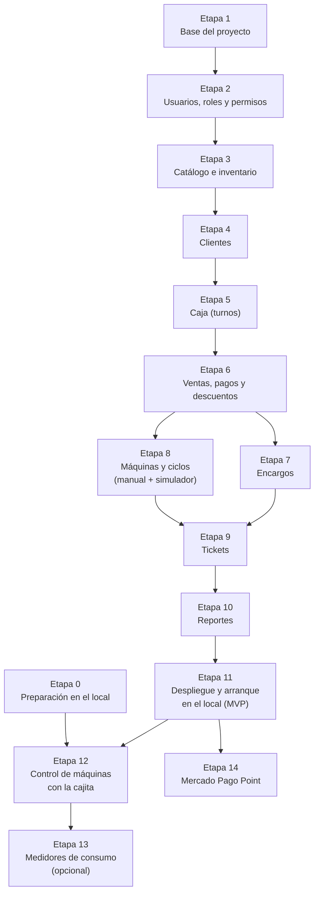

# Plan de implementación: Sistema de Gestión de Lavandería

> Basado en `mvp.md` · Última actualización: 2026-10-18

Este plan divide la construcción del sistema en **etapas** y cada etapa en **pasos pequeños**. Cada paso dice:

- **Qué se hace:** la tarea concreta.
- **Para qué:** por qué hace falta.
- **Listo cuando:** cómo comprobar que quedó bien.

Las casillas `[ ]` sirven para ir marcando el avance.

---

## Índice

- [Resumen de etapas](#resumen-de-etapas)
- [Forma de trabajo (aplica a todas las etapas)](#forma-de-trabajo-aplica-a-todas-las-etapas)
- [Etapa 0 – Preparación en el local](#etapa-0--preparación-en-el-local)
  - [0.1 Datos de la configuración de Aitare](#01-datos-de-la-configuración-de-aitare)
  - [0.2 Conexión física de los relés](#02-conexión-física-de-los-relés)
  - [0.3 Configuración actual de las máquinas](#03-configuración-actual-de-las-máquinas)
  - [0.4 Seguridad de las máquinas](#04-seguridad-de-las-máquinas)
  - [0.5 Material para la cajita](#05-material-para-la-cajita)
  - [0.6 Red WiFi del local](#06-red-wifi-del-local)
  - [0.7 Manual de la secadora](#07-manual-de-la-secadora)
  - [0.8 Caja: PC e impresora](#08-caja-pc-e-impresora)
  - [0.9 Cuentas externas](#09-cuentas-externas)
  - [0.10 (Opcional) Medidor de consumo de prueba](#010-opcional-medidor-de-consumo-de-prueba)
- [Etapa 1 – Base del proyecto](#etapa-1--base-del-proyecto)
  - [1.1 Estructura del repositorio](#11-estructura-del-repositorio)
  - [1.2 Proyecto Django](#12-proyecto-django)
  - [1.3 Apps de Django](#13-apps-de-django)
  - [1.4 Usuario personalizado](#14-usuario-personalizado)
  - [1.5 Docker para desarrollo](#15-docker-para-desarrollo)
  - [1.6 Celery](#16-celery)
  - [1.7 Django Admin con Unfold](#17-django-admin-con-unfold)
  - [1.8 API base](#18-api-base)
  - [1.9 Proyecto React](#19-proyecto-react)
  - [1.10 Cliente de la API generado](#110-cliente-de-la-api-generado)
  - [1.11 Pruebas y CI](#111-pruebas-y-ci)
- [Etapa 2 – Usuarios, roles y permisos](#etapa-2--usuarios-roles-y-permisos)
  - [2.1 Sucursal](#21-sucursal)
  - [2.2 Permisos personalizados](#22-permisos-personalizados)
  - [2.3 Roles](#23-roles)
  - [2.4 Permisos extra y bitácora](#24-permisos-extra-y-bitácora)
  - [2.5 Clase de permiso para la API](#25-clase-de-permiso-para-la-api)
  - [2.6 Endpoints de autenticación](#26-endpoints-de-autenticación)
  - [2.7 Usuarios en el admin](#27-usuarios-en-el-admin)
  - [2.8 Login en la caja](#28-login-en-la-caja)
- [Etapa 3 – Catálogo e inventario](#etapa-3--catálogo-e-inventario)
  - [3.1 Servicios y precios](#31-servicios-y-precios)
  - [3.2 Productos (insumos)](#32-productos-insumos)
  - [3.3 Consumo por carga](#33-consumo-por-carga)
  - [3.4 Movimientos de inventario](#34-movimientos-de-inventario)
  - [3.5 Alertas de stock](#35-alertas-de-stock)
  - [3.6 Pantallas de admin](#36-pantallas-de-admin)
- [Etapa 4 – Clientes](#etapa-4--clientes)
  - [4.1 Modelo Cliente](#41-modelo-cliente)
  - [4.2 API de clientes](#42-api-de-clientes)
  - [4.3 Búsqueda y alta rápida en la caja](#43-búsqueda-y-alta-rápida-en-la-caja)
- [Etapa 5 – Caja (turnos)](#etapa-5--caja-turnos)
  - [5.1 Modelo CorteCaja](#51-modelo-cortecaja)
  - [5.2 Abrir caja](#52-abrir-caja)
  - [5.3 Cerrar caja (corte)](#53-cerrar-caja-corte)
  - [5.4 Consulta de cortes](#54-consulta-de-cortes)
- [Etapa 6 – Ventas, pagos y descuentos](#etapa-6--ventas-pagos-y-descuentos)
  - [6.1 Modelos de venta](#61-modelos-de-venta)
  - [6.2 Pagos](#62-pagos)
  - [6.3 Regla de autoservicio](#63-regla-de-autoservicio)
  - [6.4 Descuentos](#64-descuentos)
  - [6.5 Cancelaciones](#65-cancelaciones)
  - [6.6 Pantalla de punto de venta](#66-pantalla-de-punto-de-venta)
- [Etapa 7 – Encargos](#etapa-7--encargos)
  - [7.1 Modelo Encargo](#71-modelo-encargo)
  - [7.2 Flujo de estados](#72-flujo-de-estados)
  - [7.3 Tablero de encargos](#73-tablero-de-encargos)
- [Etapa 8 – Máquinas y ciclos (modo manual y simulador)](#etapa-8--máquinas-y-ciclos-modo-manual-y-simulador)
  - [8.1 Modelos](#81-modelos)
  - [8.2 Ciclos generados por la venta](#82-ciclos-generados-por-la-venta)
  - [8.3 Interfaz MachineDriver](#83-interfaz-machinedriver)
  - [8.4 Driver manual](#84-driver-manual)
  - [8.5 Simulador](#85-simulador)
  - [8.6 Consumo de insumos](#86-consumo-de-insumos)
  - [8.7 Cierre por tiempo](#87-cierre-por-tiempo)
  - [8.8 Tablero de máquinas en la caja](#88-tablero-de-máquinas-en-la-caja)
- [Etapa 9 – Tickets](#etapa-9--tickets)
  - [9.1 Datos del ticket](#91-datos-del-ticket)
  - [9.2 Vista de impresión](#92-vista-de-impresión)
  - [9.3 Impresión y reimpresión](#93-impresión-y-reimpresión)
- [Etapa 10 – Reportes](#etapa-10--reportes)
  - [10.1 Indicadores del dashboard](#101-indicadores-del-dashboard)
  - [10.2 Consultas con filtros](#102-consultas-con-filtros)
  - [10.3 Endpoints de reportes](#103-endpoints-de-reportes)
- [Etapa 11 – Despliegue y arranque en el local (MVP)](#etapa-11--despliegue-y-arranque-en-el-local-mvp)
  - [11.1 Servidor](#111-servidor)
  - [11.2 Producción con Docker](#112-producción-con-docker)
  - [11.3 Respaldos](#113-respaldos)
  - [11.4 Despliegue automático](#114-despliegue-automático)
  - [11.5 Datos iniciales](#115-datos-iniciales)
  - [11.6 Capacitación](#116-capacitación)
  - [11.7 Periodo de prueba](#117-periodo-de-prueba)
- [Etapa 12 – Control de máquinas con la cajita](#etapa-12--control-de-máquinas-con-la-cajita)
  - [12.1 Broker MQTT](#121-broker-mqtt)
  - [12.2 Respaldo del programa de Aitare](#122-respaldo-del-programa-de-aitare)
  - [12.3 Identificar los pines de los relés](#123-identificar-los-pines-de-los-relés)
  - [12.4 Programa de la cajita](#124-programa-de-la-cajita)
  - [12.5 Prueba en mesa](#125-prueba-en-mesa)
  - [12.6 Escucha MQTT en el backend](#126-escucha-mqtt-en-el-backend)
  - [12.7 RelayBoardDriver](#127-relayboarddriver)
  - [12.8 Pantallas](#128-pantallas)
  - [12.9 Configurar una lavadora en modo de pago](#129-configurar-una-lavadora-en-modo-de-pago)
  - [12.10 Prueba real con una lavadora](#1210-prueba-real-con-una-lavadora)
  - [12.11 Extender a las 6 máquinas](#1211-extender-a-las-6-máquinas)
  - [12.12 Procedimiento de respaldo](#1212-procedimiento-de-respaldo)
  - [12.13 Observación](#1213-observación)
- [Etapa 13 – Medidores de consumo (opcional)](#etapa-13--medidores-de-consumo-opcional)
  - [13.1 Calibración](#131-calibración)
  - [13.2 Conexión](#132-conexión)
  - [13.3 Lógica de estados](#133-lógica-de-estados)
  - [13.4 Conciliación](#134-conciliación)
- [Etapa 14 – Mercado Pago Point](#etapa-14--mercado-pago-point)
  - [14.1 Vincular la terminal](#141-vincular-la-terminal)
  - [14.2 Integración](#142-integración)
  - [14.3 Respaldo](#143-respaldo)
- [Después del plan (Fase 3 en mvp.md)](#después-del-plan-fase-3-en-mvpmd)

---

## Resumen de etapas

| Etapa | Nombre                              | Fase en `mvp.md` |
|:-----:|-------------------------------------|:----------------:|
|   0   | Preparación en el local             |      Fase 0      |
| 1–11  | MVP operativo                       |      Fase 1      |
| 12–14 | Control de máquinas e integraciones |      Fase 2      |

La Etapa 0 se hace **en paralelo** con las Etapas 1 a 11: son tareas en el local que no bloquean el desarrollo. Solo la Etapa 12 necesita que la Etapa 0 esté terminada.

---

## Forma de trabajo (aplica a todas las etapas)

- [ ] **Una rama por etapa o funcionalidad** (p. ej. `feature/ventas`), con *pull request* hacia `main`.
  - *Para qué:* revisar cada cambio antes de mezclarlo y poder deshacerlo.
- [ ] **Pruebas automáticas** con `pytest` + `pytest-django` en el backend y `vitest` en el frontend. Cada regla de negocio importante (cobro, corte de caja, permisos, ciclos) lleva su prueba.
  - *Para qué:* que un cambio nuevo no rompa algo que ya funcionaba.
- [ ] **CI en GitHub Actions:** en cada *pull request* corren el lint (`ruff`, `eslint`) y las pruebas.
- [ ] **Migraciones de base de datos** siempre en el repositorio; nunca se edita la base a mano.
- [ ] **Secretos** (contraseñas, claves) solo en `.env`, que no se sube a git. En el repositorio va un `.env.example` sin valores reales.
- [ ] **Al cerrar cada etapa:** actualizar `mvp.md` si cambió alguna decisión.

---

## Etapa 0 – Preparación en el local

**Objetivo:** reunir los datos y el material para controlar las máquinas con la cajita, y dejar lista la caja (PC e impresora). **No bloquea** el desarrollo de las Etapas 1 a 11.

### 0.1 Datos de la configuración de Aitare
- [ ] **Qué se hace:** abrir ControlEquipos en la PC del negocio (aunque la cajita esté apagada) y tomar capturas de la configuración de **cada equipo**: pulso de arranque, duración del pulso (ms), número de pulsos, tiempo, costo y número de relé.
- **Para qué:** son los valores que la máquina espera recibir. Sin ellos no sabremos cuántos pulsos mandar.
- **Listo cuando:** hay una tabla con los 6 equipos y sus valores, guardada en `docs/`.

### 0.2 Conexión física de los relés
- [ ] **Qué se hace:** tomar una foto de cerca de los tornillos de un relé con su cable, y anotar a qué máquina va cada cable (relé 1 → Lavadora 1, etc.).
- **Para qué:** confirmar qué terminales usa (común y normalmente abierto) y el orden de los relés.
- **Listo cuando:** hay una tabla relé → máquina en `docs/`.

### 0.3 Configuración actual de las máquinas
- [ ] **Qué se hace:** entrar al menú de servicio de una lavadora (manual, págs. 23–26 del PDF) y anotar: *Product Type*, *Vend Type*, *Coin 1 Value*, precio de cada programa, *Coin Drop Type* y *Standby Return Time*.
- **Para qué:** saber cómo hay que dejarlas para que acepten los pulsos de la cajita.
- **Listo cuando:** los valores están anotados en `docs/`.

### 0.4 Seguridad de las máquinas
- [ ] **Qué se hace:** cambiar la contraseña de fábrica `3000` del menú de servicio de las 6 máquinas, si el menú lo permite. Guardar la nueva en un lugar seguro.
- **Para qué:** la contraseña de fábrica está publicada en el manual; con ella cualquiera puede pasar una máquina a modo libre.
- **Listo cuando:** la contraseña `3000` ya no funciona.

### 0.5 Material para la cajita
- [ ] **Qué se hace:** comprar un **adaptador USB-serie** de 3.3 V (CH340 o CP2102) y unos cables dupont hembra-hembra.
- **Para qué:** respaldar el programa de Aitare y cargar el nuestro en la placa.
- **Listo cuando:** se tiene el adaptador.

### 0.6 Red WiFi del local
- [ ] **Qué se hace:** confirmar que el router del local tiene una red de **2.4 GHz**, y anotar su nombre (SSID).
- **Para qué:** el chip de la cajita (ESP8266) no se conecta a redes de 5 GHz.
- **Listo cuando:** se sabe el nombre de la red de 2.4 GHz y la señal llega hasta la cajita (se puede comprobar con un celular junto a ella).

### 0.7 Manual de la secadora
- [ ] **Qué se hace:** conseguir el manual de la secadora `CDG27RUCNS`.
- **Para qué:** confirmar que su entrada de pago acepta pulsos igual que la lavadora.
- **Listo cuando:** el PDF está en `docs/` y está anotado cómo acepta el crédito.

### 0.8 Caja: PC e impresora
- [ ] **Qué se hace:** instalar el driver de la impresora **POS-8360** en la PC de caja, configurar papel de 80 mm e imprimir una página de prueba desde el navegador.
- **Para qué:** asegurar que el ticket se podrá imprimir desde el sistema web.
- **Listo cuando:** sale una impresión de prueba legible, sin márgenes raros.

### 0.9 Cuentas externas
- [ ] **Qué se hace:** crear una cuenta de desarrollador de **Mercado Pago** y revisar la API de Point. Enviar la consulta de información a LG.
- **Para qué:** dejar avanzados los trámites que tardan; no bloquean el MVP.
- **Listo cuando:** existe la cuenta de Mercado Pago y se envió la consulta a LG.

### 0.10 (Opcional) Medidor de consumo de prueba
- [ ] **Qué se hace:** comprar un Shelly Plus Plug US y conectarlo a una lavadora. Grabar desde su app el consumo durante un ciclo completo.
- **Para qué:** ver si se distinguen el inicio, el centrifugado y el fin del ciclo (Etapa 13).
- **Listo cuando:** hay una gráfica de consumo de un ciclo completo guardada.

---

## Etapa 1 – Base del proyecto

**Objetivo:** tener el esqueleto del sistema corriendo en una computadora de desarrollo con un solo comando.

### 1.1 Estructura del repositorio
- [ ] **Qué se hace:** crear las carpetas `backend/`, `frontend/`, `firmware/`, `mosquitto/` y `docs/`. Mover `lavadora.png`, `secadora.png` y el manual a `docs/`.
- **Para qué:** ordenar el proyecto como se definió en `mvp.md` §8.
- **Listo cuando:** la estructura existe y `mvp.md` sigue mostrando bien las imágenes (actualizar rutas).

### 1.2 Proyecto Django
- [ ] **Qué se hace:** crear el proyecto Django en `backend/` con la carpeta `config/` y los *settings* separados en `base.py`, `dev.py` y `prod.py`. Toda la configuración se lee de variables de entorno (`django-environ`).
- **Para qué:** usar la misma base en desarrollo y producción, cambiando solo el `.env`.
- **Listo cuando:** `python manage.py check` no da errores.

### 1.3 Apps de Django
- [ ] **Qué se hace:** crear las apps vacías `core`, `clientes`, `inventario`, `ventas` y `maquinas`.
- **Para qué:** separar el código por área, como en `mvp.md` §3.
- **Listo cuando:** las apps aparecen en `INSTALLED_APPS` y el proyecto arranca.

### 1.4 Usuario personalizado
- [ ] **Qué se hace:** crear el modelo `Usuario` en `core`, heredando de `AbstractUser`, **antes de la primera migración**. Agregar el campo `sucursal`.
- **Para qué:** Django no permite cambiar el modelo de usuario fácilmente después de la primera migración.
- **Listo cuando:** `AUTH_USER_MODEL = "core.Usuario"` y la primera migración se aplica.

### 1.5 Docker para desarrollo
- [ ] **Qué se hace:** escribir `backend/Dockerfile` y un `docker-compose.yml` con los servicios `db` (PostgreSQL 16), `redis`, `api` (Django), `worker` y `beat` (Celery) y `web` (React).
- **Para qué:** que cualquiera levante todo el sistema con `docker compose up`, sin instalar PostgreSQL ni Redis a mano.
- **Listo cuando:** `docker compose up` levanta todo y `http://localhost:8000/admin/` muestra el login.

### 1.6 Celery
- [ ] **Qué se hace:** configurar Celery con Redis como broker (`config/celery.py`) y crear una tarea de prueba.
- **Para qué:** las órdenes a las máquinas y los reintentos corren en segundo plano, sin trabar la caja.
- **Listo cuando:** la tarea de prueba se ejecuta y se ve en los logs del `worker`.

### 1.7 Django Admin con Unfold
- [ ] **Qué se hace:** instalar `django-unfold`, ponerlo en `INSTALLED_APPS` antes de `django.contrib.admin`, y configurar nombre, logo, colores e idioma español en `UNFOLD`.
- **Para qué:** tener desde el inicio el panel de administración con la imagen de la lavandería.
- **Listo cuando:** `/admin/` se ve con el tema de Unfold y en español.

### 1.8 API base
- [ ] **Qué se hace:** instalar Django REST Framework, `djangorestframework-simplejwt` y `drf-spectacular`. Publicar la documentación en `/api/docs/`.
- **Para qué:** la caja (React) y la futura app móvil hablan con el sistema por esta API.
- **Listo cuando:** `/api/docs/` muestra la documentación y `/api/auth/token/` entrega un token con un usuario de prueba.

### 1.9 Proyecto React
- [ ] **Qué se hace:** crear el proyecto con Vite + React + TypeScript en `frontend/`. Instalar la librería de componentes (MUI o shadcn/ui), TanStack Query y un enrutador.
- **Para qué:** base de la pantalla de caja.
- **Listo cuando:** `http://localhost:5173` muestra una página de inicio.

### 1.10 Cliente de la API generado
- [ ] **Qué se hace:** generar los tipos TypeScript a partir del OpenAPI (`openapi-typescript` o similar) con un script `npm run api:gen`.
- **Para qué:** que el frontend sepa exactamente qué datos manda y recibe cada endpoint, y avise si algo cambia.
- **Listo cuando:** el script genera los tipos sin errores.

### 1.11 Pruebas y CI
- [ ] **Qué se hace:** configurar `pytest`, `ruff`, `vitest` y `eslint`, y un *workflow* de GitHub Actions que los corra.
- **Para qué:** revisar la calidad en cada cambio.
- **Listo cuando:** un *pull request* de prueba muestra la revisión en verde.

**✅ Etapa 1 terminada cuando:** `docker compose up` levanta API, admin, worker y frontend, y la CI pasa.

---

## Etapa 2 – Usuarios, roles y permisos

**Objetivo:** que cada persona entre con su cuenta y solo pueda hacer lo que le corresponde (`mvp.md` §4, *Roles y permisos*).

### 2.1 Sucursal
- [ ] **Qué se hace:** crear el modelo `Sucursal` y una migración que cree la sucursal única.
- **Para qué:** casi todos los datos cuelgan de una sucursal; así queda listo si algún día se abre otra.
- **Listo cuando:** la sucursal aparece en el admin.

### 2.2 Permisos personalizados
- [ ] **Qué se hace:** definir los 15 códigos de permiso de la tabla de `mvp.md` (`ventas.cobrar`, `maquinas.activar`, …, `usuarios.gestionar`) como `Permission` de Django.
- **Para qué:** cada acción del sistema se protege con un permiso con nombre.
- **Listo cuando:** los permisos existen en la base de datos después de migrar.

### 2.3 Roles
- [ ] **Qué se hace:** crear con una migración los `Group` **Admin** (todos los permisos) y **Empleado** (los permisos por defecto de la tabla).
- **Para qué:** asignar un rol completo a un usuario con un solo clic.
- **Listo cuando:** un usuario del grupo Empleado tiene exactamente los 7 permisos por defecto.

### 2.4 Permisos extra y bitácora
- [ ] **Qué se hace:** permitir agregar permisos individuales a un empleado (`user_permissions`), **excepto** `usuarios.gestionar`. Crear el modelo `BitacoraPermiso` y registrar quién otorgó o quitó cada permiso.
- **Para qué:** que el admin delegue tareas sin convertir al empleado en admin, y que quede registro.
- **Listo cuando:** una prueba confirma que no se puede dar `usuarios.gestionar` a un empleado y que cada cambio queda en la bitácora.

### 2.5 Clase de permiso para la API
- [ ] **Qué se hace:** crear una clase de permiso de DRF, por ejemplo `TienePermiso("encargos.entregar_con_saldo")`, que se pone en cada endpoint.
- **Para qué:** que la validación ocurra siempre en el servidor, no solo escondiendo botones.
- **Listo cuando:** una prueba muestra que un empleado sin el permiso recibe error 403.

### 2.6 Endpoints de autenticación
- [ ] **Qué se hace:** `/api/auth/token/`, `/api/auth/refresh/` y `/api/auth/me/` (usuario actual + lista de permisos efectivos).
- **Para qué:** que la caja sepa quién está conectado y qué botones mostrar.
- **Listo cuando:** `/api/auth/me/` devuelve los permisos correctos para un admin y para un empleado.

### 2.7 Usuarios en el admin
- [ ] **Qué se hace:** pantalla de usuario en Unfold con rol, estado (activo / inactivo) y casillas de permisos extra. Los usuarios no se borran, se desactivan.
- **Para qué:** que el admin gestione al personal sin tocar código.
- **Listo cuando:** se puede crear un empleado, darle un permiso extra y desactivarlo.

### 2.8 Login en la caja
- [ ] **Qué se hace:** pantalla de inicio de sesión en React, guardado del token y renovación automática; cierre de sesión.
- **Para qué:** que cada empleado entre con su cuenta en la PC de caja.
- **Listo cuando:** un empleado entra, ve su nombre y, al cerrar sesión, vuelve al login.

**✅ Etapa 2 terminada cuando:** un admin y un empleado entran, cada uno ve solo lo suyo y las pruebas de permisos pasan.

---

## Etapa 3 – Catálogo e inventario

**Objetivo:** dar de alta qué se vende, a qué precio, y qué insumos se gastan.

### 3.1 Servicios y precios
- [ ] **Qué se hace:** crear los modelos `Servicio` y `PrecioServicio` (precio por modalidad: autoservicio / encargo; campo `programa` opcional para el futuro).
- **Para qué:** tener precios distintos para autoservicio y encargo, y poder agregar servicios nuevos (p. ej. lavado de tenis) sin programar.
- **Listo cuando:** en el admin se dan de alta "Lavado por carga" y "Secado por carga" con sus dos precios.

### 3.2 Productos (insumos)
- [ ] **Qué se hace:** crear el modelo `Producto` (detergente, suavizante, bolsas) con stock actual, stock mínimo y si se vende o no.
- **Para qué:** controlar cuánto insumo hay.
- **Listo cuando:** existen detergente y suavizante con `se_vende = false`.

### 3.3 Consumo por carga
- [ ] **Qué se hace:** crear `ConsumoPorCarga` (servicio + producto + cantidad) y cargar 150–200 ml de detergente y de suavizante para "Lavado por carga".
- **Para qué:** que el sistema descuente insumos automáticamente en cada lavado (se usa en la Etapa 8).
- **Listo cuando:** el consumo se puede editar desde el admin.

### 3.4 Movimientos de inventario
- [ ] **Qué se hace:** crear `MovimientoInventario` (entrada, consumo, venta, ajuste) y la regla de que cada movimiento actualiza `stock_actual`. Los ajustes requieren `inventario.ajustar`.
- **Para qué:** tener el historial de por qué cambió el stock.
- **Listo cuando:** registrar una entrada de 5 L sube el stock en 5000 ml, con prueba automática.

### 3.5 Alertas de stock
- [ ] **Qué se hace:** endpoint `/api/productos/alertas-stock/` y un filtro en el admin con los productos por debajo del mínimo.
- **Para qué:** avisar antes de quedarse sin detergente.
- **Listo cuando:** al bajar el stock del mínimo, el producto aparece en la alerta.

### 3.6 Pantallas de admin
- [ ] **Qué se hace:** configurar en Unfold las secciones *Catálogo* (servicios, precios) e *Inventario* (productos, movimientos, consumo por carga), con filtros y búsqueda.
- **Para qué:** que el admin mantenga el catálogo sin ayuda técnica.
- **Listo cuando:** se puede cambiar un precio desde el admin y la API devuelve el nuevo.

**✅ Etapa 3 terminada cuando:** el catálogo y el inventario se administran desde el admin y la API los expone.

---

## Etapa 4 – Clientes

**Objetivo:** registrar clientes rápido desde la caja.

### 4.1 Modelo Cliente
- [ ] **Qué se hace:** crear `Cliente` con nombre y teléfono obligatorios (teléfono único por sucursal); dirección, correo y notas opcionales.
- **Listo cuando:** no se puede crear un cliente sin teléfono ni repetir un teléfono.

### 4.2 API de clientes
- [ ] **Qué se hace:** `/api/clientes/` con alta, edición y **búsqueda por teléfono o nombre**.
- **Para qué:** en caja se busca al cliente por teléfono mientras se le atiende.
- **Listo cuando:** buscar los últimos dígitos del teléfono encuentra al cliente.

### 4.3 Búsqueda y alta rápida en la caja
- [ ] **Qué se hace:** un buscador en React que, si no encuentra el teléfono, ofrece dar de alta al cliente ahí mismo.
- **Listo cuando:** se registra un cliente nuevo en menos de 15 segundos sin salir de la venta.

**✅ Etapa 4 terminada cuando:** se pueden buscar y registrar clientes desde la caja.

---

## Etapa 5 – Caja (turnos)

**Objetivo:** que cada empleado abra y cierre su caja, y que el efectivo cuadre.

### 5.1 Modelo CorteCaja
- [ ] **Qué se hace:** crear `CorteCaja` (apertura, fondo inicial, cierre, efectivo esperado, efectivo contado, diferencia, total de tarjeta, número de ventas y cancelaciones).
- **Listo cuando:** el modelo está migrado y visible (solo lectura) en el admin.

### 5.2 Abrir caja
- [ ] **Qué se hace:** endpoint y pantalla para abrir caja con el fondo inicial. Un empleado no puede tener dos cajas abiertas.
- **Para qué:** cada venta queda ligada al turno de quien la cobró.
- **Listo cuando:** sin caja abierta, la pantalla de venta no deja cobrar.

### 5.3 Cerrar caja (corte)
- [ ] **Qué se hace:** el empleado captura el efectivo contado y el sistema calcula: efectivo esperado = fondo + pagos en efectivo del turno − cancelaciones; diferencia = contado − esperado; total de tarjeta para cuadrar contra Mercado Pago Point.
- **Para qué:** detectar faltantes o sobrantes por turno.
- **Listo cuando:** una prueba con ventas en efectivo, tarjeta y una cancelación da el esperado correcto.

### 5.4 Consulta de cortes
- [ ] **Qué se hace:** el empleado ve solo su corte actual; quien tenga `caja.ver_todos` ve todos los cortes en el admin.
- **Listo cuando:** un empleado no puede ver cortes de otros (prueba 403).

**✅ Etapa 5 terminada cuando:** se abre caja, se cobra (en la siguiente etapa) y el corte cuadra.

---

## Etapa 6 – Ventas, pagos y descuentos

**Objetivo:** cobrar en la caja.

### 6.1 Modelos de venta
- [ ] **Qué se hace:** crear `Venta` (modalidad, estado, subtotal, descuento, total, saldo, turno) y `DetalleVenta` (servicio o producto, cantidad, precio unitario copiado del catálogo).
- **Para qué:** que el precio cobrado no cambie aunque después se modifique el catálogo.
- **Listo cuando:** crear una venta de 3 cargas de lavado en autoservicio calcula el total con el precio de autoservicio.

### 6.2 Pagos
- [ ] **Qué se hace:** crear `Pago` (efectivo, tarjeta de crédito, tarjeta de débito; monto; referencia del voucher). Una venta puede tener varios pagos; el saldo y el estado se recalculan solos (`pendiente_pago`, `pago_parcial`, `pagada`).
- **Para qué:** permitir anticipos en encargos y pagos mixtos.
- **Listo cuando:** dos pagos parciales dejan la venta en `pagada` con saldo 0.

### 6.3 Regla de autoservicio
- [ ] **Qué se hace:** en autoservicio la venta debe quedar pagada completa antes de poder activar máquinas.
- **Listo cuando:** una prueba confirma que no se puede activar una máquina con saldo pendiente en autoservicio.

### 6.4 Descuentos
- [ ] **Qué se hace:** crear `Descuento` (porcentaje o monto fijo, vigencia, modalidad, servicios) y `DescuentoAplicado`. La API solo ofrece al empleado los descuentos vigentes que aplican a esa venta; crearlos requiere `descuentos.gestionar`.
- **Para qué:** que el empleado solo use descuentos autorizados.
- **Listo cuando:** un descuento vencido o de otra modalidad no aparece ni se puede aplicar.

### 6.5 Cancelaciones
- [ ] **Qué se hace:** cancelar una venta con motivo obligatorio; queda quién, cuándo y por qué. Los pagos en efectivo cancelados se descuentan del corte.
- **Listo cuando:** cancelar sin motivo da error, y el corte refleja la cancelación.

### 6.6 Pantalla de punto de venta
- [ ] **Qué se hace:** pantalla en React: elegir modalidad → (cliente) → agregar servicios y cantidades → aplicar descuento → cobrar (efectivo con cálculo de cambio, o tarjeta con referencia del voucher).
- **Para qué:** es la pantalla que más se usará; tiene que ser rápida.
- **Listo cuando:** se cobra una venta de autoservicio en pocos clics y aparece en el corte del turno.

**✅ Etapa 6 terminada cuando:** se cobran ventas en efectivo y tarjeta, con y sin descuento, y se pueden cancelar.

---

## Etapa 7 – Encargos

**Objetivo:** recibir ropa, darle seguimiento y entregarla.

### 7.1 Modelo Encargo
- [ ] **Qué se hace:** crear `Encargo` (ligado 1:1 a una venta de modalidad encargo), con estado (recibido, en proceso, listo, entregado) y fecha promesa. En encargo el cliente es obligatorio.
- **Listo cuando:** no se puede crear un encargo sin cliente.

### 7.2 Flujo de estados
- [ ] **Qué se hace:** endpoints para cambiar de estado. Entregar con saldo pendiente requiere `encargos.entregar_con_saldo`.
- **Para qué:** no entregar ropa sin cobrar, salvo autorización.
- **Listo cuando:** un empleado sin permiso no puede entregar con saldo (prueba 403).

### 7.3 Tablero de encargos
- [ ] **Qué se hace:** pantalla en React con columnas *Pendiente / Listo / Entregado*, búsqueda por cliente o folio y cobro del saldo al entregar.
- **Listo cuando:** se recibe un encargo con anticipo, se marca listo y se entrega cobrando el resto.

**✅ Etapa 7 terminada cuando:** un encargo completo (recibir → lavar → listo → cobrar saldo → entregar) funciona de principio a fin.

---

## Etapa 8 – Máquinas y ciclos (modo manual y simulador)

**Objetivo:** registrar cada uso de máquina ligado a la venta, sin depender todavía de la cajita.

### 8.1 Modelos
- [ ] **Qué se hace:** crear `Controlador`, `Maquina` (con canal de relé y pulsos, aunque aún no se usen) y `CicloUso` con sus estados (`pendiente_asignar`, `solicitado`, `credito_enviado`, `en_curso`, `terminado`, `fallido`, `cancelado`) y la marca `manual`.
- **Listo cuando:** las 4 lavadoras y 2 secadoras están dadas de alta en el admin.

### 8.2 Ciclos generados por la venta
- [ ] **Qué se hace:** al cobrar, cada carga de un servicio que usa máquina crea un `CicloUso` (3 cargas → 3 ciclos). En encargo quedan `pendiente_asignar`.
- **Para qué:** poder cuadrar ventas contra usos reales.
- **Listo cuando:** una venta de 2 lavados y 1 secado crea 3 ciclos (prueba).

### 8.3 Interfaz MachineDriver
- [ ] **Qué se hace:** definir la interfaz `MachineDriver` (`get_status`, `start_cycle`, `stop_cycle`) y un registro que elige el driver según `Maquina.driver`.
- **Para qué:** que ventas y ciclos no sepan qué tecnología controla la máquina; en la Etapa 12 solo se agrega otro driver.
- **Listo cuando:** existe la interfaz y una prueba que usa un driver falso.

### 8.4 Driver manual
- [ ] **Qué se hace:** `ManualDriver`: al activar, marca el ciclo como `manual` y `en_curso`; el empleado presiona Start en la máquina (modo PUSH).
- **Para qué:** es como operan hoy y es el respaldo permanente si falla la cajita.
- **Listo cuando:** activar una máquina en modo manual deja el ciclo en curso.

### 8.5 Simulador
- [ ] **Qué se hace:** `SimulatorDriver`: imita a la cajita, con confirmación tras unos segundos o falla al azar (configurable). Corre en una tarea de Celery.
- **Para qué:** construir y probar las pantallas de máquinas sin tener la cajita conectada.
- **Listo cuando:** se ve el paso `solicitado` → `credito_enviado` y, a veces, `fallido`.

### 8.6 Consumo de insumos
- [ ] **Qué se hace:** al iniciar un ciclo de lavado sin `insumos_cliente`, crear los movimientos de consumo según `ConsumoPorCarga`.
- **Listo cuando:** un lavado baja 150–200 ml de detergente y de suavizante; con `insumos_cliente` no baja nada.

### 8.7 Cierre por tiempo
- [ ] **Qué se hace:** tarea periódica (Celery Beat) que pasa a `terminado` los ciclos que superen la duración esperada del programa.
- **Para qué:** que no queden ciclos "en curso" para siempre cuando no hay medidor.
- **Listo cuando:** un ciclo viejo se cierra solo.

### 8.8 Tablero de máquinas en la caja
- [ ] **Qué se hace:** pantalla con las 6 máquinas (libre, en uso, fuera de servicio), el botón **"Activar"** junto a cada ciclo pendiente y los avisos ("Crédito enviado: presiona Start", "Sin respuesta: usa modo manual").
- **Listo cuando:** se cobra, se activa una máquina y el tablero la muestra en uso.

**✅ Etapa 8 terminada cuando:** cada venta genera sus ciclos, se activan en modo manual o simulado y el inventario se descuenta.

---

## Etapa 9 – Tickets

**Objetivo:** imprimir el comprobante del cliente (`mvp.md` §4, *Ticket*).

### 9.1 Datos del ticket
- [ ] **Qué se hace:** endpoint `/api/ventas/{id}/ticket/` que devuelve todo calculado: encabezado, líneas, línea de promoción de detergente (siempre que haya lavado), totales, pagos, cambio, saldo y fecha de entrega.
- **Para qué:** que el formato no dependa de cálculos en el navegador y sirva después para WhatsApp o PDF.
- **Listo cuando:** una prueba compara el resultado con un ticket esperado.

### 9.2 Vista de impresión
- [ ] **Qué se hace:** componente React con estilos `@media print` para papel de 80 mm (~48 caracteres por línea).
- **Listo cuando:** la vista previa del navegador se ve como el ejemplo de `mvp.md`.

### 9.3 Impresión y reimpresión
- [ ] **Qué se hace:** imprimir automáticamente al cobrar, al recibir un encargo y al entregarlo; botón de reimpresión en el historial.
- **Listo cuando:** sale el ticket en la POS-8360 de la caja.

**✅ Etapa 9 terminada cuando:** cada venta imprime un ticket correcto en la impresora real.

---

## Etapa 10 – Reportes

**Objetivo:** que el admin vea cómo va el negocio desde el dashboard de Unfold.

### 10.1 Indicadores del dashboard
- [ ] **Qué se hace:** tarjetas y gráficas en la página de inicio del admin: ventas del día (efectivo / tarjeta), cargas por máquina, encargos pendientes y listos, stock bajo, diferencias de caja, cancelaciones y descuentos por empleado.
- **Listo cuando:** los números coinciden con los datos de prueba.

### 10.2 Consultas con filtros
- [ ] **Qué se hace:** listas de ventas, ciclos y cortes en el admin con filtros por fecha, empleado, modalidad, método de pago y máquina. Todo de solo lectura.
- **Listo cuando:** se puede ver, por ejemplo, "ventas en tarjeta de la semana pasada de un empleado".

### 10.3 Endpoints de reportes
- [ ] **Qué se hace:** `/api/reportes/ventas-diarias/`, `/uso-maquinas/` e `/inventario/`, protegidos con `reportes.ver`.
- **Listo cuando:** devuelven los mismos números que el dashboard.

**✅ Etapa 10 terminada cuando:** el admin puede revisar el día y el mes sin pedir ayuda.

---

## Etapa 11 – Despliegue y arranque en el local (MVP)

**Objetivo:** poner el sistema en internet y empezar a usarlo en la lavandería, con las máquinas en **modo manual**.

### 11.1 Servidor
- [ ] **Qué se hace:** crear una VM (AWS Lightsail/EC2), instalar Docker, configurar firewall (solo puertos 80, 443 y SSH) y un dominio.
- **Listo cuando:** se entra por SSH y el dominio apunta a la VM.

### 11.2 Producción con Docker
- [ ] **Qué se hace:** `docker-compose.prod.yml` con Caddy (HTTPS automático), API, worker, beat, PostgreSQL, Redis y el frontend compilado. Variables en `.env` del servidor.
- **Listo cuando:** `https://<dominio>/` abre la caja y `/admin/` el panel, con candado HTTPS.

### 11.3 Respaldos
- [ ] **Qué se hace:** respaldo diario automático de PostgreSQL a S3 (o similar), conservando al menos 30 días, y **probar una restauración**.
- **Para qué:** un respaldo que nunca se ha restaurado no garantiza nada.
- **Listo cuando:** se restauró un respaldo en una base de prueba y los datos están completos.

### 11.4 Despliegue automático
- [ ] **Qué se hace:** *workflow* que, al mezclar a `main`, construye las imágenes y actualiza el servidor.
- **Listo cuando:** un cambio pequeño llega a producción sin entrar al servidor a mano.

### 11.5 Datos iniciales
- [ ] **Qué se hace:** cargar en producción la sucursal, las 6 máquinas (driver manual), servicios y precios reales, insumos con su stock, descuentos vigentes y las cuentas de cada empleado.
- **Listo cuando:** el admin revisó y aprobó el catálogo y los precios.

### 11.6 Capacitación
- [ ] **Qué se hace:** una sesión con los empleados: entrar, abrir caja, cobrar, encargos, activar máquinas (manual), ticket y corte. Una hoja de ayuda impresa de una página.
- **Listo cuando:** cada empleado hizo una venta y un corte de práctica.

### 11.7 Periodo de prueba
- [ ] **Qué se hace:** usar el sistema 1 o 2 semanas en paralelo con la forma actual (o con respaldo en papel), revisar cada corte y anotar problemas.
- **Listo cuando:** una semana completa sin diferencias de caja inexplicables ni errores bloqueantes.

**✅ Etapa 11 terminada cuando:** el negocio opera con el sistema todos los días (con máquinas en modo manual). **Este es el MVP en producción.**

---

## Etapa 12 – Control de máquinas con la cajita

**Objetivo:** que al activar una máquina desde la caja, la cajita le dé el crédito por cable (`mvp.md` §5).

> **Requiere:** Etapa 0 terminada (pasos 0.1, 0.2, 0.3, 0.5 y 0.6).
> **Precaución:** durante las pruebas en mesa, **desconectar los 6 cables de las máquinas** de la cajita (o dejar las máquinas en modo PUSH) para no regalar créditos por accidente.

### 12.1 Broker MQTT
- [ ] **Qué se hace:** agregar el servicio `mqtt` (Mosquitto) al docker compose, con TLS en el puerto 8883, usuario y contraseña por dispositivo y permisos por tema (`acl`): la cajita solo lee `lavanderia/<id>/cmd` y escribe en `lavanderia/<id>/ack` y `.../estado`; el backend publica órdenes.
- **Para qué:** el punto de encuentro entre el servidor y la cajita, sin abrir puertos en el local.
- **Listo cuando:** con un cliente de prueba (`mosquitto_pub` / `mosquitto_sub`) se publica y recibe un mensaje con TLS, y un usuario no autorizado es rechazado.
- **Nota:** el ESP8266 valida el certificado por su "huella" (*fingerprint*). Si el certificado se renueva (Let's Encrypt, cada 90 días), hay que actualizar la huella en la cajita. Se puede decidir entre un certificado de larga duración solo para MQTT o automatizar la actualización.

### 12.2 Respaldo del programa de Aitare
- [ ] **Qué se hace:** con la cajita desconectada de las máquinas, conectar el adaptador USB-serie a los pines `TXD`, `RXD`, `GND` (cruzados: TX→RXD, RX→TXD), poner `IO0` a tierra al encender para entrar en modo de carga, y leer toda la memoria con `esptool.py read_flash 0 0x400000 aitare_backup.bin`.
- **Para qué:** poder volver al sistema de Aitare si algo sale mal.
- **Listo cuando:** existe `firmware/aitare_backup.bin` (unos 4 MB) guardado en dos lugares (no en git).

### 12.3 Identificar los pines de los relés
- [ ] **Qué se hace:** averiguar qué pin del ESP8266 controla cada relé, siguiendo las pistas de la placa o con un programa de prueba que active los pines uno por uno mientras se escucha el clic de cada relé.
- **Para qué:** el programa necesita saber qué pin mueve qué relé.
- **Listo cuando:** hay una tabla pin → relé → máquina en `firmware/README.md`.

### 12.4 Programa de la cajita
- [ ] **Qué se hace:** escribir el programa (ESPHome en YAML, o firmware propio) que:
  1. se conecta al WiFi de 2.4 GHz y a Mosquitto con TLS;
  2. se suscribe a `lavanderia/<id>/cmd`;
  3. al recibir `{"id", "canal", "pulsos", "ancho_ms", "pausa_ms"}`, cierra el relé indicado esa cantidad de veces;
  4. **recuerda los últimos `id`** y no repite pulsos si llega la misma orden;
  5. responde en `lavanderia/<id>/ack` con `{"id", "ok"}`;
  6. publica `en línea` al conectarse y deja como "última voluntad" `fuera de línea`;
  7. se reconecta solo si se cae el WiFi o el broker.
- **Listo cuando:** el código está en `firmware/` y compila.

### 12.5 Prueba en mesa
- [ ] **Qué se hace:** cargar el programa en la placa (aún desconectada de las máquinas) y, desde `mosquitto_pub`, mandar órdenes a cada relé. Probar: pulsos correctos, orden repetida (no debe repetir pulsos), desconexión de WiFi y reconexión.
- **Listo cuando:** cada relé hace exactamente los clics pedidos y el `ack` llega; al desconectar la placa aparece "fuera de línea".

### 12.6 Escucha MQTT en el backend
- [ ] **Qué se hace:** servicio `mqtt-listener` (comando de Django siempre encendido) que recibe `ack` y `estado` y actualiza `CicloUso` (`credito_enviado`), `Controlador` (`en_linea`, `ultima_conexion`) y guarda la respuesta en `respuesta_driver`.
- **Listo cuando:** un `ack` enviado a mano cambia el ciclo a `credito_enviado`.

### 12.7 RelayBoardDriver
- [ ] **Qué se hace:** implementar `RelayBoardDriver.start_cycle`: publica la orden con el `id` del ciclo y los pulsos de la máquina; si en 10 s no llega el `ack`, el ciclo pasa a `fallido` y la caja muestra "usa modo manual".
- **Listo cuando:** las pruebas cubren éxito, sin respuesta y orden repetida.

### 12.8 Pantallas
- [ ] **Qué se hace:** en la caja, indicador "Cajita en línea / fuera de línea". En el admin, alta del `Controlador` (genera su usuario MQTT), configuración de relé y pulsos por máquina y acción **"Enviar pulso de prueba"** (`maquinas.gestionar`).
- **Listo cuando:** desde el admin se envía un pulso de prueba y se escucha el relé.

### 12.9 Configurar una lavadora en modo de pago
- [ ] **Qué se hace:** en una lavadora: `Product Type = PAY`, `Vend Type = Coin`, `Coin Drop Type` igual al ancho de pulso, precio y `Coin 1 Value` según los valores de Aitare (paso 0.1). Anotar la configuración.
- **Listo cuando:** la máquina muestra el precio en lugar de *PUSH*.

### 12.10 Prueba real con una lavadora
- [ ] **Qué se hace:** conectar el cable de esa lavadora a la cajita, cambiar su `Maquina.driver` a `relay_board` y hacer ventas reales de prueba desde la caja.
- **Listo cuando:** en 10 ventas seguidas la lavadora recibe el crédito, pita y arranca con Start, sin pulsos de más ni de menos.

### 12.11 Extender a las 6 máquinas
- [ ] **Qué se hace:** repetir 12.9 y 12.10 con las otras 3 lavadoras y las 2 secadoras (según su manual).
- **Listo cuando:** las 6 máquinas funcionan desde la caja.

### 12.12 Procedimiento de respaldo
- [ ] **Qué se hace:** documentar en una hoja impresa cómo pasar una máquina a modo PUSH y registrar la venta en modo manual si falla la cajita o internet.
- **Listo cuando:** un empleado lo practicó una vez.

### 12.13 Observación
- [ ] **Qué se hace:** 2 semanas revisando la bitácora de órdenes, ciclos fallidos y desconexiones de la cajita.
- **Listo cuando:** la tasa de fallos es aceptable. Si la señal del ESP8266 da problemas, cambiar la placa por una **ESP32 de 8 relés con antena externa** y repetir 12.3–12.5.

**✅ Etapa 12 terminada cuando:** las 6 máquinas se activan desde la caja y solo arrancan después de cobrar.

---

## Etapa 13 – Medidores de consumo (opcional)

**Objetivo:** saber si cada máquina realmente arrancó y cuándo terminó, y detectar centrifugados débiles.

### 13.1 Calibración
- [ ] **Qué se hace:** con la gráfica del paso 0.10, definir los umbrales de "trabajando" y "terminado" para lavadoras y secadoras.

### 13.2 Conexión
- [ ] **Qué se hace:** instalar un Shelly por máquina, configurarlo para publicar en Mosquitto con su propio usuario, y asociarlo a la máquina (`Maquina.medidor_id`).

### 13.3 Lógica de estados
- [ ] **Qué se hace:** en la escucha MQTT, pasar el ciclo a `en_curso` cuando el consumo sube y a `terminado` cuando baja; marcar el ciclo si no hubo pico de centrifugado.
- **Listo cuando:** en el tablero las máquinas cambian solas a "en uso" y "libre".

### 13.4 Conciliación
- [ ] **Qué se hace:** reporte de ciclos detectados por el medidor que no tienen venta (posibles usos sin cobrar).

---

## Etapa 14 – Mercado Pago Point

**Objetivo:** que el cobro con tarjeta se mande a la terminal desde la caja, sin teclear montos ni referencias.

### 14.1 Vincular la terminal
- [ ] **Qué se hace:** con la cuenta de desarrollador (paso 0.9), vincular la terminal Point y obtener las credenciales de producción.

### 14.2 Integración
- [ ] **Qué se hace:** al elegir "tarjeta", crear la intención de pago en la terminal desde el backend; recibir la confirmación por webhook y registrar el `Pago` con su `mp_payment_intent_id`.
- **Listo cuando:** un cobro con tarjeta se completa sin capturar la referencia a mano.

### 14.3 Respaldo
- [ ] **Qué se hace:** si la integración falla, permitir la captura manual de la referencia, como en el MVP.

---

## Después del plan (Fase 3 en `mvp.md`)

No forman parte de este plan; se planean cuando el sistema esté estable:
- App móvil y activación por el propio cliente con pago en línea.
- Notificaciones por WhatsApp/SMS.
- Precios por programa o por tiempo de secado.
- Autorización remota de acciones reservadas y verificación en dos pasos.
- Permisos temporales y roles personalizados.
- Integración con la API de LG, si LG da acceso.
- Facturación CFDI, multisucursal y lealtad, si se necesitan.
