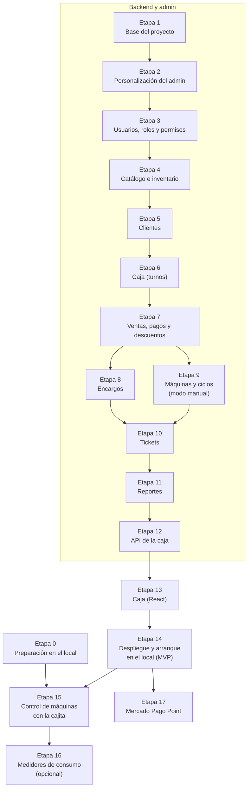

# Plan de implementación: Sistema de Gestión de Lavandería

> Basado en `mvp.md` · Última actualización: 2026-10-22

Este plan divide la construcción del sistema en **etapas** y cada etapa en **pasos pequeños**. Cada paso dice:

- **Qué se hace:** la tarea concreta.
- **Para qué:** por qué hace falta.
- **Listo cuando:** cómo comprobar que quedó bien.

Las casillas `[ ]` sirven para ir marcando el avance. Las reglas de trabajo (ramas, pruebas, migraciones, secretos, mínimo indispensable, riesgos y pendientes) están en `CLAUDE.md`.

---

## Índice

- [Resumen de etapas](#resumen-de-etapas)
- [Etapa 0 – Preparación en el local](#etapa-0--preparación-en-el-local)
- [Etapa 1 – Base del proyecto](#etapa-1--base-del-proyecto)
- [Etapa 2 – Personalización del admin (Unfold)](#etapa-2--personalización-del-admin-unfold)
- [Etapa 3 – Usuarios, roles y permisos](#etapa-3--usuarios-roles-y-permisos)
- [Etapa 4 – Catálogo e inventario](#etapa-4--catálogo-e-inventario)
- [Etapa 5 – Clientes](#etapa-5--clientes)
- [Etapa 6 – Caja (turnos)](#etapa-6--caja-turnos)
- [Etapa 7 – Ventas, pagos y descuentos](#etapa-7--ventas-pagos-y-descuentos)
- [Etapa 8 – Encargos](#etapa-8--encargos)
- [Etapa 9 – Máquinas y ciclos (modo manual)](#etapa-9--máquinas-y-ciclos-modo-manual)
- [Etapa 10 – Tickets](#etapa-10--tickets)
- [Etapa 11 – Reportes](#etapa-11--reportes)
- [Etapa 12 – API de la caja](#etapa-12--api-de-la-caja)
- [Etapa 13 – Caja (React)](#etapa-13--caja-react)
- [Etapa 14 – Despliegue y arranque en el local (MVP)](#etapa-14--despliegue-y-arranque-en-el-local-mvp)
- [Etapa 15 – Control de máquinas con la cajita](#etapa-15--control-de-máquinas-con-la-cajita)
- [Etapa 16 – Medidores de consumo (opcional)](#etapa-16--medidores-de-consumo-opcional)
- [Etapa 17 – Mercado Pago Point](#etapa-17--mercado-pago-point)
- [Después del plan (Fase 3 en mvp.md)](#después-del-plan-fase-3-en-mvpmd)

---

## Resumen de etapas

| Etapa | Nombre                                          | Fase en `mvp.md` |
|:-----:|-------------------------------------------------|:----------------:|
|   0   | Preparación en el local                         |      Fase 0      |
| 1–11  | Backend y admin (modelos, reglas y Unfold)      |      Fase 1      |
|  12   | API de la caja                                  |      Fase 1      |
|  13   | Caja (React)                                    |      Fase 1      |
|  14   | Despliegue y arranque en el local (MVP)         |      Fase 1      |
| 15–17 | Control de máquinas e integraciones             |      Fase 2      |

Primero se construyen el **backend y el admin** (Etapas 1 a 11): todas las reglas de negocio, probadas sin HTTP, y las pantallas de administración con Unfold. Después, la **API de la caja** (Etapa 12) expone esas reglas, y la **caja en React** (Etapa 13) usa esa API ya probada.

La Etapa 0 se hace **en paralelo** con las Etapas 1 a 13: son tareas en el local que no bloquean el desarrollo. Solo la Etapa 15 necesita que la Etapa 0 esté terminada.

---

## Etapa 0 – Preparación en el local

**Objetivo:** reunir los datos y el material para controlar las máquinas con la cajita, y dejar lista la caja (PC e impresora). Se hace en paralelo y **no bloquea** el desarrollo; solo la Etapa 15 la necesita terminada.

### 0.1 Datos de la configuración de Aitare
- [ ] **Qué se hace:** abrir ControlEquipos en la PC del negocio (aunque la cajita esté apagada) y tomar capturas de la configuración de **cada equipo**: pulso de arranque, duración del pulso (ms), número de pulsos, tiempo, costo y número de relé.
- **Para qué:** son los valores que la máquina espera recibir. Sin ellos no sabremos cuántos pulsos mandar.
- **Listo cuando:** hay una tabla con los 6 equipos y sus valores, guardada en `docs/`.

### 0.2 Conexión física de los relés
- [ ] **Qué se hace:** tomar una foto de cerca de los tornillos de un relé con su cable, y anotar a qué máquina va cada cable (relé 1 → Lavadora 1, etc.).
- **Para qué:** confirmar qué terminales usa (común y normalmente abierto) y el orden de los relés.
- **Listo cuando:** hay una tabla relé → máquina en `docs/`.

### 0.3 Configuración actual de las máquinas
- [ ] **Qué se hace:** entrar al menú de servicio de una lavadora (manual, págs. 23–26 del PDF) y anotar: *Product Type*, *Vend Type*, *Coin 1 Value*, precio de cada programa, *Coin Drop Type* y *Standby Return Time*.
- **Para qué:** saber cómo hay que dejarlas para que acepten los pulsos de la cajita.
- **Listo cuando:** los valores están anotados en `docs/`.

### 0.4 Seguridad de las máquinas
- [ ] **Qué se hace:** cambiar la contraseña de fábrica `3000` del menú de servicio de las 6 máquinas, si el menú lo permite. Guardar la nueva en un lugar seguro.
- **Para qué:** la contraseña de fábrica está publicada en el manual; con ella cualquiera puede pasar una máquina a modo libre.
- **Listo cuando:** la contraseña `3000` ya no funciona.

### 0.5 Material para la cajita
- [ ] **Qué se hace:** comprar un **adaptador USB-serie** de 3.3 V (CH340 o CP2102) y unos cables dupont hembra-hembra.
- **Para qué:** respaldar el programa de Aitare y cargar el nuestro en la placa.
- **Listo cuando:** se tiene el adaptador.

### 0.6 Red WiFi del local
- [ ] **Qué se hace:** confirmar que el router del local tiene una red de **2.4 GHz**, y anotar su nombre (SSID).
- **Para qué:** el chip de la cajita (ESP8266) no se conecta a redes de 5 GHz.
- **Listo cuando:** se sabe el nombre de la red de 2.4 GHz y la señal llega hasta la cajita (se puede comprobar con un celular junto a ella).

### 0.7 Manual de la secadora
- [ ] **Qué se hace:** conseguir el manual de la secadora `CDG27RUCNS`.
- **Para qué:** confirmar que su entrada de pago acepta pulsos igual que la lavadora.
- **Listo cuando:** el PDF está en `docs/` y está anotado cómo acepta el crédito.

### 0.8 Caja: PC e impresora
- [ ] **Qué se hace:** instalar el driver de la impresora **POS-8360** en la PC de caja, configurar papel de 80 mm e imprimir una página de prueba desde el navegador.
- **Para qué:** asegurar que el ticket se podrá imprimir desde el sistema web.
- **Listo cuando:** sale una impresión de prueba legible, sin márgenes raros.

### 0.9 Cuentas externas
- [ ] **Qué se hace:** crear una cuenta de desarrollador de **Mercado Pago** y revisar la API de Point. Enviar la consulta de información a LG.
- **Para qué:** dejar avanzados los trámites que tardan; no bloquean el MVP.
- **Listo cuando:** existe la cuenta de Mercado Pago y se envió la consulta a LG.

### 0.10 (Opcional) Medidor de consumo de prueba
- [ ] **Qué se hace:** comprar un Shelly Plus Plug US y conectarlo a una lavadora. Grabar desde su app el consumo durante un ciclo completo.
- **Para qué:** ver si se distinguen el inicio, el centrifugado y el fin del ciclo.
- **Listo cuando:** hay una gráfica de consumo de un ciclo completo guardada.

---

## Etapa 1 – Base del proyecto

**Objetivo:** tener el esqueleto del backend corriendo en una computadora de desarrollo con un solo comando.

### 1.1 Estructura del repositorio
- [x] **Qué se hace:** crear las carpetas `backend/` y `docs/`. Mover `lavadora.png`, `secadora.png` y el manual a `docs/`.
- **Para qué:** ordenar el proyecto como se definió en `mvp.md` §8.
- **Listo cuando:** la estructura existe y `mvp.md` sigue mostrando bien las imágenes (actualizar rutas).

### 1.2 Proyecto Django
- [x] **Qué se hace:** crear el proyecto Django en `backend/` con la carpeta `config/` y los *settings* separados en `base.py`, `dev.py` y `test.py`. Toda la configuración se lee de variables de entorno (`django-environ`).
- **Para qué:** usar la misma base en desarrollo y producción, cambiando solo el `.env`.
- **Listo cuando:** `python manage.py check` no da errores.

### 1.3 Apps de Django
- [x] **Qué se hace:** crear la app `core`.
- **Para qué:** separar el código por área, como en `mvp.md` §3.
- **Listo cuando:** la app aparece en `INSTALLED_APPS` y el proyecto arranca.

### 1.4 Usuario personalizado (`User`)
- [x] **Qué se hace:** crear el modelo `User` en `core`, heredando de `AbstractUser`, **antes de la primera migración**. Agregar el campo `branch` (sucursal).
- **Para qué:** Django no permite cambiar el modelo de usuario fácilmente después de la primera migración.
- **Listo cuando:** `AUTH_USER_MODEL = "core.User"` y la primera migración se aplica.

### 1.5 Docker para desarrollo
- [x] **Qué se hace:** escribir `backend/Dockerfile` y un `docker-compose.yml` con los servicios `db` (PostgreSQL 16) y `api` (Django).
- **Para qué:** que cualquiera levante todo el sistema con `docker compose up`, sin instalar PostgreSQL a mano.
- **Listo cuando:** `docker compose up` levanta la base de datos y la API, y `http://localhost:8000/admin/` muestra el login.

### 1.6 Django Admin con Unfold
- [x] **Qué se hace:** instalar `django-unfold`, ponerlo en `INSTALLED_APPS` antes de `django.contrib.admin`, y configurar nombre, logo, colores e idioma español en `UNFOLD`.
- **Para qué:** tener desde el inicio el panel de administración con la imagen de la lavandería.
- **Listo cuando:** `/admin/` se ve con el tema de Unfold y en español.

### 1.7 API base
- [x] **Qué se hace:** instalar Django REST Framework, `djangorestframework-simplejwt` y `drf-spectacular`. Publicar la documentación en `/api/docs/`.
- **Para qué:** la caja (React) y la futura app móvil hablan con el sistema por esta API.
- **Listo cuando:** `/api/docs/` muestra la documentación y `/api/auth/token/` entrega un token con un usuario de prueba.

### 1.8 Pruebas y revisión de estilo
- [x] **Qué se hace:** configurar `pytest` y `ruff` (PEP 8).
- **Para qué:** revisar la calidad en cada cambio.
- **Listo cuando:** un *pull request* de prueba muestra la revisión en verde.

**Notas de la implementación:**
- El modelo `Branch` (sucursal) se creó en el paso 1.4 (y no en el 3.1) porque el usuario necesita apuntar a una sucursal desde la primera migración.

**Riesgos y pendientes:**
- **Pendiente – nombres de permisos:** se guardan en la base en inglés y el admin los muestra así en las casillas de roles y usuarios, aunque su traducción ya está en el `.po`.
- **Pendiente – traducción de Unfold incompleta:** los textos de complementos no usados (importar/exportar, historial, editor de texto) siguen en inglés.

**✅ Etapa 1 terminada cuando:** `docker compose up` levanta la base de datos, la API y el admin, y las pruebas y el lint pasan.

---

## Etapa 2 – Personalización del admin (Unfold)

**Objetivo:** dejar el panel de administración con la imagen de la lavandería y el menú organizado por áreas, para que cada etapa siguiente solo agregue sus pantallas.

### 2.1 Marca de la lavandería
- [x] **Qué se hace:** crear `backend/static/` (y `STATICFILES_DIRS`) y configurar en `UNFOLD` el nombre, el logo, el ícono del navegador (*favicon*) y los colores de la lavandería, en modo claro y oscuro.
- **Para qué:** que el panel se reconozca como el sistema de la lavandería.
- **Listo cuando:** el login y el panel muestran el logo y los colores. Si aún no hay logo, se usa uno provisional y queda como pendiente.

### 2.2 Menú lateral por áreas
- [x] **Qué se hace:** configurar la navegación de Unfold (`SIDEBAR`) por áreas con íconos, empezando por *Usuarios y permisos* (sucursales, usuarios, grupos), que es la única con modelos. Cada etapa siguiente agrega su área y sus modelos según `mvp.md` §2 (*Operación*, *Catálogo*, *Inventario*, *Máquinas*, *Bitácoras*).
- **Para qué:** que el admin encuentre todo por área y no en una lista larga de modelos.
- **Listo cuando:** el menú muestra el área *Usuarios y permisos* con íconos, cada usuario solo ve las opciones a las que tiene permiso (prueba) y no aparece la lista genérica de apps de Django.

**Notas de la implementación:**
- La marca provisional usa el ícono de lavandería de Material Symbols (`SITE_SYMBOL`), un *favicon* SVG de una lavadora (`backend/static/favicon.svg`) y el azul que ya tenía el admin.
- `LOGIN_REDIRECT_URL` apunta al inicio del admin, porque el login de Unfold no envía `next` (con prueba).
- La página de inicio sigue mostrando la lista estándar de modelos de Django; el dashboard propio se hace en el paso 11.1.

**Riesgos y pendientes:**
- **Pendiente – marca real:** cambiar el ícono, el *favicon* y los colores provisionales por el logo y los colores de la lavandería.
- **Riesgo – modo oscuro no verificado:** Unfold lo trae integrado, pero no se pudo comprobar en las capturas automáticas.

**✅ Etapa 2 terminada cuando:** el admin tiene la marca de la lavandería y el menú por áreas.

---

## Etapa 3 – Usuarios, roles y permisos

**Objetivo:** que cada persona entre con su cuenta y solo pueda hacer lo que le corresponde (`mvp.md` §4, *Roles y permisos*).

### 3.1 Permiso para gestionar usuarios
- [x] **Qué se hace:** crear el permiso `core.manage_users` (gestionar usuarios, roles y permisos). Los demás permisos de `mvp.md` §4 los define cada app en su etapa.
- **Para qué:** que solo quien tenga ese permiso administre al personal.
- **Listo cuando:** el permiso existe después de migrar.

### 3.2 Roles
- [x] **Qué se hace:** crear los grupos **Admin** y **Empleado** con una migración de datos, según la tabla de `mvp.md` §4.
- **Para qué:** asignar un rol completo a un usuario con un solo clic, sin repetir la asignación de permisos en cada etapa.
- **Listo cuando:** después de migrar, Admin tiene todos los permisos y Empleado no tiene `core.manage_users` (prueba).

### 3.3 Permisos extra y bitácora
- [x] **Qué se hace:** permitir agregar permisos individuales a un empleado (`user_permissions`). Crear el modelo `PermissionLog` y registrar quién otorgó o quitó cada permiso.
- **Solo lectura:** el admin de `PermissionLog` usa una clase base de `core` que no permite agregar, editar ni borrar; la reutilizarán las demás bitácoras, ventas, pagos y cortes. Documentar en `CLAUDE.md` cómo usarla.
- **Para qué:** que el admin delegue tareas sin convertir al empleado en admin, y que quede registro.
- **Listo cuando:** una prueba confirma que cada cambio queda en la bitácora.

### 3.4 Usuarios en el admin
- [x] **Qué se hace:** pantalla de usuario en Unfold con rol, estado (activo / inactivo) y casillas de permisos extra, visible solo con `core.manage_users`. Los usuarios no se borran, se desactivan.
- **Para qué:** que el admin gestione al personal sin tocar código.
- **Listo cuando:** se puede crear un empleado, darle un permiso extra y desactivarlo; un usuario sin `core.manage_users` no entra a la pantalla (prueba).

**Notas de la implementación:**
- Los roles se crean en la migración `core/0002_create_roles` (*Admin*: todos los permisos; *Empleado*: ninguno, hasta que las apps definan los suyos). Se editan en el admin, solo con `core.manage_users`.
- Seguridad adicional: un usuario sin rango de superusuario no ve la casilla de superusuario ni puede editar a un superusuario (evita que alguien se suba de privilegios).
- La bitácora (`PermissionLog`) se muestra en el área *Bitácoras* del menú.

**Riesgos y pendientes:**
- **Riesgo – cambios fuera del admin sin bitácora:** si se agregan o quitan permisos desde la consola o el código, no quedan en `PermissionLog` (solo se registran los cambios hechos en el admin).
- **Pendiente – cambios de rol sin bitácora:** se registran los permisos extra, pero no cuando a un usuario se le cambia el rol (grupo) ni cuando se cambian los permisos de un rol.
- **Pendiente – acceso al admin:** para que un empleado entre al admin hay que marcarle "Es staff" a mano.
- **Decisión – permisos extra y roles:** se puede agregar como extra cualquier permiso de la base (incluidos los automáticos de Django: ver/agregar/cambiar/borrar de cada modelo, y `core.manage_users`), y un usuario puede tener varios roles; sus permisos se suman.
- **Riesgo – roles editables sin protecciones (decisión):** un admin puede quitarle `core.manage_users` al rol Admin (solo el superusuario podría gestionar usuarios), dárselo al rol Empleado o a un empleado como extra (esa persona podría a su vez darse cualquier permiso) o borrar un rol (sus usuarios lo pierden). Por ahora se decidió no bloquearlo.
- **Riesgo – migración olvidada:** si una etapa crea permisos y no agrega su migración para los roles, ni Admin los recibe; solo el superusuario los tendría hasta que se asignen a mano.
- **Riesgo – permisos automáticos de Django como extra:** un `ModelAdmin` que no sobrescribe `has_*_permission` usa los permisos automáticos, así que un extra como `machines.change_machine` daría acceso sin el permiso del MVP (`machines.manage_machines`). Hoy solo pasa con `core.change_branch` / `core.delete_branch`. Cada pantalla de admin nueva debe revisar el permiso del MVP en sus `has_*_permission`.

**✅ Etapa 3 terminada cuando:** un admin y un empleado entran al admin, cada uno ve solo lo suyo y las pruebas de permisos pasan.

---

## Etapa 4 – Catálogo e inventario

**Objetivo:** dar de alta qué se vende, a qué precio, y qué insumos se gastan. Se crean las apps `sales` (servicios y precios) e `inventory` (productos, consumo y movimientos). Esta etapa es **solo modelos, reglas y admin**: la API del catálogo y la de stock bajo se hacen en la Etapa 12 (12.3 y 12.10).

### 4.1 Servicios y precios
- [x] **Qué se hace:** crear los modelos `Service` y `ServicePrice` (precio por modalidad: autoservicio / encargo; campo `program` opcional para el futuro).
- **Para qué:** tener precios distintos para autoservicio y encargo, y poder agregar servicios nuevos (p. ej. lavado de tenis) sin programar.
- **Listo cuando:** en el admin se dan de alta "Lavado por carga" y "Secado por carga" con sus dos precios.

### 4.2 Productos (insumos)
- [x] **Qué se hace:** crear el modelo `Product` (detergente, suavizante, bolsas) con stock actual, stock mínimo y si se vende o no.
- **Para qué:** controlar cuánto insumo hay.
- **Listo cuando:** existen detergente y suavizante con `is_for_sale = false`.

### 4.3 Consumo por carga
- [x] **Qué se hace:** crear `LoadConsumption` (servicio + producto + cantidad) y cargar 150–200 ml de detergente y de suavizante para "Lavado por carga".
- **Para qué:** que el sistema descuente insumos automáticamente en cada lavado.
- **Listo cuando:** el consumo se puede editar desde el admin.

### 4.4 Movimientos de inventario
- [x] **Qué se hace:** crear `StockMovement` (entrada, consumo, venta, ajuste) y la regla de que cada movimiento actualiza `stock`. Los ajustes requieren `inventory.adjust_stock`.
- **Para qué:** tener el historial de por qué cambió el stock.
- **Listo cuando:** registrar una entrada de 5 L sube el stock en 5000 ml, con prueba automática.

### 4.5 Alertas de stock
- [x] **Qué se hace:** un filtro en el admin con los productos por debajo del mínimo.
- **Para qué:** avisar antes de quedarse sin detergente.
- **Listo cuando:** al bajar el stock del mínimo, el producto aparece en el filtro.

### 4.6 Pantallas de admin
- [x] **Qué se hace:** configurar en Unfold las secciones *Catálogo* (servicios, precios) e *Inventario* (productos, movimientos, consumo por carga), con filtros y búsqueda.
- **Para qué:** que el admin mantenga el catálogo sin ayuda técnica.
- **Listo cuando:** se puede cambiar un precio desde el admin.

**Notas de la implementación:**
- Apps `sales` (`Service`, `ServicePrice` y las modalidades `Mode`) e `inventory` (`Product`, `LoadConsumption`, `StockMovement`). Los precios se capturan dentro de la ficha del servicio.
- **Permisos:** `sales.manage_catalog` (servicios, precios, **productos** y consumo por carga), `inventory.receive_stock` (entradas) e `inventory.adjust_stock` (ajustes). Las migraciones `sales/0002` e `inventory/0002` se los dan a los roles: Admin, todos; Empleado, `receive_stock`. Productos y movimientos se ven con cualquiera de los tres; crear o editar productos requiere `manage_catalog`.
- **Precios sin fecha:** el último precio agregado es el activo y los anteriores quedan inactivos como historial, con su fecha `created_at` (`ServicePrice.save`). Los precios no se editan ni se borran, solo se desactivan; un error de captura se corrige agregando otro precio.
- **Movimientos:** `quantity` lleva signo (compra > 0; consumo y venta < 0; ajuste ≠ 0), validado en el modelo y en la base de datos. `record_stock_movement` (`inventory/services.py`) guarda el movimiento y actualiza el stock con `F()` en una transacción. En el admin, quien tiene `receive_stock` solo puede registrar compras y quien tiene `adjust_stock`, ajustes; el consumo y las ventas los generará el sistema (Etapas 7 y 9). Los movimientos no se editan ni se borran, y el stock del producto es de solo lectura.
- **Unidad fija:** la unidad de un producto no se puede cambiar una vez que tiene movimientos (solo lectura en el admin y rechazada en `Product.save`); si hace falta otra unidad, se crea otro producto.
- **Motivo del ajuste:** `StockMovement.reason` es obligatorio en los ajustes (validado en el modelo y en la base de datos), para la bitácora de `mvp.md` §6.
- `LoadConsumption` solo acepta servicios de lavado. Un producto a la venta necesita precio de venta.
- **Datos iniciales:** no se cargan por migración; los reales (servicios con sus dos precios, detergente, suavizante y su consumo de 150–200 ml) se capturan en el admin. Para desarrollo, `make seed` (`python manage.py seed_demo`) carga datos ficticios: sucursal, usuarios `demo_admin` / `demo_empleado`, servicios, productos con stock inicial y consumo por carga. Solo crea lo que falta y no corre con `DEBUG` apagado.

**Riesgos y pendientes:**
- **Riesgo – stock negativo:** no se impide que el stock quede en negativo (p. ej. si el consumo teórico supera lo registrado o faltó capturar una entrada). Se decidió así para no bloquear un lavado; el filtro de stock bajo lo hace visible.
- **Riesgo – precios editados por código:** `update()` y `bulk_update` se saltan la regla de que los precios no se editan.
- **Riesgo – borrar un servicio:** si nunca se ha vendido, borra también sus precios (con su historial) y su consumo por carga (`CASCADE`); uno vendido no se puede borrar. Para retirarlo se usa `is_active`.
- **Riesgo – sucursal del precio:** cada precio pide su sucursal a mano. Con una sola sucursal no importa; con varias, un precio con la sucursal equivocada no se encontraría al cobrar.
- **Pendiente – enlace al ciclo:** `StockMovement.machine_cycle` se agrega con `MachineCycle` (Etapa 9).
- **Pendiente – tipo de movimiento con botones de opción:** en el admin, al crear un movimiento de inventario, el tipo (compra o ajuste) se elige en una lista desplegable; cambiarla por botones de opción (*radio*) para que solo se marque "Compra" o "Ajuste".

**✅ Etapa 4 terminada cuando:** el catálogo y el inventario se administran desde el admin.

---

## Etapa 5 – Clientes

**Objetivo:** registrar y buscar clientes desde el admin. Se crea la app `customers`. Esta etapa es **solo modelo y admin**: la clase de permiso de la API y la API de clientes se hacen en la Etapa 12 (12.1 y 12.4).

### 5.1 Modelo `Customer`
- [x] **Qué se hace:** crear `Customer` con nombre y teléfono obligatorios (teléfono único por sucursal); dirección, correo y notas opcionales.
- **Listo cuando:** no se puede crear un cliente sin teléfono ni repetir un teléfono.

### 5.2 Clientes en el admin
- [x] **Qué se hace:** pantalla de clientes en Unfold, en el área *Operación* del menú, con búsqueda por teléfono (también por los últimos dígitos) o nombre. Se ve y edita solo con `customers.manage_customers`.
- **Para qué:** registrar y encontrar clientes mientras no existe la caja.
- **Listo cuando:** buscar los últimos dígitos del teléfono encuentra al cliente; un usuario sin el permiso recibe 403 (pruebas).

**Notas de la implementación:**
- App `customers` con `Customer` (sucursal, nombre, teléfono, correo, dirección, notas, fecha). Teléfono único por sucursal con una restricción en la base de datos.
- **Teléfono solo con dígitos**, de cualquier longitud: el modelo rechaza espacios, guiones y letras, y la base de datos lo exige con una restricción. Así "55 1234-5678" no esquiva el teléfono único.
- **Permiso:** `customers.manage_customers`; la migración `customers/0002` se lo da a Admin y a Empleado (mvp §4).
- Nueva área *Operación* en el menú lateral, primera según `mvp.md` §2.

**Riesgos y pendientes:**
- **Pendiente – uso por empleados:** el rol Empleado tiene `manage_customers`, pero un empleado normal no entra al admin (`is_staff`); registrará clientes desde la caja (API en 12.4, pantalla en la Etapa 13).

**✅ Etapa 5 terminada cuando:** se pueden registrar y buscar clientes desde el admin.

---

## Etapa 6 – Caja (turnos)

**Objetivo:** las reglas del turno de caja: abrir con un fondo, una caja abierta por sucursal y el corte con su diferencia. Esta etapa es **solo modelo, servicios, admin y pruebas**: la API de caja se hace en la Etapa 12 (12.2).

### 6.1 Modelo `CashSession`
- [x] **Qué se hace:** crear `CashSession` (apertura, fondo inicial, cierre, efectivo esperado, efectivo contado, diferencia, total de tarjeta, número de ventas y cancelaciones) y los permisos `sales.operate_cash_session` y `sales.view_all_cash_sessions`, con su migración para los roles.
- **Listo cuando:** el modelo está migrado y visible (solo lectura) en el admin.

### 6.2 Abrir caja
- [x] **Qué se hace:** servicio para abrir caja con el fondo inicial. Solo puede haber una caja abierta por sucursal.
- **Para qué:** cada venta queda ligada al turno de quien la cobró.
- **Listo cuando:** abrir una segunda caja con la primera abierta da error (prueba).

### 6.3 Cerrar caja (corte)
- [x] **Qué se hace:** servicio de cierre: el empleado captura el efectivo contado y el sistema calcula: efectivo esperado = fondo + pagos en efectivo del turno − cancelaciones; diferencia = contado − esperado; total de tarjeta para cuadrar contra Mercado Pago Point.
- **Para qué:** detectar faltantes o sobrantes por turno.
- **Listo cuando:** una prueba de un turno sin ventas da esperado = fondo y la diferencia correcta. La prueba con ventas en efectivo, tarjeta y una cancelación se hace en la Etapa 7 (7.2 y 7.5).

### 6.4 Cortes en el admin
- [x] **Qué se hace:** consulta de cortes en Unfold, en el área *Operación*, de solo lectura, visible con `sales.view_all_cash_sessions`.
- **Listo cuando:** un usuario sin el permiso recibe 403 en la pantalla de cortes (prueba).

**Notas de la implementación:**
- **Cambio respecto a lo planeado:** una sola caja abierta **por sucursal** (no por empleado): el siguiente turno no abre hasta que el anterior cierre. Se exige también en la base de datos.
- `CashSession` en `sales`; servicios `open_cash_session` y `close_cash_session` en `sales/services.py`. La sucursal sale del usuario: sin sucursal asignada no se puede abrir.
- Al cerrar se guardan esperado, contado, diferencia, total de tarjeta y conteos. **Con diferencia ≠ 0 la nota es obligatoria** (validado en el servicio y en la base de datos).
- **Permisos:** `sales.operate_cash_session` y `sales.view_all_cash_sessions`; la migración `sales/0004` se los da a Admin y `operate_cash_session` a Empleado. Cortes en el área *Operación* del menú.
- **Permisos en los servicios:** abrir requiere `sales.operate_cash_session`; cerrar, ser quien abrió (con ese permiso) o tener `sales.view_all_cash_sessions`. Si no, `PermissionDenied`.
- **Caja olvidada:** quien tiene `sales.view_all_cash_sessions` puede cerrar desde el admin una caja que quedó abierta (acción *Cerrar caja* en el detalle del corte), capturando el efectivo contado y, si hay diferencia, la nota. Cada corte guarda quién lo cerró (`closed_by`).

**Riesgos y pendientes:**
- **Pendiente – API de caja:** abrir, cerrar y consultar desde la caja (Etapa 12, 12.2). Hasta entonces solo se abre y cierra desde código o pruebas.
- **Riesgo – acción del admin no probada en el navegador:** el diálogo de *Cerrar caja* se probó con pruebas automáticas, no a mano.

**Cambio general – `BaseModel` (hecho durante la Etapa 6):**
- Todos los modelos heredan de `core.models.BaseModel`, con `created_at`, `updated_at`, `created_by` y `updated_by`. `CurrentUserMiddleware` (`core/middleware.py`, con `contextvars`) da el usuario de la petición y `BaseModel.save` lo llena solo.
- Se reemplazaron campos repetidos: `StockMovement.user` y `PermissionLog.performed_by` pasaron a ser `created_by` (migraciones con `RenameField`); los `created_at` propios se heredan. `CashSession.user` y `opened_at` se quedan porque son del negocio.
- **Riesgo – registros sin usuario:** fuera de una petición (consola, `seed_demo`, migraciones y, más adelante, Celery o MQTT) `created_by` queda vacío salvo que se pase a mano. Por eso `StockMovement.created_by` ahora es opcional (antes era obligatorio).
- **Riesgo – escrituras masivas:** `bulk_create` y `QuerySet.update` no pasan por `save`; deben llenar estos campos a mano (como `log_permission_changes`).
- **Riesgo – API con JWT sin probar:** el middleware lee el usuario cuando se guarda, después de que DRF lo autentica, pero no hay endpoints todavía; se prueba en la Etapa 12.

**✅ Etapa 6 terminada cuando:** las reglas de abrir y cerrar caja y el cálculo del corte pasan sus pruebas.

---

## Etapa 7 – Ventas, pagos y descuentos

**Objetivo:** las reglas de cobro (ventas, pagos, descuentos y cancelaciones) en el backend, con su consulta en el admin. Esta etapa es **solo modelos, servicios, admin y pruebas**: la API se hace en la Etapa 12. Los servicios reciben al usuario y **validan sus permisos** (p. ej. cobrar sin `sales.charge` da error), así que las reglas de permisos se prueban aquí.

### 7.1 Modelos de venta
- [x] **Qué se hace:** crear `Sale` (modalidad, estado, subtotal, descuento, total, saldo, turno) y `SaleItem` (servicio o producto, cantidad, precio unitario copiado del catálogo), y el servicio de cobro, que requiere `sales.charge` y una caja abierta.
- **Para qué:** que el precio cobrado no cambie aunque después se modifique el catálogo.
- **Listo cuando:** una venta de 3 cargas de lavado en autoservicio calcula el total con el precio de autoservicio; sin caja abierta o sin `sales.charge` la venta se rechaza (pruebas).

### 7.2 Pagos
- [x] **Qué se hace:** crear `Payment` (efectivo, tarjeta de crédito, tarjeta de débito; monto; referencia del voucher). Una venta puede tener varios pagos; el saldo y el estado se recalculan solos (`pending`, `partially_paid`, `paid`). Conectar `session_totals` del corte (Etapa 6) con los pagos.
- **Para qué:** permitir anticipos en encargos y pagos mixtos.
- **Listo cuando:** dos pagos parciales dejan la venta en `paid` con saldo 0, y el corte del turno suma bien los pagos en efectivo y con tarjeta (pruebas).

### 7.3 Regla de autoservicio
- **Movido al 9.3:** la regla se valida al activar una máquina, que se construye en la Etapa 9.

### 7.4 Descuentos
- [x] **Qué se hace:** crear `Discount` (porcentaje o monto fijo, vigencia, modalidad, servicios) y `AppliedDiscount`. Un servicio lista los descuentos vigentes que aplican a una venta y otro los aplica (requiere `sales.apply_discount`). Crearlos y editarlos en el admin requiere `sales.manage_discounts`.
- **Para qué:** que el empleado solo use descuentos autorizados.
- **Listo cuando:** un descuento vencido o de otra modalidad no aparece ni se puede aplicar (pruebas).

### 7.5 Cancelaciones
- [x] **Qué se hace:** servicio para cancelar una venta con motivo obligatorio (requiere `sales.cancel_sale`); queda quién, cuándo y por qué. Los pagos en efectivo cancelados se descuentan del corte.
- **Listo cuando:** cancelar sin motivo o sin permiso da error, y el corte refleja la cancelación (pruebas).

**Notas de la implementación:**
- Los servicios están en `sales/services.py` y declaran su permiso con `@requires_perm` (`core.permissions`). Una venta de otra sucursal da `PermissionDenied`.
- **Quién y cuándo:** el cajero de la venta, quien cobró un pago y quien aplicó un descuento son `created_by`. No hay campos `user` ni `paid_at`.
- **Folio:** prefijo por sucursal (`Branch.sale_prefix`, por defecto `A`) + 6 dígitos (`A-000123`). El contador `Branch.last_sale_number` se bloquea en la transacción del cobro, así que no hay huecos ni repetidos.
- **Productos:** venderlos crea un `StockMovement` ligado a la venta. No se vende más de lo que hay en stock (los productos se bloquean durante el cobro). Los servicios se venden en unidades completas.
- **Campos que no estaban en el MVP:** `Payment.cash_session` (el pago cuenta en el turno que lo recibió) y `Sale.cancel_cash_session` (el turno que cancela devuelve los pagos; un corte cerrado no cambia). `StockMovement` tiene el tipo nuevo `sale_cancellation`.
- **Descuentos:** tienen `branch`, y su nombre admite `%` (no usa `validate_name`). Si los descuentos dejan el total en $0, la venta pasa a `paid`.
- **Admin:** ventas en *Operación*, de solo lectura, con sus líneas, descuentos aplicados y pagos. Descuentos en *Catálogo*, con `sales.manage_discounts`, sin borrar.
- **Migraciones de roles:** `sales/0007` (`charge`), `0009` (pagos, Admin), `0011` (descuentos; Empleado `apply_discount`) y `0013` (`cancel_sale`).
- **7.3** se movió al 9.3.

**Riesgos y pendientes:**
- **Pendiente – precio por programa (función futura):** `active_price` ya busca por programa de lavado con respaldo al precio general, pero el cobro siempre usa el general porque no hay precios por programa.
- **Riesgo – cambiar el prefijo:** el consecutivo es por sucursal; si una sucursal cambia su `sale_prefix`, su numeración sigue (p. ej. de `A-000010` a `B-000011`).
- **Pendiente – cambio en efectivo:** resuelto en la Etapa 10: `Payment.received` guarda el efectivo recibido y el ticket calcula el cambio; falta que la caja (Etapa 13) lo capture.
- **Pendiente – pagos en el admin:** solo se ven dentro de la venta; no hay lista de pagos con filtro por método (el MVP lo menciona para el dashboard y reportes, Etapa 11).
- **Riesgo – tarjeta sin referencia:** la referencia es opcional, así que un pago con tarjeta puede no tener cómo cuadrarse contra el reporte de Mercado Pago Point.
- **Pendiente – descuentos por día de la semana:** el MVP pone de ejemplo "10% martes", pero la vigencia es solo por fechas; falta un campo de días si el negocio lo necesita.
- **Pendiente – quitar un descuento aplicado:** no se puede deshacer; habría que cancelar la venta (7.5) y cobrarla de nuevo.
- **Riesgo – redondeo:** el porcentaje se redondea a centavos por renglón (redondeo bancario de `Decimal`), así que la suma por renglones puede diferir un centavo del porcentaje del total.
- **Pendiente – bitácora de cancelaciones:** el MVP pide registrarlas en bitácora; por ahora quedan en la propia venta (quién, cuándo, por qué), visibles en el admin.
- **Pendiente – ciclos y encargos:** cancelar no toca ciclos de máquina ni encargos, que llegan en las Etapas 8 y 9.
- **Riesgo – devolución con tarjeta:** el sistema resta la tarjeta del corte, pero la devolución real se hace a mano en la terminal de Mercado Pago Point; si no se hace, el corte no cuadra con el reporte de Point.
- **Riesgo – caja sin efectivo suficiente:** cancelar una venta de un turno anterior puede dejar el esperado del turno abierto por debajo de lo que hay en caja (incluso negativo); no se valida.

**✅ Etapa 7 terminada cuando:** los servicios permiten cobrar ventas en efectivo y tarjeta, con y sin descuento, y cancelarlas, con pruebas de cada regla y permiso, y el corte de caja cuadra.

---

## Etapa 8 – Encargos

**Objetivo:** recibir ropa, darle seguimiento y entregarla.

### 8.1 Modelo `DropOffOrder`
- [x] **Qué se hace:** crear `DropOffOrder` (ligado 1:1 a una venta de modalidad encargo), con estado (recibido, en proceso, listo, entregado) y fecha promesa. En encargo el cliente es obligatorio.
- **Listo cuando:** no se puede crear un encargo sin cliente.

### 8.2 Flujo de estados
- [x] **Qué se hace:** servicios para cambiar de estado (requieren `customers.manage_customers`). Entregar con saldo pendiente requiere `sales.deliver_with_balance`.
- **Para qué:** no entregar ropa sin cobrar, salvo autorización.
- **Listo cuando:** un empleado sin permiso no puede entregar con saldo (prueba).

**Notas de la implementación:**
- `DropOffOrder` en `sales`. **Se crea al cobrar:** `create_sale` en encargo recibe un `DropOffRequest` (fecha promesa y notas) y crea el encargo en la misma transacción, así no hay venta de encargo sin encargo. La fecha promesa es obligatoria y no puede estar en el pasado. Recibir un encargo pide `sales.charge` (es un cobro); moverlo y entregarlo, `customers.manage_customers`.
- **Estados solo hacia adelante, sin saltos:** `advance_drop_off_order` pasa de recibido → en proceso → listo; `deliver_drop_off_order` entrega solo uno listo y, con saldo, exige `sales.deliver_with_balance`. Se guardan `delivered_at` y `delivered_by` (no estaba en el MVP).
- **Cancelación:** el encargo de una venta cancelada ya no cambia; una venta con encargo entregado no se puede cancelar.
- Encargos en el admin (área *Operación*), de solo lectura, y dentro de la ficha de la venta. Migración `sales/0015`: Admin todos los permisos (incluido `deliver_with_balance`).

**Riesgos y pendientes:**
- **Pendiente – "en proceso" automático:** se cambia a mano; se decidió que activar los ciclos (Etapa 9) no lo avanza. Se puede revisar después del arranque.
- **Pendiente – bitácora de entregas con saldo:** quedan en el encargo (`delivered_by`, saldo de la venta), pero no hay bitácora aparte (mvp §6).
- **Riesgo – sin regresar de estado:** si hay que relavar algo ya marcado como listo, no se puede regresar a en proceso.
- **Riesgo – fecha promesa vencida:** no hay aviso de encargos con la fecha promesa ya pasada; se verá en el dashboard (Etapa 11).

**✅ Etapa 8 terminada cuando:** un encargo completo (recibir → lavar → listo → cobrar saldo → entregar) funciona de principio a fin con los servicios (prueba).

---

## Etapa 9 – Máquinas y ciclos (modo manual)

**Objetivo:** registrar cada uso de máquina ligado a la venta, sin depender todavía de la cajita. Se crea la app `machines`.

### 9.1 Modelos
- [x] **Qué se hace:** crear `Machine` (sucursal, tipo, etiqueta, modelo, número de serie y estado) y `MachineCycle` con sus estados (`pending`, `requested`, `credit_sent`, `running`, `finished`, `failed`, `cancelled`), `customer_supplies`, `started_by` y la marca `is_manual`. Agregar `Service.expected_minutes` (duración esperada, para el cierre por tiempo del 14.3). `MachineController`, `Machine.driver` y los campos de relé, pulsos y medidor se agregan en la Etapa 15.
- **Listo cuando:** las 4 lavadoras y 2 secadoras están dadas de alta en el admin.
- **Hecho:** app `machines` con `Machine` (`available` / `out_of_service`; "en uso" se calcula por el ciclo `running`) y `MachineCycle` ligado solo a `sale_item` (la venta sale de ahí); `program` y `driver_response` se agregan cuando se usen. `Service.expected_minutes` es opcional. Permisos `machines.manage_machines` (Admin) y `machines.start_machine` (Admin y Empleado) con `machines/0002_grant_role_permissions`. Admin: máquinas con `manage_machines` y sin borrar (se marcan fuera de servicio); ciclos de solo lectura. Menú: área *Máquinas*. `seed_demo` crea Lavadora 1–4 y Secadora 1–2 y pone 36 / 40 minutos a lavado y secado.

### 9.2 Ciclos generados por la venta
- [x] **Qué se hace:** al cobrar, cada carga de un servicio que usa máquina crea un `MachineCycle` `pending`, sin máquina (3 cargas → 3 ciclos), en autoservicio y en encargo. Al cancelar la venta, sus ciclos `pending` pasan a `cancelled`; no se puede cancelar si alguno ya se activó.
- **Para qué:** poder cuadrar ventas contra usos reales.
- **Listo cuando:** una venta de 2 lavados y 1 secado crea 3 ciclos (prueba).
- **Hecho:** `machines/services.py` con `create_cycles` (lo llama `create_sale`) y `cancel_cycles` (lo llama `cancel_sale`, que bloquea los ciclos de la venta mientras los revisa).

### 9.3 Activación manual
- [x] **Qué se hace:** servicio `start_cycle` (requiere `machines.start_machine`): el empleado elige la máquina y marca `customer_supplies` si el cliente trajo sus productos (en cualquier ciclo: p. ej. sus hojas aromatizantes en el secado). La máquina debe ser de la misma sucursal y del tipo del servicio, no estar fuera de servicio ni tener otro ciclo en curso. El ciclo queda `is_manual` y `running` (en curso); el empleado presiona Start en la máquina (modo PUSH). **Regla de autoservicio** (movida desde el 7.3): la venta debe estar pagada completa antes de activar sus máquinas; un encargo se puede activar con saldo. Activar no avanza el encargo: el empleado lo pasa a *en proceso* a mano.
- **Para qué:** es como operan hoy y es el respaldo permanente si falla la cajita.
- **Listo cuando:** activar una máquina en modo manual deja el ciclo en curso, y no se puede activar con saldo pendiente en autoservicio (prueba).
- **Agregado:** `finish_cycle` (mismo permiso): el empleado marca terminado un ciclo en curso y libera la máquina, si terminó antes del tiempo esperado o si el servicio no tiene minutos. Un registro de otra sucursal (venta o máquina) da `PermissionDenied`. `start_cycle` bloquea la venta, el ciclo y la máquina, en el mismo orden que la cancelación.
- **Cambio en el inventario:** `LoadConsumption` ya acepta cualquier servicio que use máquina (antes solo lavado), para poder configurar consumo en el secado si se necesita; los servicios sin máquina siguen rechazados.

### 9.4 Consumo de insumos
- [x] **Qué se hace:** al activar un ciclo sin `customer_supplies` (hoy solo el lavado tiene consumo; el secado se puede configurar), crear los movimientos de consumo según `LoadConsumption`, ligados al ciclo (`StockMovement.machine_cycle`). El stock puede quedar negativo para no frenar un lavado pagado; la alerta de stock mínimo avisa.
- **Listo cuando:** un lavado baja 150–200 ml de detergente y de suavizante; con `customer_supplies` no baja nada.
- **Hecho:** `start_cycle` crea un `StockMovement` de consumo por producto del `LoadConsumption` del servicio, ligado al ciclo (`inventory/0007`, con la restricción de que todo consumo tiene ciclo). Solo toma productos de la sucursal de la máquina, porque los servicios son de todas las sucursales y los productos de una.

**Riesgos y pendientes:**
- **Riesgo – servicio sin duración:** `expected_minutes` es opcional; un ciclo de un servicio sin minutos nunca se cerrará por tiempo (14.3); habrá que terminarlo a mano.
- **Pendiente – máquinas reales:** dar de alta en el admin las 6 máquinas del local con su modelo y número de serie (`seed_demo` solo crea las de prueba).
- **Pendiente – ciclos en la ficha de la venta:** el admin de la venta todavía no muestra sus ciclos; por ahora se buscan por folio en *Ciclos de máquina*.
- **Riesgo – sin probar la concurrencia real:** el orden de bloqueo (venta → ciclo → máquina) evita activar y cancelar a la vez, pero no hay prueba con dos peticiones simultáneas.
- **Pendiente – consumo en el admin:** la lista de movimientos de inventario no muestra a qué ciclo pertenece cada consumo.
- **Pendiente – cierre por tiempo:** se movió al 14.3 (necesita una tarea programada, que existe hasta el despliegue). Mientras, el empleado termina los ciclos a mano con `finish_cycle`; un ciclo olvidado deja su máquina "en curso" y sin hora de fin.

**✅ Etapa 9 terminada cuando:** cada venta genera sus ciclos, se activan en modo manual y el inventario se descuenta.

---

## Etapa 10 – Tickets

**Objetivo:** que el backend entregue los datos del ticket listos para imprimir (`mvp.md` §4, *Ticket*).

### 10.1 Datos del ticket
- [x] **Qué se hace:** servicio que arma los datos del ticket con todo calculado: encabezado, líneas, línea de promoción de detergente (siempre que haya lavado), totales, pagos, cambio, saldo y fecha de entrega. El endpoint se hace en la Etapa 12.
- **Para qué:** que el formato no dependa de cálculos en el navegador y sirva después para WhatsApp o PDF.
- **Listo cuando:** una prueba compara el resultado con un ticket esperado.

**Diferencias con lo planeado:**
- El servicio es `build_receipt(user, sale)` en `sales/receipts.py`. Pide `sales.charge`, rechaza ventas de otra sucursal y devuelve datos estructurados (`Receipt`); React les da el formato de 80 mm.
- `Payment` tiene el campo nuevo `received` (efectivo que entregó el cliente, opcional y solo en efectivo), para mostrar el cambio. `add_payment` lo recibe como `received=`.
- Decisiones del ticket (`mvp.md` §4, *Ticket para el cliente*):
  - una línea por descuento;
  - en un encargo, el pago que deja saldo es "Anticipo" y el que lo liquida es "Pago";
  - una venta cancelada se puede reimprimir, marcada y con el motivo;
  - no se muestra la máquina de cada carga.

**Riesgos y pendientes:**
- **Pendiente – pie configurable:** el pie del ticket es fijo; si el negocio quiere horario, políticas o redes sociales, agregar un campo de texto a `Branch`.
- **Pendiente – capturar el efectivo recibido:** es opcional; la caja (Etapa 13) debe pedirlo en los pagos en efectivo, o el ticket saldrá sin cambio. Los datos de demostración (`demo_history`) no lo llenan.
- **Pendiente – endpoint:** `/api/sales/{id}/receipt/` se hace en la Etapa 12.
- **Riesgo – formato sin probar:** no se ha impreso en la POS-8360; el ancho de 48 caracteres con nombres de servicio largos se revisará en la vista de impresión.

**✅ Etapa 10 terminada cuando:** el servicio del ticket devuelve los datos correctos para cada tipo de venta (prueba).

---

## Etapa 11 – Reportes

**Objetivo:** que el admin vea cómo va el negocio desde el dashboard de Unfold.

### 11.1 Indicadores del dashboard
- [x] **Qué se hace:** crear el permiso `core.view_reports` y reemplazar la página de inicio del admin por un dashboard propio (plantilla en `backend/templates/admin/` y `DASHBOARD_CALLBACK` de Unfold) con tarjetas y gráficas: ventas del día (efectivo / tarjeta), cargas por máquina, encargos pendientes y listos, stock bajo, diferencias de caja, cancelaciones y descuentos por empleado.
- **Listo cuando:** los números coinciden con los datos de prueba.

**Diferencias con lo planeado y decisiones:**
- Los cálculos están en `core/reports.py` (`build_dashboard`, pide `core.view_reports`); el armado de tarjetas y tablas para Unfold en `core/dashboard.py`, y la plantilla en `backend/templates/admin/index.html`.
- **Periodo:** cada indicador muestra hoy y lo que va del mes (del día 1 a hoy, hora de México), sin selector de fechas; para otros rangos están las consultas del 11.2.
- **Dinero cobrado:** pagos recibidos en el periodo por método, menos los pagos de las ventas canceladas en el periodo (la misma regla del corte). Incluye saldos de encargos de días anteriores. Puede salir negativo si hoy se cancela una venta cobrada otro día.
- **Cargas por máquina:** ciclos iniciados en el periodo en estado `running` o `finished` (no cuentan los `failed`); salen todas las máquinas, lavadoras primero.
- **Encargos:** los que hay en este momento: pendientes = `received` o `in_progress`; listos = `ready`; no cuentan los de ventas canceladas.
- **Stock bajo:** existencia menor que el mínimo, como el filtro del inventario.
- **Diferencias de caja:** cortes cerrados en el mes con diferencia distinta de cero (incluye los de hoy).
- **Cancelaciones y descuentos por empleado:** quién canceló o quién aplicó el descuento; se cuentan ventas (un descuento sobre varias líneas cuenta una vez) y su monto.
- Un usuario sin `core.view_reports` ve la página de inicio normal de Unfold. Un usuario con el permiso pero sin sucursal ve un aviso.

**Riesgos y pendientes:**
- **Riesgo – rendimiento:** cada carga del inicio hace unas 17 consultas sobre todo el mes; con el volumen de una sucursal está bien, pero no se ha medido con datos de meses reales.
- **Pendiente – descuentos de ventas canceladas:** se cuentan igual; si el negocio quiere excluirlos, filtrar por estado de la venta.
- **Pendiente – permiso en la API:** el dashboard solo existe en el admin; si la caja necesita indicadores, se hará un endpoint aparte.
- **Pendiente – admin sin sucursal:** validar con el negocio si un admin debe tener siempre una sucursal asignada. Hoy, sin sucursal, el dashboard muestra un aviso en lugar de los indicadores.
- **Pendiente – selector de sucursal:** agregar al dashboard un selector para ver los indicadores de todas las sucursales juntas o solo los de una sucursal elegida.

### 11.2 Consultas con filtros
- [x] **Qué se hace:** listas de ventas, ciclos y cortes en el admin con filtros por fecha, empleado, modalidad, método de pago y máquina. Todo de solo lectura.
- **Listo cuando:** se puede ver, por ejemplo, "ventas en tarjeta de la semana pasada de un empleado".

**Diferencias con lo planeado y decisiones:**
- **Fechas:** filtro de rango desde/hasta en el panel de filtros: ventas por fecha de cobro, ciclos por fecha de inicio y cortes por fecha de apertura. Ventas ya no tiene la navegación por año, mes y día de arriba.
  - `core.admin_base.LocalDateRangeFilter` compara solo la fecha local: el filtro de Unfold, con campos de fecha y hora, dejaba fuera los registros del último día.
- **Método de pago:** filtro en ventas; muestra las ventas con al menos un pago de ese método (efectivo, tarjeta de crédito o tarjeta de débito). Una venta pagada con los dos sale en ambos.
- **Empleado:** ventas por quién cobró, ciclos por quién inició la máquina y cortes por cajero. **Máquina** y **modalidad** ya existían (ciclos y ventas).
- Las tres listas ya eran de solo lectura.
- **Conteos en ventas:** cada filtro muestra siempre cuántos registros tiene (`show_facets = ALWAYS`), porque el enlace "Mostrar conteos" recargaba la página y cerraba el panel de filtros.

**Riesgos y pendientes:**
- **Pendiente – sumas de lo filtrado:** las listas no muestran el total de lo filtrado (p. ej. cuánto suman las ventas en tarjeta de la semana); por ahora las sumas están solo en el dashboard.
- **Riesgo – fecha mal escrita:** si alguien escribe la fecha a mano en un formato que no se reconoce, el filtro se ignora sin avisar (el calendario siempre manda el formato correcto).

**✅ Etapa 11 terminada cuando:** el admin puede revisar el día y el mes sin pedir ayuda.

---

## Etapa 12 – API de la caja

**Objetivo:** exponer por la API REST todo lo que usará la caja (React), sobre los servicios ya probados de las Etapas 6 a 11. Las vistas son delgadas: validan datos, llaman al servicio y responden; las reglas y permisos ya los validan los servicios, y la API los repite con su 403. Todo documentado con `drf-spectacular` para que la caja genere sus tipos.

**Decisiones (antes de empezar):**
- **Errores:** el `ValidationError` de Django que lanzan los servicios se responde como 400 con los mensajes por campo (manejador de excepciones común); `PermissionDenied` es 403.
- **Paginación:** por número de página en todas las listas; tamaño por defecto y máximo en `.env` (25 y 100 por defecto), y la caja puede pedir otro con `?page_size=` dentro del máximo.
- **Cobro en una sola petición:** `POST /api/sales/` recibe líneas, descuentos y pagos y guarda todo junto o nada. Los pagos posteriores (saldo de un encargo) van en `POST /api/sales/{id}/payments/`.
- **Autoservicio con saldo:** se permite cobrar sin pagar completo; las máquinas solo se activan si la venta está pagada (regla de la Etapa 9).
- **Cierre de caja a ciegas:** mientras la caja está abierta, el empleado no ve el efectivo esperado; lo ve, con la diferencia, después de cerrar. Quien tiene `sales.view_all_cash_sessions` sí lo ve.
- **Reportes por la API (12.10):** pospuesto; el dashboard está en el admin y los empleados no tienen `core.view_reports`.

### 12.1 Clase de permiso para la API
- [x] **Qué se hace:** crear una clase de permiso de DRF, por ejemplo `HasPermission("sales.operate_cash_session")`, que se pone en cada endpoint.
- **Para qué:** que la validación ocurra siempre en el servidor, no solo escondiendo botones.
- **Listo cuando:** una prueba muestra que un usuario sin el permiso recibe error 403, y que con JWT se llena `created_by` (`CurrentUserMiddleware`).

**Diferencias con lo planeado:**
- `core/api.py` reúne lo común de la API: `HasPermission("app.code", ...)` (se pone en `permission_classes`; para no repetir códigos se puede usar `HasPermission(*servicio.required_perms)`), el manejador de errores (los `ValidationError` de los servicios responden 400 por campo, o en `non_field_errors` si no son de un campo) y la paginación (`API_PAGE_SIZE` y `API_MAX_PAGE_SIZE` en `.env`, con `?page_size=`). El manejador y la paginación se adelantaron aquí porque los usan todos los endpoints.
- Las pruebas usan vistas propias del archivo de pruebas, porque todavía no hay endpoints de negocio.

**Riesgos y pendientes:**
- **Pendiente – variables nuevas:** agregar `API_PAGE_SIZE` y `API_MAX_PAGE_SIZE` al `.env` si se quieren valores distintos de 25 y 100 (sin ellas se usan esos).

### 12.2 API de caja
- [x] **Qué se hace:** `/api/cash-sessions/` para abrir y cerrar caja, ver el corte actual y el historial, protegida con `sales.operate_cash_session`. El empleado ve y cierra solo su caja; con `sales.view_all_cash_sessions` se ven todas.
- **Listo cuando:** sin el permiso responde 403, y un empleado no puede ver ni cerrar cortes de otros (pruebas).

**Diferencias con lo planeado y decisiones:**
- Endpoints (`sales/views.py`, `CashSessionViewSet`): `GET /api/cash-sessions/` (historial, del más reciente al más antiguo), `GET /api/cash-sessions/{id}/`, `POST /api/cash-sessions/` (abrir con `opening_float`), `GET /api/cash-sessions/current/` (la caja abierta de la sucursal; 404 si no hay) y `POST /api/cash-sessions/{id}/close/` (`counted_cash` y `notes`).
- **Cierre a ciegas:** mientras la caja está abierta, el empleado recibe en `null` el efectivo esperado, el total de tarjeta y los conteos; quien tiene `sales.view_all_cash_sessions` los ve calculados al momento. Al cerrar, todos ven el corte completo.
- **Caja abierta por otro empleado:** `current/` la muestra (quién y desde cuándo, sin montos) y los demás empleados cobran en ella, como ya hacían los servicios; solo quien la abrió, o quien tiene `view_all_cash_sessions`, la cierra.
- Un corte de otro empleado responde 404 (no 403), para no revelar que existe.

**Riesgos y pendientes:**
- **Riesgo – cobros en caja ajena:** si un empleado cobra en la caja que abrió otro, el faltante o sobrante de esa caja queda a nombre de quien la abrió.

### 12.3 API del catálogo
- [x] **Qué se hace:** `/api/services/` (servicios activos con su precio por modalidad) y `/api/products/` (productos a la venta), de solo lectura. El catálogo se sigue editando en el admin.
- **Listo cuando:** al cambiar un precio en el admin, la API devuelve el nuevo.

**Diferencias con lo planeado y decisiones:**
- Ambas listas piden `sales.charge` (son para cobrar), van paginadas como el resto de la API y se ordenan por nombre.
- `/api/services/` (`sales.views.ServiceViewSet`): servicios activos con precio general (sin programa) en al menos una modalidad de la sucursal del usuario; cada uno trae `prices`, una lista de `{mode, price}` con una entrada por modalidad con precio (una modalidad nueva aparece sin cambiar la API). Los precios se cargan con `prefetch_related`.
- `/api/products/` (`inventory.views.ProductViewSet`): productos a la venta de la sucursal, con su `stock` para que la caja avise antes de cobrar.

**Riesgos y pendientes:**
- **Pendiente – precios por programa:** solo se devuelve el precio general; los precios por programa (`ServicePrice.program`, reservado para después) no se exponen todavía.

### 12.4 API de clientes
- [ ] **Qué se hace:** `/api/customers/` con alta, edición y **búsqueda por teléfono o nombre**, protegida con `customers.manage_customers`.
- **Listo cuando:** buscar los últimos dígitos del teléfono encuentra al cliente; sin el permiso responde 403.

### 12.5 API de ventas
- [ ] **Qué se hace:** `/api/sales/` para cobrar (con pagos y descuentos), consultar y cancelar ventas, y `/api/discounts/` con los descuentos vigentes que aplican a una venta (servicios de la Etapa 7).
- **Listo cuando:** se cobra una venta en efectivo y tarjeta, con descuento, y se cancela por la API; cada acción sin su permiso responde 403 (pruebas).

### 12.6 API de encargos
- [ ] **Qué se hace:** `/api/drop-off-orders/` para recibir, cambiar de estado y entregar encargos (servicios de la Etapa 8).
- **Listo cuando:** un encargo completo funciona por la API; entregar con saldo sin `sales.deliver_with_balance` responde 403.

### 12.7 API de máquinas
- [ ] **Qué se hace:** `/api/machines/` con el estado de cada máquina y los ciclos pendientes, y la acción de activar un ciclo (servicios de la Etapa 9, requiere `machines.start_machine`).
- **Listo cuando:** activar un ciclo por la API lo deja en curso; sin el permiso responde 403.

### 12.8 API de entradas de inventario
- [ ] **Qué se hace:** `/api/inventory/movements/`: `POST` para registrar una entrada de insumo (requiere `inventory.receive_stock`) y `GET` para el historial. Los ajustes se siguen haciendo en el admin.
- **Para qué:** que un empleado sin acceso al admin registre desde la caja los insumos que llegan.
- **Listo cuando:** registrar una entrada por la API sube el stock; sin `inventory.receive_stock` responde 403 (pruebas).

### 12.9 API del ticket
- [ ] **Qué se hace:** `/api/sales/{id}/receipt/` con los datos del ticket (servicio de la Etapa 10).
- **Listo cuando:** devuelve lo mismo que el servicio para cada tipo de venta.

### 12.10 API de reportes (pospuesto)
- **Pospuesto:** se hará si la caja llega a necesitar indicadores; por ahora están en el dashboard del admin (11.1).
- [ ] **Qué se hace:** `/api/reports/daily-sales/`, `/machine-usage/` e `/inventory/`, protegidos con `core.view_reports`, y `/api/products/low-stock/` con los productos por debajo del mínimo.
- **Listo cuando:** devuelven los mismos números que el dashboard.

### 12.11 Usuario actual
- [ ] **Qué se hace:** `/api/auth/me/` con el usuario actual y su lista de permisos efectivos.
- **Para qué:** que la caja sepa quién entró y qué botones mostrar.
- **Listo cuando:** devuelve los permisos del rol más los extra (prueba).

**✅ Etapa 12 terminada cuando:** todos los endpoints que usará la caja existen, están documentados en `/api/docs/` y sus pruebas (incluidos los 403) pasan.

---

## Etapa 13 – Caja (React)

**Objetivo:** construir las pantallas de la caja sobre la API ya terminada (Etapa 12). Se hace después del backend para que cada pantalla use reglas y endpoints ya probados.

> En la Etapa 1 se hizo un primer esqueleto (Vite + React + TypeScript + Tailwind + shadcn/ui + TanStack Query + React Router, con proxy a la API y tipos generados) y luego se quitó de la rama. Se puede retomar de ese trabajo.

### 13.1 Proyecto React
- [ ] **Qué se hace:** crear el proyecto con Vite + React + TypeScript en `frontend/`. Instalar Tailwind + shadcn/ui, TanStack Query y React Router, con proxy de `/api` hacia el backend. Agregar el servicio `web` al `docker-compose.yml`.
- **Para qué:** base de la pantalla de caja.
- **Listo cuando:** `http://localhost:5173` muestra una página de inicio.

### 13.2 Cliente de la API generado
- [ ] **Qué se hace:** generar los tipos TypeScript a partir del OpenAPI (`openapi-typescript` o similar) con un script `npm run api:gen`.
- **Para qué:** que el frontend sepa exactamente qué datos manda y recibe cada endpoint, y avise si algo cambia.
- **Listo cuando:** el script genera los tipos sin errores.

### 13.3 Pruebas y CI del frontend
- [ ] **Qué se hace:** configurar `vitest`, Testing Library y `oxlint` (lint, tipos, pruebas y compilación).
- **Listo cuando:** `npm run lint`, `npm run typecheck`, `npm test` y `npm run build` pasan.

### 13.4 Login en la caja
- [ ] **Qué se hace:** pantalla de inicio de sesión en React (con `/api/auth/me/` de 12.11), guardado del token y renovación automática; cierre de sesión.
- **Para qué:** que cada empleado entre con su cuenta en la PC de caja.
- **Listo cuando:** un empleado entra, ve su nombre y, al cerrar sesión, vuelve al login.

### 13.5 Búsqueda y alta rápida en la caja
- [ ] **Qué se hace:** un buscador en React que, si no encuentra el teléfono, ofrece dar de alta al cliente ahí mismo.
- **Listo cuando:** se registra un cliente nuevo en menos de 15 segundos sin salir de la venta.

### 13.6 Abrir y cerrar caja
- [ ] **Qué se hace:** pantallas para abrir caja con el fondo inicial y para hacer el corte del turno (efectivo contado, diferencia, total de tarjeta).
- **Listo cuando:** un empleado abre caja, cobra y hace su corte desde la caja.

### 13.7 Pantalla de punto de venta
- [ ] **Qué se hace:** pantalla en React: elegir modalidad → (cliente) → agregar servicios y cantidades → aplicar descuento → cobrar (efectivo con cálculo de cambio, o tarjeta con referencia del voucher).
- **Para qué:** es la pantalla que más se usará; tiene que ser rápida.
- **Listo cuando:** se cobra una venta de autoservicio en pocos clics y aparece en el corte del turno.

### 13.8 Tablero de encargos
- [ ] **Qué se hace:** pantalla en React con columnas *Pendiente / Listo / Entregado*, búsqueda por cliente o folio y cobro del saldo al entregar.
- **Listo cuando:** se recibe un encargo con anticipo, se marca listo y se entrega cobrando el resto.

### 13.9 Tablero de máquinas en la caja
- [ ] **Qué se hace:** pantalla con las 6 máquinas (libre, en uso, fuera de servicio), el botón **"Activar"** junto a cada ciclo pendiente y los avisos ("Crédito enviado: presiona Start", "Sin respuesta: usa modo manual").
- **Listo cuando:** se cobra, se activa una máquina y el tablero la muestra en uso.

### 13.10 Vista de impresión
- [ ] **Qué se hace:** componente React con estilos `@media print` para papel de 80 mm (~48 caracteres por línea).
- **Listo cuando:** la vista previa del navegador se ve como el ejemplo de `mvp.md`.

### 13.11 Impresión y reimpresión
- [ ] **Qué se hace:** imprimir automáticamente al cobrar, al recibir un encargo y al entregarlo; botón de reimpresión en el historial.
- **Listo cuando:** sale el ticket en la POS-8360 de la caja.

### 13.12 Entradas de inventario en la caja
- [ ] **Qué se hace:** pantalla para registrar los insumos que llegan (producto y cantidad), con la API de 12.8.
- **Listo cuando:** un empleado registra una entrada desde la caja y el stock sube.

**✅ Etapa 13 terminada cuando:** un empleado hace en la caja todo su turno: abrir caja, cobrar, encargos, activar máquinas (manual), registrar entradas de inventario, imprimir tickets y corte.

**Riesgos y pendientes:**
- **Riesgo – dependencias del frontend:** `npm audit` reportaba 7 avisos "high" en dependencias internas de la herramienta de shadcn (`ts-morph` → `fast-glob` → `braces`), que no van en la app del navegador; revisar al retomar.
- **Riesgo – `openapi-typescript`** pedía TypeScript 5 y la plantilla usa el 6 (se resolvió con un `override` en `package.json`).

---

## Etapa 14 – Despliegue y arranque en el local (MVP)

**Objetivo:** poner el sistema en internet y empezar a usarlo en la lavandería, con las máquinas en **modo manual**.

### 14.1 Servidor
- [ ] **Qué se hace:** crear una VM (AWS Lightsail/EC2), instalar Docker, configurar firewall (solo puertos 80, 443 y SSH) y un dominio.
- **Listo cuando:** se entra por SSH y el dominio apunta a la VM.

### 14.2 Producción con Docker
- [ ] **Qué se hace:** settings de producción (`config/settings/prod.py`: HTTPS, cookies seguras, documentación de la API solo para admins), servidor `gunicorn` (`requirements/prod.txt`), cómo se sirven los archivos estáticos (WhiteNoise o Nginx, por decidir), y `docker-compose.prod.yml` con Caddy (HTTPS automático), API, PostgreSQL y el frontend compilado. Variables en `.env` del servidor. Pasar `manage.py check --deploy`.
- **Listo cuando:** `https://<dominio>/` abre la caja y `/admin/` el panel, con candado HTTPS.

### 14.3 Cierre de ciclos por tiempo
- [ ] **Qué se hace:** comando de Django que pasa a `finished` los ciclos `running` (en curso) que superen `Service.expected_minutes`, programado para correr solo en el servidor (cron, cada pocos minutos). *(Antes era el 9.5.)*
- **Para qué:** que no queden ciclos "en curso" para siempre, con su máquina bloqueada, cuando al empleado se le olvida terminarlos y no hay medidor.
- **Listo cuando:** un ciclo viejo se cierra solo.
- **Dato del negocio:** hoy un lavado dura 36 min y un secado 40 min (valores iniciales de `expected_minutes`, editables en el admin).

### 14.4 Respaldos
- [ ] **Qué se hace:** respaldo diario automático de PostgreSQL a S3 (o similar), conservando al menos 30 días, y **probar una restauración**.
- **Para qué:** un respaldo que nunca se ha restaurado no garantiza nada.
- **Listo cuando:** se restauró un respaldo en una base de prueba y los datos están completos.

### 14.5 Revisión automática (CI) y despliegue automático
- [ ] **Qué se hace:** *workflows* de GitHub Actions (`.github/workflows/`) que:
  1. en cada *pull request* corren el lint, las migraciones, las pruebas del backend y del frontend, y la compilación;
  2. al mezclar a `main`, construyen las imágenes y actualizan el servidor.
- **Para qué:** que ningún cambio llegue a `main` ni a producción sin pasar las pruebas, aunque alguien olvide correrlas.
- **Listo cuando:** un *pull request* muestra la revisión en verde y un cambio pequeño llega a producción sin entrar al servidor a mano.

### 14.6 Datos iniciales
- [ ] **Qué se hace:** cargar en producción la sucursal, las 6 máquinas (driver manual), servicios y precios reales, insumos con su stock, descuentos vigentes y las cuentas de cada empleado.
- **Listo cuando:** el admin revisó y aprobó el catálogo y los precios.

### 14.7 Capacitación
- [ ] **Qué se hace:** una sesión con los empleados: entrar, abrir caja, cobrar, encargos, activar máquinas (manual), ticket y corte. Una hoja de ayuda impresa de una página.
- **Listo cuando:** cada empleado hizo una venta y un corte de práctica.

### 14.8 Periodo de prueba
- [ ] **Qué se hace:** usar el sistema 1 o 2 semanas en paralelo con la forma actual (o con respaldo en papel), revisar cada corte y anotar problemas.
- **Listo cuando:** una semana completa sin diferencias de caja inexplicables ni errores bloqueantes.

**✅ Etapa 14 terminada cuando:** el negocio opera con el sistema todos los días (con máquinas en modo manual). **Este es el MVP en producción.**

---

## Etapa 15 – Control de máquinas con la cajita

**Objetivo:** que al activar una máquina desde la caja, la cajita le dé el crédito por cable (`mvp.md` §5).

> **Requiere:** Etapa 0 terminada (pasos 0.1, 0.2, 0.3, 0.5 y 0.6).
> **Precaución:** durante las pruebas en mesa, **desconectar los 6 cables de las máquinas** de la cajita (o dejar las máquinas en modo PUSH) para no regalar créditos por accidente.
> **Carpetas:** al empezar esta etapa se crean `firmware/` (programa de la cajita) y `mosquitto/` (configuración del broker).

### 15.1 Broker MQTT
- [ ] **Qué se hace:** agregar el servicio `mqtt` (Mosquitto) al docker compose, con TLS en el puerto 8883, usuario y contraseña por dispositivo y permisos por tema (`acl`): la cajita solo lee `laundry/<id>/cmd` y escribe en `laundry/<id>/ack` y `.../status`; el backend publica órdenes.
- **Para qué:** el punto de encuentro entre el servidor y la cajita, sin abrir puertos en el local.
- **Listo cuando:** con un cliente de prueba (`mosquitto_pub` / `mosquitto_sub`) se publica y recibe un mensaje con TLS, y un usuario no autorizado es rechazado.
- **Nota:** el ESP8266 valida el certificado por su "huella" (*fingerprint*). Si el certificado se renueva (Let's Encrypt, cada 90 días), hay que actualizar la huella en la cajita. Se puede decidir entre un certificado de larga duración solo para MQTT o automatizar la actualización.

### 15.2 Respaldo del programa de Aitare
- [ ] **Qué se hace:** con la cajita desconectada de las máquinas, conectar el adaptador USB-serie a los pines `TXD`, `RXD`, `GND` (cruzados: TX→RXD, RX→TXD), poner `IO0` a tierra al encender para entrar en modo de carga, y leer toda la memoria con `esptool.py read_flash 0 0x400000 aitare_backup.bin`.
- **Para qué:** poder volver al sistema de Aitare si algo sale mal.
- **Listo cuando:** existe `firmware/aitare_backup.bin` (unos 4 MB) guardado en dos lugares (no en git).

### 15.3 Identificar los pines de los relés
- [ ] **Qué se hace:** averiguar qué pin del ESP8266 controla cada relé, siguiendo las pistas de la placa o con un programa de prueba que active los pines uno por uno mientras se escucha el clic de cada relé.
- **Para qué:** el programa necesita saber qué pin mueve qué relé.
- **Listo cuando:** hay una tabla pin → relé → máquina en `firmware/README.md`.

### 15.4 Programa de la cajita
- [ ] **Qué se hace:** escribir el programa (ESPHome en YAML, o firmware propio) que:
  1. se conecta al WiFi de 2.4 GHz y a Mosquitto con TLS;
  2. se suscribe a `laundry/<id>/cmd`;
  3. al recibir `{"id", "channel", "pulses", "width_ms", "gap_ms"}`, cierra el relé indicado esa cantidad de veces;
  4. **recuerda los últimos `id`** y no repite pulsos si llega la misma orden;
  5. responde en `laundry/<id>/ack` con `{"id", "ok"}`;
  6. publica `online` al conectarse y deja como "última voluntad" `offline`;
  7. se reconecta solo si se cae el WiFi o el broker.
- **Listo cuando:** el código está en `firmware/` y compila.

### 15.5 Prueba en mesa
- [ ] **Qué se hace:** cargar el programa en la placa (aún desconectada de las máquinas) y, desde `mosquitto_pub`, mandar órdenes a cada relé. Probar: pulsos correctos, orden repetida (no debe repetir pulsos), desconexión de WiFi y reconexión.
- **Listo cuando:** cada relé hace exactamente los clics pedidos y el `ack` llega; al desconectar la placa aparece "fuera de línea".

### 15.6 Interfaz MachineDriver
- [ ] **Qué se hace:** agregar `Machine.driver` (`manual` por defecto), definir la interfaz `MachineDriver` (`get_status`, `start_cycle`, `stop_cycle`) con un registro que elige el driver según `Machine.driver`, y pasar la activación manual (9.3) a `ManualDriver`. *(Antes estaba en la Etapa 9.)*
- **Para qué:** que ventas y ciclos no sepan qué tecnología controla la máquina; el simulador y la cajita son solo otros drivers.
- **Listo cuando:** la activación manual sigue pasando sus pruebas y hay una prueba con un driver falso.

### 15.7 Celery, Redis y simulador
- [ ] **Qué se hace:** agregar Celery con Redis como broker (`config/celery.py`, servicios `redis`, `worker` y `beat` en `docker-compose.yml`, `REDIS_URL` en `.env.example`), pasar el cierre por tiempo (14.3) a Celery Beat y crear `SimulatorDriver`: imita a la cajita, con confirmación tras unos segundos o falla al azar (configurable). En las pruebas automáticas Celery corre en el mismo proceso, sin Redis. *(Antes estaba en la Etapa 9.)*
- **Para qué:** las órdenes a la cajita y la espera del `ack` corren en segundo plano, sin trabar la caja; el simulador permite probar ese flujo sin la placa.
- **Listo cuando:** se ve el paso `requested` → `credit_sent` y, a veces, `failed`.

### 15.8 Escucha MQTT en el backend
- [ ] **Qué se hace:** servicio `mqtt-listener` (comando de Django siempre encendido) que recibe `ack` y `status` y actualiza `MachineCycle` (`credit_sent`), `MachineController` (`is_online`, `last_seen_at`) y guarda la respuesta en `driver_response`.
- **Listo cuando:** un `ack` enviado a mano cambia el ciclo a `credit_sent`.

### 15.9 RelayBoardDriver
- [ ] **Qué se hace:** implementar `RelayBoardDriver.start_cycle`: publica la orden con el `id` del ciclo y los pulsos de la máquina; si en 10 s no llega el `ack`, el ciclo pasa a `failed` y la caja muestra "usa modo manual".
- **Listo cuando:** las pruebas cubren éxito, sin respuesta y orden repetida.

### 15.10 Pantallas
- [ ] **Qué se hace:** en la caja, indicador "Cajita en línea / fuera de línea". En el admin, alta del `MachineController` (genera su usuario MQTT), configuración de relé y pulsos por máquina y acción **"Enviar pulso de prueba"** (`machines.manage_machines`).
- **Listo cuando:** desde el admin se envía un pulso de prueba y se escucha el relé.

### 15.11 Configurar una lavadora en modo de pago
- [ ] **Qué se hace:** en una lavadora: `Product Type = PAY`, `Vend Type = Coin`, `Coin Drop Type` igual al ancho de pulso, precio y `Coin 1 Value` según los valores de Aitare (paso 0.1). Anotar la configuración.
- **Listo cuando:** la máquina muestra el precio en lugar de *PUSH*.

### 15.12 Prueba real con una lavadora
- [ ] **Qué se hace:** conectar el cable de esa lavadora a la cajita, cambiar su `Machine.driver` a `relay_board` y hacer ventas reales de prueba desde la caja.
- **Listo cuando:** en 10 ventas seguidas la lavadora recibe el crédito, pita y arranca con Start, sin pulsos de más ni de menos.

### 15.13 Extender a las 6 máquinas
- [ ] **Qué se hace:** repetir 15.11 y 15.12 con las otras 3 lavadoras y las 2 secadoras (según su manual).
- **Listo cuando:** las 6 máquinas funcionan desde la caja.

### 15.14 Procedimiento de respaldo
- [ ] **Qué se hace:** documentar en una hoja impresa cómo pasar una máquina a modo PUSH y registrar la venta en modo manual si falla la cajita o internet.
- **Listo cuando:** un empleado lo practicó una vez.

### 15.15 Observación
- [ ] **Qué se hace:** 2 semanas revisando la bitácora de órdenes, ciclos fallidos y desconexiones de la cajita.
- **Listo cuando:** la tasa de fallos es aceptable. Si la señal del ESP8266 da problemas, cambiar la placa por una **ESP32 de 8 relés con antena externa** y repetir 15.3–15.5.

**✅ Etapa 15 terminada cuando:** las 6 máquinas se activan desde la caja y solo arrancan después de cobrar.

---

## Etapa 16 – Medidores de consumo (opcional)

**Objetivo:** saber si cada máquina realmente arrancó y cuándo terminó, y detectar centrifugados débiles.

### 16.1 Calibración
- [ ] **Qué se hace:** con la gráfica del paso 0.10, definir los umbrales de "trabajando" y "terminado" para lavadoras y secadoras.

### 16.2 Conexión
- [ ] **Qué se hace:** instalar un Shelly por máquina, configurarlo para publicar en Mosquitto con su propio usuario, y asociarlo a la máquina (`Machine.meter_id`).

### 16.3 Lógica de estados
- [ ] **Qué se hace:** en la escucha MQTT, pasar el ciclo a `running` cuando el consumo sube y a `finished` cuando baja; marcar el ciclo si no hubo pico de centrifugado.
- **Listo cuando:** en el tablero las máquinas cambian solas a "en uso" y "libre".

### 16.4 Conciliación
- [ ] **Qué se hace:** reporte de ciclos detectados por el medidor que no tienen venta (posibles usos sin cobrar).

---

## Etapa 17 – Mercado Pago Point

**Objetivo:** que el cobro con tarjeta se mande a la terminal desde la caja, sin teclear montos ni referencias.

### 17.1 Vincular la terminal
- [ ] **Qué se hace:** con la cuenta de desarrollador (paso 0.9), vincular la terminal Point y obtener las credenciales de producción.

### 17.2 Integración
- [ ] **Qué se hace:** al elegir "tarjeta", crear la intención de pago en la terminal desde el backend; recibir la confirmación por webhook y registrar el `Payment` con su `mp_payment_intent_id`.
- **Listo cuando:** un cobro con tarjeta se completa sin capturar la referencia a mano.

### 17.3 Respaldo
- [ ] **Qué se hace:** si la integración falla, permitir la captura manual de la referencia, como en el MVP.

---

## Después del plan (Fase 3 en `mvp.md`)

No forman parte de este plan y se planean cuando el sistema esté estable: la **Fase 3** de `mvp.md` §7 y, de la Fase 2, el `LGCloudDriver`, que depende de que LG dé acceso a su API.
